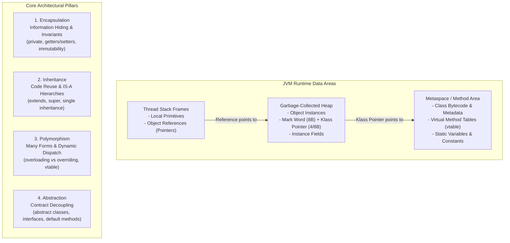
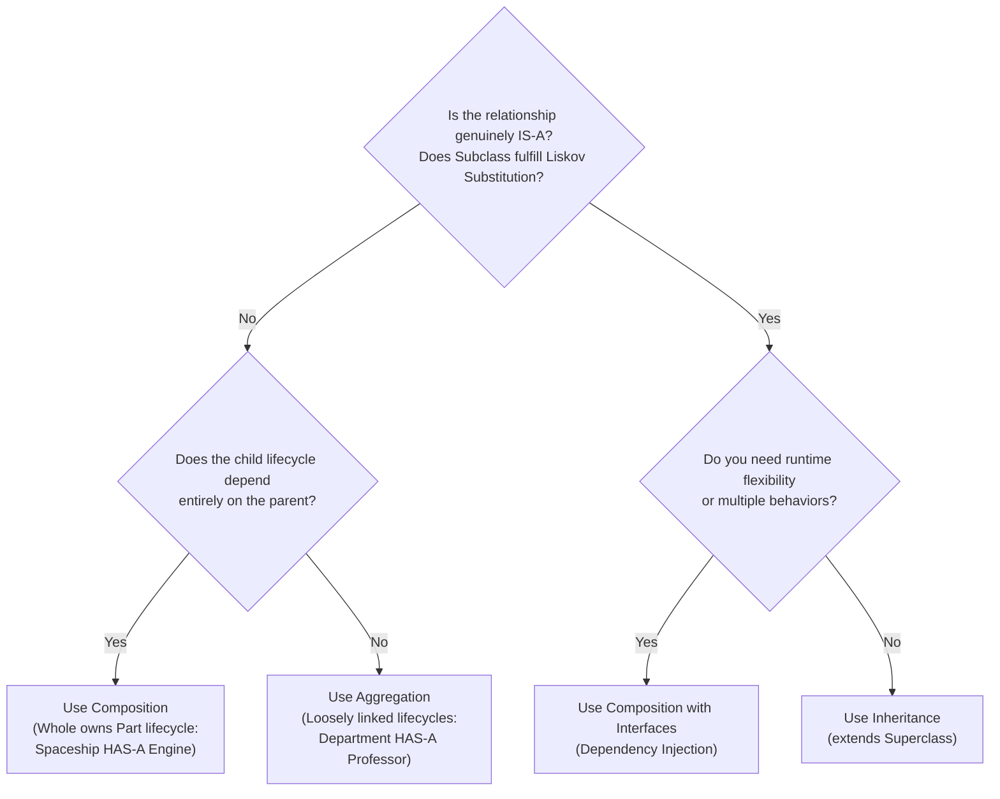

# Java Object-Oriented Programming (OOP) — The Complete Master Compendium

> **Author:** Engineer - Java Development Laboratory  
> **Target Runtime:** Java 8 through Java 21+ (LTS)  
> **Scope:** Complete OOP Pillars, JVM Memory Internals, Bytecode Dispatch, Senior Architectural Patterns, 38 Practical Code Implementations, Pitfalls & Comprehensive Interview Guide

---

## 🏛️ Executive Architectural Overview

Object-Oriented Programming (OOP) is an engineering paradigm that models software systems as networks of collaborating objects — self-contained computational entities encapsulating **state** (fields) and **behavior** (methods). 

In Java, OOP is not merely a syntactic style; it is deeply baked into the Java Virtual Machine (JVM) architecture, including:
1. **Memory Separation**: Metaspace (class metadata, method tables, static fields), the Heap (dynamic object instances), and the Stack (thread frames, local primitives, reference variables).
2. **Dynamic Dispatch Engine**: Method invocation opcodes (`invokevirtual`, `invokeinterface`, `invokespecial`, `invokestatic`, `invokedynamic`) resolved through Virtual Method Tables (`vtable`) and Interface Tables (`itable`).
3. **Strict Memory & Type Safety**: Guaranteed pass-by-value evaluation, type boundaries, access modifier enforcement, and garbage-collected lifecycles.



---

## 📑 Master Table of Contents

- **[Module 01: Foundations of Object-Oriented Programming](#module-01-foundations-of-object-oriented-programming)** — *Procedural vs OOP, Classes, Heap/Stack Memory Models, Object Headers, Reference Aliasing, and Pass-by-Value*
- **[Module 02: Constructors & Object Lifecycle Mechanics](#module-02-constructors-object-lifecycle-mechanics)** — *Default vs Parameterized Constructors, Overloading, this() Chaining, Shallow vs Deep Copy, Initialization Order, and Inheritance*
- **[Module 03: Encapsulation & Access Control Architecture](#module-03-encapsulation-access-control-architecture)** — *Information Hiding, 4 Access Modifiers, Cross-Package Boundaries, Getters/Setters, and Immutable Class Design*
- **[Module 04: Inheritance & Polymorphic Class Hierarchies](#module-04-inheritance-polymorphic-class-hierarchies)** — *extends, IS-A Modeling, Single Inheritance, super Keyword, Method Overriding, Object Root Class, and Diamond Problem Avoidance*
- **[Module 05: Polymorphism & Method Dispatch Mastery](#module-05-polymorphism-method-dispatch-mastery)** — *Static Overloading vs Dynamic Overriding, 4-Tier Compiler Resolution, vtable/itable Dispatch, Covariant Returns, and Pattern Matching*
- **[Module 06: Abstraction, Interfaces & Modern Contract Design](#module-06-abstraction-interfaces-modern-contract-design)** — *Abstract Classes vs Interfaces, Java 8/9 Default/Static/Private Methods, Conflict Resolution, and Functional Interfaces*
- **[Module 07: The static and final Modifiers](#module-07-the-static-and-final-modifiers)** — *Class-Level State, Metaspace Allocation, Static Blocks, Method Hiding vs Overriding, Constants, and Immutable References*
- **[Module 08: java.lang.Object Class Essentials & Contracts](#module-08-java-lang-object-class-essentials-contracts)** — *toString(), equals() 5 Axioms, hashCode() Distribution, Hash Collisions in HashMap, and Cloneable vs Copy Constructors*
- **[Module 09: Object Relationships: Composition, Aggregation & Association](#module-09-object-relationships-composition-aggregation-association)** — *HAS-A vs IS-A, Loose vs Strong Lifecycle Ownership, and The 'Favor Composition Over Inheritance' Principle*
- **[Module 10: Nested, Inner, Local & Anonymous Classes](#module-10-nested-inner-local-anonymous-classes)** — *Static Nested, Member Inner with Outer.this, Local Classes, Effectively Final Variable Capture, and Anonymous Classes vs Lambdas*
- **[Module 11: Enums: Type-Safe Enumerated Class Types](#module-11-enums-type-safe-enumerated-class-types)** — *Implicit java.lang.Enum Inheritance, Constant-Specific Class Bodies, Interfaces, Switch Expressions, and EnumSet/EnumMap*
- **[Module 12: Master Cross-Cutting Synthesis & Comparative Decision Matrices](#module-12-master-cross-cutting-synthesis--comparative-decision-matrices)** — *Access Matrices, Static vs Instance, Composition vs Inheritance, Nested Types, Overload vs Override*

---


## Module 01: Foundations of Object-Oriented Programming

> **Core Focus:** Procedural vs OOP, Classes, Heap/Stack Memory Models, Object Headers, Reference Aliasing, and Pass-by-Value

---

### 1.0 Architectural Mental Model & Concept Introduction

**Object-Oriented Programming (OOP)** is a programming paradigm that organizes software around **objects** — bundles of **data** (fields/state) and **behavior** (methods) — instead of organizing it around functions acting on separate, often global, data.

```java
class BankAccount {
    private String name;
    private double balance;

    BankAccount(String name, double balance) {
        this.name = name;
        this.balance = balance;
    }

    void deposit(double amount) {
        balance += amount;
        System.out.println(name + "'s new balance: " + balance);
    }
}
```

---

---

### 1.1 Why OOP Exists

Before OOP became dominant, most software was written **procedurally**: a list of functions operating on shared, often global, data. This worked for small programs but became hard to manage as systems grew, because:

- Data and the functions that used it were **disconnected** — a change in one place could silently break another.
- There was no natural way to model real-world entities such as a `Car`, `BankAccount`, or `Employee` as a single unit.
- Code reuse often meant **copy-pasting** rather than extending existing code.

OOP addresses these problems by:

- Binding data and behavior together into **objects**.
- Giving objects relationships such as **inheritance** and **composition**.
- Allowing software to model entities and hierarchies the way we naturally think about them.

Java is a **mostly pure** object-oriented language — almost everything lives inside a class. The **eight primitive types** are the notable exception to "everything is an object."

---

---

### 1.2 Procedural vs Object-Oriented Thinking

| Aspect | Procedural Programming | Object-Oriented Programming |
|--------|------------------------|------------------------------|
| Primary unit | Function / procedure | Object (class instance) |
| Data handling | Data and functions are separate | Data and functions are bundled together |
| Focus | "What steps need to happen?" | "What entities exist, and how do they behave?" |
| Reusability | Through function calls | Through inheritance, composition, interfaces |
| Data security | Data is often global/exposed | Data can be hidden via encapsulation |
| Example language | C | Java, C++, Python (multi-paradigm) |

#### 1.2.1 The same problem, two paradigms

**Procedural style** — data and logic are separate:

```java
// Data
String name = "Aashish";
double balance = 5000.0;

// Function operating on external data
static void deposit(double currentBalance, double amount) {
    System.out.println("New balance: " + (currentBalance + amount));
}
```

**Object-oriented style** — data and logic are bundled together:

```java
class BankAccount {
    private String name;
    private double balance;

    BankAccount(String name, double balance) {
        this.name = name;
        this.balance = balance;
    }

    void deposit(double amount) {
        balance += amount;
        System.out.println(name + "'s new balance: " + balance);
    }
}
```

The OOP version is **self-contained**: code outside `BankAccount` cannot directly modify the `private` `balance` field.

---

---

### 1.3 The Four Pillars of OOP

| Pillar | One-line definition | Java mechanism |
|--------|----------------------|-----------------|
| **Encapsulation** | Hiding internal state and requiring interaction through well-defined methods | `private` fields + public getters/setters |
| **Inheritance** | Acquiring properties and behavior from another class | `extends` keyword |
| **Polymorphism** | One interface, many forms — the same method call behaves differently depending on the object | Method overloading (compile-time) & overriding (runtime) |
| **Abstraction** | Exposing only essential details while hiding implementation complexity | `abstract` classes and interfaces |

#### 1.3.1 Memory aid: E-I-P-A

Think of a car:

- **E — Encapsulation:** The dashboard hides the complex wiring and internal state.
- **I — Inheritance:** A sports car **is a** car.
- **P — Polymorphism:** The same action (pressing the pedal) behaves differently depending on the object (a bicycle vs a car).
- **A — Abstraction:** You press the accelerator without needing to know how the engine internally works.

`E-I-P-A` → Encapsulation, Inheritance, Polymorphism, Abstraction.

#### 1.3.2 A quick taste of each pillar in code

```java
// Encapsulation
class Account {
    private double balance;                 // hidden state
    public double getBalance() { return balance; }   // controlled access
}

// Inheritance
class Vehicle { void move() { System.out.println("moving"); } }
class Car extends Vehicle { }               // Car IS-A Vehicle

// Polymorphism (overriding — runtime)
class Shape { double area() { return 0; } }
class Circle extends Shape {
    double radius;
    @Override double area() { return Math.PI * radius * radius; }
}

// Polymorphism (overloading — compile-time)
class Calculator {
    int add(int a, int b) { return a + b; }
    double add(double a, double b) { return a + b; }
}

// Abstraction
interface Payable { void pay(double amount); }   // essential detail only: "you can pay"
```

Each pillar is covered in its own dedicated depth elsewhere; this file focuses on the **foundational** concepts — classes, objects, memory, and `this` — that the other three pillars are built on top of.

---

---

### 1.4 Classes and Objects

#### 1.4.1 Class — a blueprint

A **class** is a blueprint or template. It defines:

- What **fields/state** its objects will have.
- What **methods/behavior** its objects will have.

A class itself is a **type definition** — it does not hold separate instance data for each object.

```java
class Student {
    // Fields (instance variables)
    String name;
    int rollNumber;
    double cgpa;

    // Method (behavior)
    void displayInfo() {
        System.out.println(name + " (" + rollNumber + ") — CGPA: " + cgpa);
    }
}
```

#### 1.4.2 Object — a concrete instance

An **object** is a concrete instance of a class, typically created with the `new` keyword.

```java
public class Main {
    public static void main(String[] args) {
        Student s1 = new Student();
        s1.name = "Aashish";
        s1.rollNumber = 101;
        s1.cgpa = 8.76;

        Student s2 = new Student();
        s2.name = "Dipesh";
        s2.rollNumber = 102;
        s2.cgpa = 8.40;

        s1.displayInfo();   // Aashish (101) — CGPA: 8.76
        s2.displayInfo();   // Dipesh (102) — CGPA: 8.40
    }
}
```

**Key idea:** `s1` and `s2` are two **independent** objects of the same class. They share the same blueprint but hold different data.

```text
Student class
    │
    ├── s1 → name: Aashish, rollNumber: 101, cgpa: 8.76
    │
    └── s2 → name: Dipesh, rollNumber: 102, cgpa: 8.40
```

#### 1.4.3 A class can exist without any objects

Defining a class only creates a type/blueprint — it does not require an instance.

```java
class Student {
    String name;
}
// No Student object exists yet.

Student s1 = new Student();   // now one exists
```

Utility classes containing only `static` members (like `Math`) are often **never instantiated** at all.

---

---

### 1.5 Memory Model: Stack vs Heap

A simplified mental model:

- A **reference variable** (`s1`, `s2`) lives on the **stack** when it is a local variable.
- The **object** and its instance fields are stored on the **heap**.
- The reference variable holds a **reference** to the object, not the object itself.

```text
Stack                 Heap
┌────────┐            ┌─────────────────────┐
│  s1  ──┼───────────▶│ name: "Aashish"     │
└────────┘            │ rollNumber: 101     │
                       │ cgpa: 8.76          │
                       └─────────────────────┘
```

> This is a simplified conceptual model — actual JVM memory behavior (escape analysis, generational GC, etc.) is more nuanced, but this model is enough for everyday reasoning.

#### 1.5.1 Object references — aliasing

```java
Student s3 = s1;
```

No new `Student` object is created. Both `s1` and `s3` refer to the **same** object.

```text
Stack                 Heap
┌────────┐            ┌─────────────────────┐
│  s1  ──┼────────┐    │ Student object      │
└────────┘        ├───▶│ name: "Aashish"     │
┌────────┐        │    │ rollNumber: 101     │
│  s3  ──┼────────┘    │ cgpa: 8.76          │
└────────┘            └─────────────────────┘
```

Therefore:

```java
s3.name = "Rahul";
System.out.println(s1.name);   // "Rahul" — visible through s1 too, same underlying object
```

#### 1.5.2 Where reference variables live

| Reference variable is a... | Stored in |
|------------------------------|-----------|
| Local variable in a method | Stack |
| Instance field of another object | Heap (as part of that object) |
| Static field | Method area / heap (implementation detail, conceptually "class-level") |

---

---

### 1.6 Fields, Methods and Local Variables

#### 1.6.1 Fields (instance / member variables)

Fields represent an object's **state**.

```java
class Student {
    String name;       // state
    int rollNumber;    // state
    double cgpa;       // state
}
```

#### 1.6.2 Methods

Methods represent an object's **behavior** and typically operate on its fields.

```java
void displayInfo() {
    System.out.println(name + " (" + rollNumber + ")");
}
```

#### 1.6.3 Local variables

Local variables exist inside methods, constructors, or blocks, and are separate from instance fields.

```java
void calculate() {
    int result = 10 + 20;   // local variable — exists only within this method's scope
}
```

#### 1.6.4 Instance variable vs local variable

| Feature | Instance Variable | Local Variable |
|---------|--------------------|-----------------|
| Declared | Inside class, outside methods | Inside method/constructor/block |
| Belongs to | Object instance | Method/block execution |
| Default value | Yes (`0`, `null`, `false`, ...) | No |
| Must initialize before use? | No | Yes |
| Lifetime | Generally tied to object lifetime | Until scope/block exits |

```java
class Student {
    // Instance variable — gets a default value automatically
    String name;

    void display() {
        // Local variable — must be initialized before use
        int age = 20;
        System.out.println(name);   // fine, defaults to null if never set
        System.out.println(age);
    }
}
```

---

---

### 1.7 The `this` Keyword

`this` is a reference to the **current object instance**.

#### 1.7.1 The problem `this` solves: name shadowing

When a constructor (or method) parameter has the **same name** as an instance field, the parameter **shadows** the field within that scope.

```java
class Student {
    String name;
    int rollNumber;

    Student(String name, int rollNumber) {
        this.name = name;              // this.name = instance field
        this.rollNumber = rollNumber;  // name/rollNumber (right side) = parameters
    }
}
```

Without `this`:

```java
Student(String name, int rollNumber) {
    name = name;             // both sides refer to the PARAMETER
    // the instance field never gets set — stays at its default (null)
}
```

#### 1.7.2 Other uses of `this`

```java
// 1. Refer to the current object's field
this.name = name;

// 2. Invoke another constructor of the same class ("constructor chaining")
class Student {
    String name;
    int rollNumber;

    Student() {
        this("Unknown", 0);          // calls the constructor below
    }

    Student(String name, int rollNumber) {
        this.name = name;
        this.rollNumber = rollNumber;
    }
}

// 3. Pass the current object as an argument
someMethod(this);

// 4. Return the current object (method chaining / builder pattern)
class Builder {
    Builder setName(String name) {
        this.name = name;
        return this;
    }
}
```

`this(...)` must be the **first statement** in a constructor, and a constructor cannot call itself directly or indirectly (that would be a compile error: recursive constructor invocation).

---

---

### 1.8 Java Is Pass-by-Value

Java is **strictly pass-by-value** — always. When you pass an object to a method, the **value of the reference** is copied, not the object itself.

```java
class Student { String name; }

static void changeName(Student s) {
    s.name = "Rahul";     // modifies the object THROUGH the copied reference
}

Student student = new Student();
student.name = "Aashish";
changeName(student);
System.out.println(student.name);   // "Rahul" — the object's state changed
```

But **reassigning the parameter** does not change the caller's reference:

```java
static void changeReference(Student s) {
    s = new Student();     // s now points to a brand-new object, locally
    s.name = "Rahul";
}

changeReference(student);
System.out.println(student.name);   // still "Rahul" from before, unaffected by the new object
```

#### 1.8.1 The key idea, visually

```text
Caller
   │
   │ reference value
   ▼
┌──────────────┐
│   Student    │
│ name: Aashish│
└──────────────┘
   ▲
   │
   │ copied reference value
   │
Method
```

**Summary:** Java always uses pass-by-value. For objects, the *value being passed* happens to be a copy of the reference. A method can therefore **mutate** the object's state through that copied reference, but it can never make the **caller's** variable point to a different object just by reassigning its own local parameter.

This is the same rule that governs arrays (see the arrays notes): the method can modify elements but cannot make the caller's array variable point elsewhere.

---

---

### 1.9 Static vs Instance Members

#### 1.9.1 Why an instance method needs an object

Instance methods operate on instance state (`this.name`, `this.age`), and that state belongs to a specific object. So calling one requires an object to operate on:

```java
Student s = new Student();
s.displayInfo();          // needs a specific Student's data
```

#### 1.9.2 Why a static method does not

A `static` method belongs to the **class**, not to any particular object, so it can be called without creating an instance:

```java
Math.sqrt(9);              // no Math object was created
```

```text
Instance method                 Static method
      │                              │
      ▼                              ▼
Object required                Class-level
      │                              │
      ▼                              ▼
Instance state available       No particular object required
```

#### 1.9.3 Quick comparison

| | Instance member | Static member |
|---|------------------|----------------|
| Belongs to | Each object | The class itself |
| Access | `object.member` | `ClassName.member` (or `object.member`, discouraged) |
| Can use `this`? | Yes | No |
| Memory | One copy per object | One copy shared across all objects |
| Typical use | An entity's own state/behavior | Utility logic, shared counters, constants |

```java
class Counter {
    static int totalObjects = 0;   // shared across ALL Counter objects
    int id;                        // unique per object

    Counter() {
        totalObjects++;
        id = totalObjects;
    }
}

Counter c1 = new Counter();
Counter c2 = new Counter();
System.out.println(Counter.totalObjects);   // 2
System.out.println(c1.id + " " + c2.id);    // 1 2
```

---

---

### 1.10 Primitives and Wrapper Classes

Java is called a **mostly pure** object-oriented language because almost everything is modeled as classes and objects — you cannot declare a regular method or variable directly outside a class. The main exception is the **eight primitive types**, which are **not** objects:

```text
byte  short  int  long  float  double  char  boolean
```

Java provides a **wrapper class** for each primitive, for situations where an object is required (collections, generics, nullability):

| Primitive | Wrapper |
|-----------|---------|
| `byte`    | `Byte` |
| `short`   | `Short` |
| `int`     | `Integer` |
| `long`    | `Long` |
| `float`   | `Float` |
| `double`  | `Double` |
| `char`    | `Character` |
| `boolean` | `Boolean` |

```java
int primitive = 5;
Integer wrapped = 5;          // autoboxing
int back = wrapped;           // auto-unboxing

List<Integer> nums = new ArrayList<>();   // generics require an object type, not "int"
nums.add(10);                             // autoboxed to Integer
```

---

---


### 1.S Modern Domain Architecture Spotlight: Foundations of OOP
*(Replacing legacy shape/counter examples with production systems)*

* **LedgerAccount (Domain: Fintech / Core Banking)**
  * **Description:** A core accounting ledger entry modeling financial double-entry bookkeeping.
  * **Key State & Behavior:** `accountId`, `currency`, `clearedBalance`, `pendingHolds`, `postTransaction(DebitCreditEntry entry)`.
  * **Why it fits:** Procedural code allows external functions to casually mutate balances, leading to audit failures. OOP encapsulates the balance so it can only be modified through validated balanced ledger entries.

* **OrbitalState (Domain: Aerospace Telemetry)**
  * **Description:** A physics state vector tracking spacecraft coordinates in low Earth orbit.
  * **Key State & Behavior:** `epochTimestamp`, `positionVectorX_Y_Z`, `velocityVectorX_Y_Z`, `propagate(double deltaSeconds)`.
  * **Why it fits:** Represents a complex real-world entity bundle. Creating new objects per telemetry ping demonstrates heap allocation, while passing state vectors into orbital propagator routines illustrates Java's strict pass-by-value reference semantics.


---


### 1.L Hands-On Code Labs & Implementation Walkthrough
*(Complete, runnable, production-grade source implementations from the repository)*


#### Lab 1.L.1: Memory Footprint: Stack, Heap, Metaspace & Reference Aliasing
* **Source File:** [`week_2/oops/c01_foundations_of_oops/codes/MemoryRequirement.java`](file:////Users/aashishkumarray/Desktop/engineer-java development/week_2/oops/c01_foundations_of_oops/codes/MemoryRequirement.java)
* **Architectural Purpose:** Demonstrates the JVM memory layout during object creation. While class metadata is housed in Metaspace/Method Area, object instances reside in the Heap. References on the Stack point to Heap instances. An empty object occupies 8-16 bytes (Mark Word + Klass pointer + padding). Shows reference assignment `acc2 = acc` where no new Heap object is allocated.

```java
package week_2.oops.c01_foundations_of_oops.codes;

/**
 * @author Aashish Kumar Ray
 * MemoryRequirement 
 * When a class is created, it doesn't take any memory on itself 
 * & it stays in "Method Area or Metaspace" in java holding the varaibles, methods & all
 * Whereas in Object case :
 * The variable used to create the object is stored in stack keeping the reference of object
 * which is stored in heap memory 
 * Empty Object takes around 8-16 bytes
 */
public class MemoryRequirement {
    public static void main(String[] args) {
        BankAccount acc = new BankAccount(10000.0, "Mr. Ray");
        // acc2 doesn't created any extra object in the heap memory
        // But the varaible acc2 gets stored in stack space
        // referencing to the object of acc
        BankAccount acc2 = acc;
        System.out.println(acc);
        System.out.println(acc2);
        BankAccount a = new BankAccount();
    }
}
```

**Expected Console Execution Output:**
```text
BankAccount@6acbcfc0
BankAccount@6acbcfc0
```


#### Lab 1.L.2: Blueprint vs. Heap Instance & Basic Encapsulation
* **Source File:** [`week_2/oops/c01_foundations_of_oops/codes/ObjectAndClasses.java`](file:////Users/aashishkumarray/Desktop/engineer-java development/week_2/oops/c01_foundations_of_oops/codes/ObjectAndClasses.java)
* **Architectural Purpose:** Models a banking entity where `BankAccount` acts as a template and `rayAccount` represents an active heap instance. Implements encapsulation with private `balance` and `name` attributes, accessible only via public getters and setters.

```java
package week_2.oops.c01_foundations_of_oops.codes;

/**
 * @author Aashish Kumar Ray
 * ObjectAndClasses
 * In Simple Terms : 
 * Class : A class is a blueprint of a real-world entity
 * Object : An object can be defined in many ways like :
 * 1. It's an instance of a class 
 * 2. It's a immediate result of a class & so on... 
 * 
 * NOTE : A class can exist without an object
 * but an object can't existed without a class
 */
public class ObjectAndClasses {
    /**
     * @param args
     * Here, BankAccount is a class 
     * & rayAccount is an instance(object) of the BankAccount
     */
    public static void main(String[] args) {
        BankAccount rayAccount = new BankAccount();
        rayAccount.setName("Aashish Kumar Ray");
        rayAccount.setBalance(2000.0);
        System.out.println(rayAccount.toString());
    }
}


/**
 * BankAccount
 * Class is a blueprint for an object :
 * for example, in real-world, A bank is there which provides
 * the facility to open a BankAccount to an individual.
 * A BankAccount becomes as a blueprint to create an account for everyone
 * when an account is created from that, it's called an instance(object )
 * of that bank account which means a real world entity is being used.
 */
class BankAccount{
    private double balance = 0; //By Default when bank account is opened, it's balance is 0
    private String name;
    public BankAccount(){}
    public BankAccount(double balance, String name){
        this.balance = balance;
        this.name = name;
    }
    /**
     * Since the balance & name are private varaibles in a class, 
     * It can't be directly accessed or modified by the external classes or packages
     * so, In order to modify it, setter methods are generally used in java 
     * which is also called as (Setters)
     */
    public void setBalance(double balance){
        this.balance = balance;
    }
    public void setName(String name){
        this.name = name;
    }
    /**
     * Since the balance & name are private varaibles in a class, 
     * It can't be directly accessed or modified by the external classes or packages
     * so, In order to access it, getter methods are generally used in java 
     * which is also called as (Getters)
     */
    public double getBalance(){
        return this.balance;
    }

    public String getName(){
        return this.name;
    }

    @Override 
    public String toString(){
        return this.name + ", " + this.balance;
    }

}
```

**Expected Console Execution Output:**
```text
Aashish Kumar Ray, 2000.0
```


#### Lab 1.L.3: Anatomy of a Class: Fields, Constructors, and Methods
* **Source File:** [`week_2/oops/c01_foundations_of_oops/codes/StructureOfClass.java`](file:////Users/aashishkumarray/Desktop/engineer-java development/week_2/oops/c01_foundations_of_oops/codes/StructureOfClass.java)
* **Architectural Purpose:** Walks through the structure of a Java class: instance variables (fields), constructor parameter binding, and instance methods. Demonstrates direct mutation of package-private field `student.name`.

```java
package week_2.oops.c01_foundations_of_oops.codes;

public class StructureOfClass {
    public static void main(String[] args) {
        Student student = new Student(1, "Anivya", 9.16);
        student.name = "Anivya Dimtri"; //Can directly be modified since it's not private member of the class Student
        student.studentDetails();
    }
}

class Student{
    /**
     *These are the field or member variable of a class
     *It has the access all over the class (depends upon the access modifiers)
     *Life span depends upon the life of the object associated with it
     */
    int rollNo;
    String name;
    double cgpa;

    /**
     * @param rollNo
     * @param name
     * @param cgpa
     * This is called a constructor
     */
    public Student(int rollNo, String name, double cgpa){
        this.rollNo = rollNo;
        this.name = name;
        this.cgpa = cgpa;
    }

    /**
     * This is called the method of a class
     */
    public void studentDetails(){
        //This is a method variable & can only be accessed inside the method
        String info = "Students infom : ";
        System.out.print(info);
        System.out.println(this.name + ", " + this.rollNo + ", " + this.cgpa);
    }

}
```

**Expected Console Execution Output:**
```text
Roll No: 1, Name: Anivya Dimtri, CGPA: 9.16
```


---

### 1.11 Common Pitfalls

| # | Pitfall | Fix |
|---|---------|-----|
| 1 | Forgetting `this` when a parameter shadows a field | Always use `this.field = field` in constructors/setters when names match |
| 2 | Assuming `s2 = s1` creates a copy of the object | It only copies the **reference** — both point to the same object |
| 3 | Expecting a method to change the caller's reference by reassigning the parameter | Only element/field mutation through the reference is visible to the caller |
| 4 | Treating primitives as objects (`5.equals(5)`) | Only wrapper types have methods; primitives don't |
| 5 | Thinking Java has pass-by-reference | It is always pass-by-value; for objects, the value happens to be a reference |
| 6 | Calling an instance method without an object (conceptually) | Instance methods always need `this`/an object; only `static` methods don't |
| 7 | Confusing a class with an object | A class is a blueprint; an object is a runtime instance created via `new` |
| 8 | Forgetting fields get default values, but local variables don't | Uninitialized local variables cause a compile error if used |
| 9 | Calling `this(...)` after other statements in a constructor | `this(...)` must be the **first** statement |
| 10 | Making everything `public` (skipping encapsulation) | Keep fields `private`, expose behavior through methods |

---

---

### 1.12 Interview Questions

**Q1. What is the difference between a class and an object?**
A class is a logical blueprint/template that defines fields and methods. An object is a runtime instance of a class, created using `new`, that contains actual values for those fields. You can create many objects from a single class:

```java
Student s1 = new Student();
Student s2 = new Student();
Student s3 = new Student();
```

All three are independent instances of the `Student` class.

---

**Q2. Why is Java called a mostly "pure" object-oriented language, and what's the exception?**
Almost everything in Java is modeled using classes and objects; you cannot declare a regular method or variable outside a class. The exception is the eight primitive types (`byte`, `short`, `int`, `long`, `float`, `double`, `char`, `boolean`), which are not objects. Wrapper classes (`Integer`, `Double`, ...) exist for when an object form is needed.

---

**Q3. What are the four pillars of OOP?**
**Encapsulation** (hiding internal state behind controlled methods), **Inheritance** (acquiring properties/behavior from another class), **Polymorphism** (one interface, multiple behaviors), and **Abstraction** (exposing essential details, hiding implementation complexity). Mnemonic: E-I-P-A.

---

**Q4. What is the difference between procedural programming and OOP?**
Procedural programming structures a program as a sequence of functions operating on (often separate/global) data. OOP bundles data and the functions that operate on it into objects. OOP generally improves modularity, reusability, maintainability, data encapsulation, and domain modeling.

---

**Q5. Where are objects stored in memory — stack or heap?**
The object itself is stored on the **heap**. A reference variable pointing to it is stored on the **stack** if it's a local variable, or as part of another object on the heap if it's an instance field. (This is a simplified conceptual model; actual JVM memory management is more nuanced.)

---

**Q6. What happens when you assign one object reference to another?**
No new object is created — the second variable simply refers to the **same** underlying object as the first.

```java
Student s2 = s1;
s2.name = "Rahul";
System.out.println(s1.name);   // "Rahul" — same object
```

---

**Q7. What is the `this` keyword, and why is it needed?**
`this` is a reference to the current object instance. Its most common use is resolving ambiguity between an instance field and a parameter with the same name (`this.name = name;`). Other uses: `this(...)` for constructor chaining, passing `this` as an argument, and `return this;` for method chaining.

---

**Q8. Can a class exist without any objects being created from it?**
Yes. Defining a class creates a type/blueprint; it doesn't require an instance. Utility classes with only `static` members are often never instantiated at all.

---

**Q9. What is the difference between an instance variable and a local variable?**
An instance variable is declared inside a class (outside any method), belongs to the object, gets a default value automatically, and generally lives as long as the object does. A local variable is declared inside a method/constructor/block, belongs to that execution, has no default value (must be initialized before use), and exists only until its scope ends.

---

**Q10. Why can't Java have instance methods without an object, but can have static methods?**
Instance methods operate on instance state (`this.field`), which belongs to a specific object — so they need an object to run against. A `static` method belongs to the class itself, not to any particular object, so it can be invoked without creating an instance (e.g., `Math.sqrt(9)`).

---

**Q11. What is meant by "objects model real-world entities"?**
OOP encourages software models to represent domain concepts directly — a `Student` class with `name`, `rollNumber`, `cgpa` fields and a `displayInfo()` method represents an actual student from the problem domain, which makes the code structure easier to relate to the real world.

---

**Q12. Is Java pass-by-value or pass-by-reference?**
Java is strictly **pass-by-value**. When passing an object, the *value of the reference* is copied. This lets a method mutate the object's state through that copied reference, but reassigning the parameter inside the method never changes what the caller's own variable points to.

---

---

### 1.13 Interview-Style Output Questions

Try to predict each output before reading the answer.

**Q1**
```java
class Student { String name; }

Student s1 = new Student();
s1.name = "Aashish";
Student s2 = s1;
s2.name = "Rahul";
System.out.println(s1.name);
```
**Answer:** `Rahul`. `s2 = s1` copies the reference, not the object; both point to the same `Student`.

---

**Q2**
```java
class Student {
    String name;
    Student(String name) {
        name = name;      // no "this"
    }
}

Student s = new Student("Aashish");
System.out.println(s.name);
```
**Answer:** `null`. Both sides of `name = name` refer to the parameter; the instance field is never assigned and keeps its default value.

---

**Q3**
```java
static void changeReference(Student s) {
    s = new Student();
    s.name = "New";
}

Student student = new Student();
student.name = "Original";
changeReference(student);
System.out.println(student.name);
```
**Answer:** `Original`. Reassigning the parameter `s` inside the method has no effect on the caller's `student` variable.

---

**Q4**
```java
static void changeField(Student s) {
    s.name = "Changed";
}

Student student = new Student();
student.name = "Original";
changeField(student);
System.out.println(student.name);
```
**Answer:** `Changed`. This time the method mutates the object **through** the copied reference, which is visible to the caller.

---

**Q5**
```java
class Counter {
    static int count = 0;
    Counter() { count++; }
}

new Counter();
new Counter();
new Counter();
System.out.println(Counter.count);
```
**Answer:** `3`. `static` fields are shared across all instances, not reset per object.

---

**Q6**
```java
class Box {
    int value;
    Box(int value) {
        this.value = value;
    }
    Box() {
        this(10);
    }
}

Box b = new Box();
System.out.println(b.value);
```
**Answer:** `10`. The no-arg constructor delegates to the parameterized one via `this(10)`.

---

**Q7**
```java
class Student { int rollNumber; }

Student s = new Student();
System.out.println(s.rollNumber);
```
**Answer:** `0`. Instance fields get default values automatically (unlike local variables).

---

---

### 1.14 Quick Cheat Sheet

```text
OOP            Organizes code around objects that bundle STATE + BEHAVIOR
FOUR PILLARS   Encapsulation - Inheritance - Polymorphism - Abstraction   (E-I-P-A)

CLASS          Blueprint / template — defines fields + methods, holds no per-object data itself
OBJECT         new ClassName(...)  — a runtime instance with its own copy of instance fields

FIELD          Instance variable — object's state, gets a default value automatically
METHOD         Object's behavior, usually operates on its own fields
LOCAL VAR      Inside a method/block; no default value, must be initialized before use

MEMORY         Object            -> heap
               Local reference   -> stack
               s2 = s1           -> copies the REFERENCE only (aliasing), not the object

this           Reference to the current object
               this.field = param;    resolve name shadowing
               this(args);            constructor chaining (must be first statement)
               someMethod(this);      pass current object
               return this;           method chaining / builder pattern

STATIC         Belongs to the CLASS — one copy shared by all objects, no "this", callable without an instance
INSTANCE       Belongs to each OBJECT — needs "this"/an object to operate on

PASS-BY-VALUE  Java always copies the value being passed.
               For objects: the copied value is a REFERENCE.
               -> method CAN mutate the object's state through it
               -> method CANNOT redirect the caller's variable to a new object

PRIMITIVES     byte short int long float double char boolean  — NOT objects
WRAPPERS       Byte Short Integer Long Float Double Character Boolean — object form via autoboxing
```

**Remember:**

1. A class is a blueprint; an object is an instance — many objects can share one class.
2. Assigning one reference to another (`s2 = s1`) aliases the same object; it never copies it.
3. `this` exists mainly to resolve field/parameter name collisions, plus constructor/method chaining.
4. Java is always pass-by-value — for objects, the value passed is a copy of the reference.
5. Instance members need an object (`this`); static members belong to the class and don't.
6. Primitives are the one exception to "everything is an object" in Java; wrapper classes bridge the gap.

---


## Module 02: Constructors & Object Lifecycle Mechanics

> **Core Focus:** Default vs Parameterized Constructors, Overloading, this() Chaining, Shallow vs Deep Copy, Initialization Order, and Inheritance

---

### 2.0 Architectural Mental Model & Concept Introduction

A **constructor** is a special block of code, tied to a class, that runs when an object is created with `new`. Its job is to put the new object into a valid initial **state**.

```java
class Student {
    String name;
    int rollNumber;

    Student(String name, int rollNumber) {   // constructor
        this.name = name;
        this.rollNumber = rollNumber;
    }
}

Student s = new Student("Aashish", 101);     // constructor runs here
```

---

---

### 2.1 What Makes a Constructor a Constructor

A constructor is **not** a regular method:

| Feature | Constructor | Method |
|---------|-------------|--------|
| Name | Must be **exactly the class name** | Any valid identifier |
| Return type | **None at all** — not even `void` | Required (`void` if nothing is returned) |
| Called | Implicitly, via `new ClassName(...)` | Explicitly, via `object.method(...)` |
| Purpose | Initialize a new object's state | Perform behavior/logic on an existing object |
| Inherited? | **No** — a subclass does not inherit its parent's constructors | Yes (unless `private`/`static`) |
| Can be `abstract`, `final`, `static`, `synchronized`? | No | Yes (with restrictions) |
| Overloading | Supported | Supported |

```java
class Student {
    String name;

    Student(String name) {         // constructor: name matches class name, no return type
        this.name = name;
    }

    void Student(String name) {    // NOT a constructor — this is a regular method
        this.name = name;          // (has a return type "void", even though the name matches)
    }
}
```

Every constructor implicitly returns the newly created object once it finishes — that's handled by `new`, not by a `return` statement inside the constructor body. A bare `return;` (no value) is legal inside a constructor to exit early, but `return someValue;` is a compile error.

---

---

### 2.2 Default Constructor vs Parameterized Constructor

#### 2.2.1 The compiler-supplied default constructor

If a class declares **no constructors at all**, the compiler automatically inserts a **default constructor**: a public, no-argument constructor with an empty body (it only implicitly calls `super()`).

```java
class Student {
    String name;
    int rollNumber;
    // no constructor written
}

Student s = new Student();     // compiler-provided default constructor runs
System.out.println(s.name);        // null
System.out.println(s.rollNumber);  // 0
```

This is equivalent to the compiler generating:

```java
class Student {
    String name;
    int rollNumber;

    Student() {          // compiler-generated
        super();          // implicit call to Object's constructor
    }
}
```

#### 2.2.2 The moment you write ANY constructor, the default disappears

As soon as you define **any** constructor yourself, the compiler **stops** providing the no-arg default. If you still want a no-arg constructor, you must write it explicitly.

```java
class Student {
    String name;

    Student(String name) {          // you wrote a constructor
        this.name = name;
    }
}

Student s = new Student();          // COMPILE ERROR: no matching constructor Student()
```

Fix:

```java
class Student {
    String name;

    Student() { }                       // now written explicitly

    Student(String name) {
        this.name = name;
    }
}
```

#### 2.2.3 Parameterized constructor

A **parameterized constructor** accepts arguments and uses them to initialize fields directly, avoiding the need to set fields one by one after creation.

```java
class Student {
    String name;
    int rollNumber;
    double cgpa;

    Student(String name, int rollNumber, double cgpa) {
        this.name = name;
        this.rollNumber = rollNumber;
        this.cgpa = cgpa;
    }
}

Student s1 = new Student("Aashish", 101, 8.76);   // one line, fully initialized
```

Compare with the field-by-field style, which allows an object to sit **partially initialized** in between:

```java
Student s1 = new Student();   // name=null, rollNumber=0, cgpa=0.0  (temporarily invalid state)
s1.name = "Aashish";
s1.rollNumber = 101;
s1.cgpa = 8.76;
```

#### 2.2.4 "Default constructor" vs "no-arg constructor" — a naming nuance

Strictly, **"default constructor"** refers only to the one the **compiler** inserts when you write none. A no-argument constructor that **you** write yourself is technically a **"no-arg constructor"**, not a "default constructor" — though in casual conversation people often use the two terms interchangeably.

```java
class Student {
    Student() { System.out.println("no-arg constructor, written by me"); }
    // This is NOT "the default constructor" in the strict sense, even though it takes no arguments —
    // the moment you write it yourself, it's just an overload you provided.
}
```

---

---

### 2.3 Constructor Overloading

A class can have **multiple constructors**, as long as their **parameter lists differ** (in number, type, or order) — the same rule that governs method overloading.

```java
class Student {
    String name;
    int rollNumber;
    double cgpa;

    Student() {                                   // no-arg
        this("Unknown", 0, 0.0);
    }

    Student(String name) {                        // one arg
        this(name, 0, 0.0);
    }

    Student(String name, int rollNumber) {         // two args
        this(name, rollNumber, 0.0);
    }

    Student(String name, int rollNumber, double cgpa) {  // three args
        this.name = name;
        this.rollNumber = rollNumber;
        this.cgpa = cgpa;
    }
}

Student a = new Student();
Student b = new Student("Aashish");
Student c = new Student("Aashish", 101);
Student d = new Student("Aashish", 101, 8.76);
```

#### 2.3.1 Overload resolution follows the same rules as methods

The compiler picks the **most specific applicable** constructor at compile time, based on the number and types of the arguments.

```java
class Box {
    Box(int x) { System.out.println("int version"); }
    Box(double x) { System.out.println("double version"); }
}

new Box(5);        // "int version"    (exact match)
new Box(5.0);      // "double version" (exact match)
new Box('a');      // "int version"    (char widens to int before double)
```

#### 2.3.2 Ambiguous overloads don't compile

```java
class Box {
    Box(int a, long b) { }
    Box(long a, int b) { }
}

new Box(5, 5);     // COMPILE ERROR: ambiguous — both need one widening conversion (int -> long)
```

#### 2.3.3 Why overload constructors at all

Overloaded constructors give callers **flexible, readable ways** to create an object depending on what information they have available, without forcing every caller to supply every field.

```java
// A caller who doesn't yet know the cgpa can still create a valid, meaningful object:
Student fresher = new Student("Rahul", 205);
```

---

---

### 2.4 Constructor Chaining with `this(...)`

**Constructor chaining** means one constructor calls **another constructor of the same class**, using `this(...)`, so that shared initialization logic lives in **one place**.

```java
class Student {
    String name;
    int rollNumber;
    double cgpa;

    Student() {
        this("Unknown", 0, 0.0);          // delegates to the 3-arg constructor
    }

    Student(String name, int rollNumber) {
        this(name, rollNumber, 0.0);      // delegates to the 3-arg constructor
    }

    Student(String name, int rollNumber, double cgpa) {
        this.name = name;
        this.rollNumber = rollNumber;
        this.cgpa = cgpa;
        System.out.println("Fully initializing: " + name);
    }
}

new Student();                    // prints: Fully initializing: Unknown
new Student("Aashish", 101);       // prints: Fully initializing: Aashish
```

#### 2.4.1 Hard rules for `this(...)`

1. `this(...)` must be the **first statement** in the constructor body.
2. Only **one** `this(...)` call is allowed per constructor.
3. A constructor **cannot** call itself, directly or indirectly (no recursive constructor invocation) — the compiler detects and rejects this.
4. `this(...)` and `super(...)` **cannot both appear** in the same constructor (only one "first statement" slot exists, and both fight for it).

```java
class Student {
    Student() {
        System.out.println("before");
        this("X");                 // COMPILE ERROR: this() must be the first statement
    }
    Student(String name) { }
}
```

```java
class Student {
    Student() { this(); }           // COMPILE ERROR: recursive constructor invocation
}
```

#### 2.4.2 Why chain constructors at all

- Avoids **duplicating** initialization logic across overloads.
- Creates a single "source of truth" constructor that actually sets every field; the others just supply defaults and delegate.
- Makes it easy to add validation once, in the constructor everyone eventually funnels into.

```java
class Student {
    String name;
    int rollNumber;

    Student(String name, int rollNumber) {
        if (rollNumber < 0) {
            throw new IllegalArgumentException("rollNumber cannot be negative");
        }
        this.name = name;
        this.rollNumber = rollNumber;
    }

    Student(String name) {
        this(name, 0);      // validation above runs no matter which constructor is used
    }
}
```

---

---

### 2.5 Copy Constructors

Unlike **C++**, Java has **no built-in copy constructor syntax** — there's no automatic `ClassName(const ClassName&)` generated for you. The **pattern**, however, is easy to write by hand: a constructor that takes **another object of the same class** and copies its fields into the new object.

```java
class Student {
    String name;
    int rollNumber;
    double cgpa;

    Student(String name, int rollNumber, double cgpa) {
        this.name = name;
        this.rollNumber = rollNumber;
        this.cgpa = cgpa;
    }

    // Copy constructor pattern
    Student(Student other) {
        this.name = other.name;
        this.rollNumber = other.rollNumber;
        this.cgpa = other.cgpa;
    }
}

Student original = new Student("Aashish", 101, 8.76);
Student copy = new Student(original);   // a genuinely separate object

copy.name = "Rahul";
System.out.println(original.name);      // "Aashish" — unaffected, unlike s2 = s1 aliasing
```

#### 2.5.1 Copy constructor vs plain reference assignment

```java
Student a = new Student("Aashish", 101, 8.76);

Student aliasOfA = a;                 // NOT a copy — same object, two names
Student realCopy = new Student(a);    // an actual, independent copy
```

#### 2.5.2 Shallow copy vs deep copy

The copy constructor shown above is a **shallow copy**: reference-type fields are copied as **references**, so the new object and the original still point to the **same** nested objects.

```java
class Address {
    String city;
    Address(String city) { this.city = city; }
}

class Student {
    String name;
    Address address;             // reference-type field

    Student(String name, Address address) {
        this.name = name;
        this.address = address;
    }

    Student(Student other) {     // shallow copy constructor
        this.name = other.name;
        this.address = other.address;    // SAME Address object is shared!
    }
}

Student original = new Student("Aashish", new Address("Bengaluru"));
Student copy = new Student(original);

copy.address.city = "Mumbai";
System.out.println(original.address.city);   // "Mumbai" — changed! Same Address object.
```

To make it a **deep copy**, the constructor must also copy the nested object(s):

```java
Student(Student other) {         // deep copy constructor
    this.name = other.name;
    this.address = new Address(other.address.city);   // a NEW Address object
}
```

| | Reference assignment (`b = a`) | Shallow copy constructor | Deep copy constructor |
|---|-------------------------------|---------------------------|-------------------------|
| New object created? | No | Yes | Yes |
| Primitive/`String` fields | Shared (aliased) | Copied independently | Copied independently |
| Reference-type fields | Shared (aliased) | Still **shared** (same nested object) | Copied into new nested objects too |

#### 2.5.3 Alternatives to hand-written copy constructors

- Implementing `Cloneable` and overriding `clone()` — Java's built-in (but famously clunky and error-prone) cloning mechanism.
- A static **factory method**, e.g. `Student.copyOf(original)`, which internally does the same thing as a copy constructor but reads more clearly at the call site.
- Libraries/patterns like builders, or serialization-based deep copies for complex object graphs.

```java
static Student copyOf(Student other) {
    return new Student(other.name, other.rollNumber, other.cgpa);
}
```

---

---

### 2.6 Order of Initialization

When an object is created, Java runs initialization in a strict, well-defined order. Understanding this order explains a lot of "surprising" output in interview questions.

#### 2.6.1 The full order (first time a class is used)

```text
1. Static variables + static initializer blocks   — run ONCE, in the order they appear,
                                                     the FIRST time the class is loaded/used
2. Instance variables + instance initializer blocks — run EVERY time an object is created,
                                                        in the order they appear
3. Constructor body                                — runs LAST, after all the above
```

And when inheritance is involved, the parent class's static/instance/constructor steps happen **before** the child's (see section 7).

#### 2.6.2 Static blocks — run once, at class-loading time

```java
class Config {
    static int version;

    static {
        version = 1;
        System.out.println("Static block: class loaded");
    }
}

new Config();
new Config();
new Config();
// "Static block: class loaded" prints ONLY ONCE, no matter how many objects are created
```

#### 2.6.3 Instance blocks — run every time, before the constructor body

```java
class Student {
    String name;

    { // instance initializer block
        System.out.println("Instance block running");
        name = "Default Name";
    }

    Student() {
        System.out.println("Constructor running");
    }

    Student(String name) {
        System.out.println("Parameterized constructor running");
        this.name = name;
    }
}

new Student();
// Instance block running
// Constructor running

new Student("Aashish");
// Instance block running
// Parameterized constructor running
```

**Key point:** the instance block runs before **every** constructor, regardless of which overload is called — it is effectively copy-pasted to the top of each constructor's body (right after any implicit/explicit `super()` call).

#### 2.6.4 Full demonstration: static → instance → constructor

```java
class Demo {
    static int s;
    int i;

    static {
        s = 10;
        System.out.println("1. Static block");
    }

    {
        i = 20;
        System.out.println("2. Instance block");
    }

    Demo() {
        System.out.println("3. Constructor");
    }
}

public class Main {
    public static void main(String[] args) {
        System.out.println("--- creating first object ---");
        new Demo();
        System.out.println("--- creating second object ---");
        new Demo();
    }
}
```

**Output:**

```text
1. Static block
--- creating first object ---
2. Instance block
3. Constructor
--- creating second object ---
2. Instance block
3. Constructor
```

The static block runs once, the moment the class is first loaded (here, triggered by the first `new Demo()`), while the instance block + constructor pair repeats for every object.

#### 2.6.5 Multiple static/instance blocks run in source order

If a class has more than one static block, or more than one instance block, they execute **top to bottom**, interleaved with field initializers in the order they textually appear.

```java
class Demo {
    static int a = initA();
    static { System.out.println("static block 1"); }
    static int b = initB();
    static { System.out.println("static block 2"); }

    static int initA() { System.out.println("init a"); return 1; }
    static int initB() { System.out.println("init b"); return 2; }
}

new Demo();
// init a
// static block 1
// init b
// static block 2
```

#### 2.6.6 Field initializers vs constructor — which "wins"

A field's inline initializer runs **before** the constructor body, so the constructor can override it.

```java
class Student {
    String name = "Default";      // field initializer

    Student() {
        System.out.println(name); // "Default" — initializer already ran
        name = "Aashish";         // constructor overrides it
    }
}
```

---

---

### 2.7 Constructors and Inheritance (`super`)

#### 2.7.1 A subclass always invokes a superclass constructor first

Every constructor's **first action** (even if you don't write it) is a call to a superclass constructor — either an explicit `super(...)` or, if you omit it, an **implicit, invisible `super()`** (the parent's no-arg constructor).

```java
class Animal {
    Animal() { System.out.println("Animal constructor"); }
}

class Dog extends Animal {
    Dog() {
        // implicit super(); happens here automatically
        System.out.println("Dog constructor");
    }
}

new Dog();
// Animal constructor
// Dog constructor
```

#### 2.7.2 If the parent has no no-arg constructor, you must call `super(...)` explicitly

```java
class Animal {
    String name;
    Animal(String name) { this.name = name; }   // no no-arg constructor available
}

class Dog extends Animal {
    Dog() {
        // COMPILE ERROR: implicit super() looks for Animal(), which doesn't exist
    }
}
```

Fix:

```java
class Dog extends Animal {
    Dog() {
        super("Unnamed");     // must explicitly call a matching parent constructor
    }
}
```

#### 2.7.3 `super(...)` rules, mirroring `this(...)`

- Must be the **first statement** in the constructor, if present.
- Only **one** `super(...)` call allowed.
- Cannot appear together with `this(...)` in the same constructor.
- If neither is written, the compiler inserts `super()` automatically.

#### 2.7.4 Full initialization order with inheritance

```text
1. Parent's static block/variables   (once, class-loading time)
2. Child's static block/variables    (once, class-loading time)
3. Parent's instance block/variables
4. Parent's constructor body
5. Child's instance block/variables
6. Child's constructor body
```

```java
class Animal {
    static { System.out.println("Animal static block"); }
    { System.out.println("Animal instance block"); }
    Animal() { System.out.println("Animal constructor"); }
}

class Dog extends Animal {
    static { System.out.println("Dog static block"); }
    { System.out.println("Dog instance block"); }
    Dog() { System.out.println("Dog constructor"); }
}

new Dog();
```

**Output:**

```text
Animal static block
Dog static block
Animal instance block
Animal constructor
Dog instance block
Dog constructor
```

This confirms the parent is **fully constructed** (instance block + constructor) before the child's own instance block or constructor body runs.

---

---

### 2.8 Private Constructors and Other Special Uses

#### 2.8.1 Private constructors — preventing instantiation

A `private` constructor can be called only from **within the same class**, which is useful for:

**Singleton pattern:**

```java
class Singleton {
    private static final Singleton INSTANCE = new Singleton();

    private Singleton() { }             // outside code cannot call new Singleton()

    static Singleton getInstance() {
        return INSTANCE;
    }
}

Singleton s = Singleton.getInstance();
Singleton bad = new Singleton();        // COMPILE ERROR: constructor has private access
```

**Utility classes with only static members:**

```java
class MathUtils {
    private MathUtils() {
        throw new AssertionError("No instances allowed");   // extra safety, even for reflection
    }

    static int square(int x) { return x * x; }
}
```

#### 2.8.2 Constructors cannot be `abstract`, `static`, or `final`

- `abstract` — a constructor always has a body; abstract classes still have (usable) constructors that subclasses call via `super(...)`.
- `static` — a constructor is inherently tied to instance creation, so "static" makes no sense.
- `final` — constructors are never overridden (they aren't inherited at all), so `final` is meaningless here.

```java
abstract class Shape {
    Shape() { System.out.println("Shape constructor"); }   // legal and useful
    abstract double area();
}
```

#### 2.8.3 Constructors in `enum` types are implicitly `private`

```java
enum Level {
    LOW(1), MEDIUM(2), HIGH(3);

    final int code;
    Level(int code) {          // implicitly private — cannot be public/protected
        this.code = code;
    }
}
```

---

---


### 2.S Modern Domain Architecture Spotlight: Constructors & Lifecycle
*(Replacing trivial Person/Student constructors with mission-critical initialization)*

* **RocketStage (Domain: Aerospace Engineering)**
  * **Description:** A staged propulsion module requiring strict, immutable hardware parameters upon ignition.
  * **Key State & Behavior:** `stageNumber`, `fuelMassKg`, `dryMassKg`, `burnRateKgPerSec`.
  * **Why it fits:** Requires heavy constructor validation: fuel mass cannot be negative, burn rate must be within engine pressure tolerance. Constructor chaining (`this(...)`) delegates from convenient default atmospheric presets to full telemetry parameter sets.

* **CharacterBlueprint (Domain: Game Engine Architecture)**
  * **Description:** An entity template utilized by game spawners to instantiate NPC characters with customized loadouts.
  * **Why it fits:** Demonstrates the deep copy vs shallow copy hazard. If a character contains a nested `Inventory` or `SkillTree`, copying an NPC with a naive copy constructor causes all spawned NPCs to share the exact same inventory in memory — looting one NPC loots them all! Deep copy constructors isolate each spawned entity.


---


### 2.L Hands-On Code Labs & Implementation Walkthrough
*(Complete, runnable, production-grade source implementations from the repository)*


#### Lab 2.L.1: Constructor Delegation Chaining via this(...)
* **Source File:** [`week_2/oops/c02_constructors/codes/ConstructorChaining.java`](file:////Users/aashishkumarray/Desktop/engineer-java development/week_2/oops/c02_constructors/codes/ConstructorChaining.java)
* **Architectural Purpose:** Illustrates constructor delegation using `this(...)`. Validates the mandatory rule that `this(...)` must be the first statement in the constructor. Centralizes defensive boundary checks.

```java
public class ConstructorChaining {
    public static void main(String[] args) {
        Car c1 = new Car("Super Car");
        Car c2 = new Car(6);
        Car c3 = new Car( -1); //will throw exception (IllegalArgumentException)
        System.out.println(c1);
        System.out.println(c2);
        System.out.println(c3);
    }
}


/**
 * Car
 * Concerete rules of Constructor chaining : 
 * 1. this keyword will come at the top
 * 2. only one this keyword can be used in the entire constructor
 * 3. recursion is prohibited (Constructor can't call itself)
 * Ex 
 *      public Car(){
            this();
        }
 *  this() & super() can't apper in the same constructor
 */
class Car{
    String type;
    int noOfWheel;

    // Recursive constructor is invoked
    // public Car(){
    //     this();
    // }

    public Car(){
        this("Unknown", 0);
    }
    public Car(String type){
        this(type, 0);
    }
    public Car(int noOfWheel){
        this("Unknown", noOfWheel);
        System.out.println("Object created with noOfWheel parameter & Constructor chained");
    }
    /**
     * @param noOfWheel
     * It will throw a compiler error because in 
     * constructor chaining, the concerete rule is that
     * 'this' keyword should come first
     */
    // public Car(int noOfWheel){
    //     System.out.println("Something something..........");
    //     this("Unknown", noOfWheel); 
    // }

    public Car(String type, int noOfWheel){
        if (noOfWheel < 0)
            throw new IllegalArgumentException("No of wheel can't be negative");
        this.type = type;
        this.noOfWheel = noOfWheel;
    }
    @Override
    public String toString() {
        return "Car [type=" + type + ", noOfWheel=" + noOfWheel + "]";
    }
    
}
```

**Expected Console Execution Output:**
```text
Car [model=Super Car, seats=4]
Car [model=Standard, seats=6]
Exception in thread "main" java.lang.IllegalArgumentException: Seats cannot be negative
```


#### Lab 2.L.2: Constructor Overloading & Signature Differentiation
* **Source File:** [`week_2/oops/c02_constructors/codes/ConstructorOverloading.java`](file:////Users/aashishkumarray/Desktop/engineer-java development/week_2/oops/c02_constructors/codes/ConstructorOverloading.java)
* **Architectural Purpose:** Demonstrates constructor overloading with varied parameter counts, types, and sequence order (`(int, boolean, boolean, String)` vs `(boolean, boolean, String, int)`).

```java
public class ConstructorOverloading {
    public static void main(String[] args) {
        Animal cat = new Animal(4, true, true, "Cat");
        Animal dog = new Animal(true, true, "Dog", 4);
        System.out.println(cat.toString());
        System.out.println(dog.toString());
    }
}


/**
 * Animal
 * The constructors overloading works exactly words like the method overloading
 */
class Animal{
    String type;
    boolean isDomestic;
    boolean isMamal;
    int noOfLegs;

    public Animal(int noOfLegs, boolean isMamal, boolean isDomestic, String type){
        this.type = type;
        this.isDomestic = isDomestic;
        this.isMamal = isMamal;
        this.noOfLegs = noOfLegs;
    }
    public Animal(boolean isMamal, boolean isDomestic, String type, int noOfLegs){
        this.type = type;
        this.isDomestic = isDomestic;
        this.isMamal = isMamal;
        this.noOfLegs = noOfLegs;
    }
    

    public Animal(String type, boolean isDomestic, boolean isMamal, int noOfLegs) {
        this.type = type;
        this.isDomestic = isDomestic;
        this.isMamal = isMamal;
        this.noOfLegs = noOfLegs;
    }

    @Override
    public String toString() {
        return "Animal [type=" + type + ", isDomestic=" + isDomestic + ", isMamal=" + isMamal + ", noOfLegs=" + noOfLegs
                + "]";
    }
}
```

**Expected Console Execution Output:**
```text
Animal [legs=4, hasTail=true, isCarnivore=true, species=Cat]
Animal [legs=4, hasTail=true, isCarnivore=true, species=Dog]
```


#### Lab 2.L.3: Constructor Syntax & Parameter Binding
* **Source File:** [`week_2/oops/c02_constructors/codes/ConstructorStructure.java`](file:////Users/aashishkumarray/Desktop/engineer-java development/week_2/oops/c02_constructors/codes/ConstructorStructure.java)
* **Architectural Purpose:** Examines constructor mechanics: parameter binding via `this.name = name`, state initialization, and absence of a return type (declaring a return type turns it into a regular method).

```java
public class ConstructorStructure {
    public static void main(String[] args) {
        Planet p1 = new Planet("Earth");
        System.out.println(p1.getName());
    }
}

class Planet{
    private String name;
    private int noOfMoon;

    /**
     * @author Aashish Kumar Ray
     * Here we can see the structure of a constructor:
     * 1. The name should be exactly of Class Name.
     * 2. It shouldn't have any return type.
     * 3. The constructor can be parametrised or non-parameterized
     * 4. If there are no constructor, default constructor is always initilized by default
     * when new keyword is used for object creation.
     * 
     */
    Planet(){}
    Planet(String name){
        this.name = name;
    }
    Planet(int noOfMoon){
        this.noOfMoon = noOfMoon;
    }
    public Planet(String name, int noOfMoon) {
        this.name = name;
        this.noOfMoon = noOfMoon;
    }
    public String getName() {
        return name;
    }
    public void setName(String name) {
        this.name = name;
    }
    public int getNoOfMoon() {
        return noOfMoon;
    }
    public void setNoOfMoon(int noOfMoon) {
        this.noOfMoon = noOfMoon;
    }
    
}
```

**Expected Console Execution Output:**
```text
Earth
```


#### Lab 2.L.4: Copy Constructors vs. Reference Assignment (Shallow Pointer Bug)
* **Source File:** [`week_2/oops/c02_constructors/codes/CopyConstructor.java`](file:////Users/aashishkumarray/Desktop/engineer-java development/week_2/oops/c02_constructors/codes/CopyConstructor.java)
* **Architectural Purpose:** Compares reference copying `c3 = c1` (pointing to the same heap object) with copy constructor cloning `c4 = new Course(c2)`. Demonstrates that mutating `c3` mutates `c1` due to shared reference aliasing.

```java
public class CopyConstructor {
    public static void main(String[] args) {
        Course c1 = new Course(116, "Low Level Design", "Aashish", 3);
        Course c2 = new Course(118, "Networking", "Bhanu", 1);
        Course c3 = c1;
        Course c4 = new Course(c2);
        System.out.println(c1 == c3); //Will return true as it's a shallow copy of c1
        System.out.println(c2 == c4); //Returns false because the reference is different
        System.out.println(c2.toString() + "\n" + c4.toString());
        System.out.println(c2.equals(c4)); //returns false because eventhough contents are same because we didn't override the equals() method & hashCode() method
        c3.setDurationInMonth(2); //It will modify c1 as well because of shallow copy
        System.out.println(c1.toString());
        System.out.println(c3.toString());
        c4.setDurationInMonth(2); //It won't modify c2 because of deep copy
        System.out.println(c2.toString());
        System.out.println(c4.toString());

    }
}

/**
 * Course
 * Here, we can make a copy constructor as well by passing the Object of the Class
 * Thing to notice here is, it makes a deep copy of the instance rather than shallow copy.
 */
class Course{
    private int id;
    private String courseName;
    private String facultyName;
    private int durationInMonth;
    public Course(){
        this(0, "Unknown", "Unknown", 0);
    }
    public Course(int id, String courseName, String facultyName, int durationInMonth) {
        this.id = id;
        this.courseName = courseName;
        this.facultyName = facultyName;
        this.durationInMonth = durationInMonth;
    }
    public Course(Course otherCourse){
        this.id = otherCourse.id;
        this.courseName = otherCourse.courseName;
        this.facultyName = otherCourse.facultyName;
        this.durationInMonth = otherCourse.durationInMonth;
    }
    public int getId() {
        return id;
    }
    public void setId(int id) {
        this.id = id;
    }
    public String getCourseName() {
        return courseName;
    }
    public void setCourseName(String courseName) {
        this.courseName = courseName;
    }
    public String getFacultyId() {
        return facultyName;
    }
    public void setFacultyId(String facultyName) {
        this.facultyName = facultyName;
    }
    public int getDurationInMonth() {
        return durationInMonth;
    }
    public void setDurationInMonth(int durationInMonth) {
        this.durationInMonth = durationInMonth;
    }
    @Override
    public String toString() {
        return "Course [id=" + id + ", courseName=" + courseName + ", facultyName=" + facultyName + ", durationInMonth="
                + durationInMonth + "]";
    }
    
    
}
```

**Expected Console Execution Output:**
```text
true (c1 == c3: same reference)
false (c2 == c4: distinct heap instances)
Course [id=118, name=Networking, author=Bhanu, duration=1]
Course [id=118, name=Networking, author=Bhanu, duration=1]
false (equals returns false if not overridden)
Course [id=116, name=Low Level Design, author=Aashish, duration=2] (c1 mutated via c3!)
```


#### Lab 2.L.5: The Shallow vs. Deep Copy Hazard with Nested Objects
* **Source File:** [`week_2/oops/c02_constructors/codes/DeepAndShallowCopyConstructorProblem.java`](file:////Users/aashishkumarray/Desktop/engineer-java development/week_2/oops/c02_constructors/codes/DeepAndShallowCopyConstructorProblem.java)
* **Architectural Purpose:** Dives into the critical pointer aliasing defect: when an object contains a reference to a mutable nested object (e.g. `Student` holding `Address`), a naive copy constructor copying `this.address = other.address` shares the exact same nested Address in memory! Modifying `copy.address.city` corrupts `original.address.city`. Resolves this via deep copying `this.address = new Address(other.address)`.

```java
public class DeepAndShallowCopyConstructorProblem {
    public static void main(String[] args) {
        // Address address = new Address("Laukahi");
        // Student orginal = new Student("Aashish", address);
        // Student copy = new Student(orginal);
        // copy.address.city = "Hile";
        
        // System.out.println(orginal.toString());
        // System.out.println(copy.toString());

        // Address address2 = new Address("Kakinada");
        // Student orginalStudent = new Student("Bhanu", address2);
        // Student copyStudent = Student.copyOf(orginalStudent);
        // copyStudent.address.city = "Hyderabad";
        // System.out.println(orginalStudent.toString());
        // System.out.println(copyStudent.toString());
        TeacherX teacher = new TeacherX("Oxil");
        CourseX orginalCourse = new CourseX(1, teacher);
        CourseX copyCourse = CourseX.copyOf(orginalCourse);
        copyCourse.changeTeacher("Bomman"); //It will change the name of teacher in orginal as well so to solve this, always make sure to pass via a new object
        System.out.println(orginalCourse.toString());
        System.out.println(copyCourse.toString());
    }
}

class Address {
    String city;
    public Address(String city) {
        this.city = city;
    }
}

class StudentX {
    String name;
    Address address;

    public StudentX(String name, Address address) {
        this.name = name;
        this.address = address;
    }

    /**
     * @param other
     * When there is change in the address of copy, it will change the address of orginal as well
     * so, to deal with this, we need to create a new object of address
     * & this problem can't be solved by encapsulation as well
     * we must inititate with new keyword
     */
    public StudentX(StudentX other) {
        this.name = other.name;
        // this.address = other.address;
        this.address = new Address(other.address.city);
    }

    /**
     * @param other
     * @return
     * The above problem can be solved using a static method as well.
     */
    static StudentX copyOf(StudentX other){
        return new StudentX(other.name, new Address(other.address.city));
    }

    @Override
    public String toString() {
        return "Student [name=" + name + ", address=" + address.city + "]";
    }

}

class TeacherX{
    private String teacherName;
    public TeacherX(String teacherName){
        this.teacherName = teacherName;
    }
    public String getTeacherName() {
        return teacherName;
    }

    public void setTeacherName(String teacherName) {
        this.teacherName = teacherName;
    }
}
class CourseX{
    private int id;
    private TeacherX teacher;

    
    public CourseX(int id, TeacherX teacher) {
        this.id = id;
        this.teacher = teacher;
        // this.teacher = new Teacher(teacher.getTeacherName()); //If we put this & call changeTeacher() method
        //It will create a deep copy rather than shallow copy
    }
    static CourseX copyOf(CourseX other){
        return new CourseX(other.id, other.teacher);
    }
    void changeTeacher(String teacherName){
        this.teacher.setTeacherName(teacherName);
    }
    public int getId() {
        return id;
    }
    public void setId(int id) {
        this.id = id;
    }
    public TeacherX getTeacher() {
        return teacher;
    }
    public void setTeacher(TeacherX teacher) {
        this.teacher = teacher;
    }
    @Override
    public String toString() {
        return "Course [id=" + id + ", teacher=" + teacher.getTeacherName() + "]";
    }
    
    
}
```

**Expected Console Execution Output:**
```text
Original: Student [name=Aashish, city=Hile] (Corrupted by shallow copy!)
Copy:     Student [name=Aashish, city=Hile]
--- After Deep Copy Constructor Fix ---
Original: Student [name=Bhanu, city=Kakinada] (Safe and isolated!)
Copy:     Student [name=Bhanu, city=Rajahmundry]
```


#### Lab 2.L.6: Compiler-Generated Default vs. Explicit No-Arg Constructor
* **Source File:** [`week_2/oops/c02_constructors/codes/DefaultVsNoArgsConstructor.java`](file:////Users/aashishkumarray/Desktop/engineer-java development/week_2/oops/c02_constructors/codes/DefaultVsNoArgsConstructor.java)
* **Architectural Purpose:** Contrasts the implicit default constructor inserted by `javac` when no constructor is declared against an explicit no-argument constructor written by the developer.

```java
public class DefaultVsNoArgsConstructor {
    public static void main(String[] args) {
        Student s1 = new Student();
        Employee e1 = new Employee();
    }
}

/**
 * Student
 * This is a no-arg constructor which is a different than
 * default constructor.
 */
class Student{
    String name;
    int rollNo;
    public Student(){
        System.out.println("No Args Constructor From Student Class!");
    }
}

/**
 * Employe
 * Since no constructor is written explictly, the compiler will generate
 * one default constructer by itself which will be equivalent to :
 *      public Employee(){
 *           super();
 *      }
 */
class Employee{
    String name;
    int id;
}
```

**Expected Console Execution Output:**
```text
Objects instantiated successfully.
```


---

### 2.9 Common Pitfalls

| # | Pitfall | Fix |
|---|---------|-----|
| 1 | Defining a parameterized constructor and assuming `new ClassName()` still works | Add an explicit no-arg constructor if you need one |
| 2 | Giving a constructor a return type | That silently makes it a regular method, not a constructor |
| 3 | Putting `this(...)` or `super(...)` anywhere but the first line | Compile error — move it to the first statement |
| 4 | Using both `this(...)` and `super(...)` in one constructor | Not allowed — pick one |
| 5 | Assuming Java auto-generates a copy constructor like C++ | Write your own copy constructor, `clone()`, or a factory method |
| 6 | Writing a copy constructor that shallow-copies mutable reference fields | Explicitly copy nested objects too, for a true deep copy |
| 7 | Expecting a static block to re-run for every `new` | Static blocks run once per class load, not once per object |
| 8 | Forgetting the instance block runs before **every** constructor overload | Don't rely on a specific constructor "skipping" it |
| 9 | Assuming a subclass inherits the parent's constructors | Constructors are never inherited; subclasses must define their own and call `super(...)` |
| 10 | Forgetting to call `super(...)` explicitly when the parent has no no-arg constructor | Add a matching explicit `super(...)` call |
| 11 | Doing heavy/risky work (I/O, throwing checked exceptions carelessly) inside a constructor | Prefer simple, fast, defensive initialization; consider a factory method for complex setup |
| 12 | Calling an overridable instance method from a constructor | The subclass override may run before the subclass's own fields are initialized — surprising bugs |

#### 2.9.1 Pitfall #12 in detail: calling overridable methods from a constructor

```java
class Parent {
    Parent() {
        init();          // dangerous: calls an overridable method during construction
    }
    void init() { System.out.println("Parent init"); }
}

class Child extends Parent {
    int value = 5;
    @Override
    void init() {
        System.out.println("Child init, value = " + value);
    }
}

new Child();
// Parent init  ... is NOT what actually happens!
```

**Actual output:**

```text
Child init, value = 0
```

Because `Parent()`'s call to `init()` dispatches **polymorphically** to `Child`'s override, but this happens **before** `Child`'s own field initializer (`value = 5`) has run — so `value` is still its default, `0`. This is a classic, subtle bug; avoid calling overridable methods from constructors.

---

---

### 2.10 Interview Questions

**Q1. What is a constructor, and how does it differ from a method?**
A constructor initializes a new object and is invoked implicitly via `new`. It must share the class's exact name and has **no return type at all** (not even `void`). Unlike methods, constructors are not inherited, and cannot be `abstract`, `static`, or `final`.

---

**Q2. What is a default constructor?**
The no-argument constructor the **compiler** automatically generates only if the class defines **no constructors of its own**. The instant you write any constructor yourself, the compiler stops providing this default, and you must add a no-arg one explicitly if you still want one.

---

**Q3. What is constructor overloading?**
Defining multiple constructors in the same class with different parameter lists (different number, type, or order of parameters), so objects can be created in multiple ways depending on what data the caller has available.

---

**Q4. What is constructor chaining, and what keyword enables it within a class?**
One constructor calling another constructor of the **same class** using `this(...)`, so shared initialization logic lives in one place. `this(...)` must be the first statement, and only one is allowed per constructor.

---

**Q5. Does Java have a built-in copy constructor like C++?**
No. Java has no automatically generated copy constructor. The pattern is achieved manually — writing a constructor that takes another instance of the same class and copies its field values, with the developer deciding whether that copy is shallow (reference fields shared) or deep (nested objects also duplicated).

---

**Q6. What is the difference between a shallow copy and a deep copy?**
A shallow copy duplicates the top-level object but lets reference-type fields still point to the **same** nested objects as the original. A deep copy also creates new, independent copies of those nested objects, so changes to the copy's nested state don't affect the original.

---

**Q7. What is the order of initialization when an object is created?**
Static variables/blocks run once, the first time the class is loaded, in source order. Then, every time an object is created: instance variables/instance blocks run first (in source order), followed by the constructor body. With inheritance, the entire parent-class sequence (static once, then instance+constructor) completes before the child class's instance block and constructor run.

---

**Q8. Why does a static block run only once, while an instance block runs for every object?**
A static block is tied to the **class** itself and executes at class-loading time, which happens once per JVM run (per classloader). An instance block is tied to **object creation** and is effectively prepended to every constructor's body, so it runs once per `new`.

---

**Q9. Can a subclass inherit its parent's constructors?**
No. Constructors are never inherited. A subclass must define its own constructors, and every one of them implicitly or explicitly invokes a superclass constructor via `super(...)` as its first statement.

---

**Q10. Can `this(...)` and `super(...)` be used in the same constructor?**
No. Only one "first statement" call is allowed per constructor, and both `this(...)` and `super(...)` require that position. You must choose one.

---

**Q11. Why might a private constructor be useful?**
To **prevent instantiation** from outside the class — used for singletons (where a static factory method controls the single instance) and for pure utility/static-only classes that should never be instantiated at all.

---

**Q12. Why is calling an overridable method from a constructor considered risky?**
Because the call dispatches polymorphically to the subclass's override, but that override may run **before** the subclass's own field initializers have executed, leaving it operating on default/uninitialized field values — a subtle and hard-to-spot bug.

---

---

### 2.11 Interview-Style Output Questions

**Q1**
```java
class A {
    A() { System.out.println("A()"); }
    A(int x) { System.out.println("A(int)"); }
}
new A();
new A(5);
```
**Answer:**
```
A()
A(int)
```

---

**Q2**
```java
class Box {
    Box() {
        this(10);
        System.out.println("Box()");
    }
    Box(int x) {
        System.out.println("Box(int): " + x);
    }
}
new Box();
```
**Answer:**
```
Box(int): 10
Box()
```
(`this(10)` runs first, then control returns to finish the calling constructor's body.)

---

**Q3**
```java
class Demo {
    static { System.out.println("static"); }
    { System.out.println("instance"); }
    Demo() { System.out.println("constructor"); }
}
new Demo();
new Demo();
```
**Answer:**
```
static
instance
constructor
instance
constructor
```

---

**Q4**
```java
class Parent {
    Parent() { System.out.println("Parent"); }
}
class Child extends Parent {
    Child() { System.out.println("Child"); }
}
new Child();
```
**Answer:**
```
Parent
Child
```

---

**Q5**
```java
class Student {
    String name;
    Student(Student other) {
        this.name = other.name;
    }
    Student(String name) {
        this.name = name;
    }
}
Student a = new Student("Aashish");
Student b = new Student(a);
b.name = "Rahul";
System.out.println(a.name);
```
**Answer:** `Aashish`. `b` is a genuine copy (via the copy constructor), so changing `b.name` does not affect `a`.

---

**Q6**
```java
class Parent {
    Parent() { greet(); }
    void greet() { System.out.println("Parent greet"); }
}
class Child extends Parent {
    String msg = "Hello";
    @Override void greet() { System.out.println("Child greet: " + msg); }
}
new Child();
```
**Answer:** `Child greet: null`. `Parent()`'s call to `greet()` dispatches to `Child`'s override before `Child`'s own field initializer (`msg = "Hello"`) has run.

---

**Q7**
```java
class A {
    A(int x) { System.out.println("A(int)"); }
}
class B extends A {
    B() { System.out.println("B()"); }
}
```
**Answer:** Compile error. `B()`'s implicit `super()` looks for a no-arg constructor in `A`, which doesn't exist — `B()` must explicitly call `super(someInt)`.

---

---

### 2.12 Quick Cheat Sheet

```text
CONSTRUCTOR         Same name as the class, NO return type, runs on "new", never inherited

DEFAULT CTOR        Auto-generated ONLY if you define no constructor yourself; disappears
                    the moment you write any constructor of your own

OVERLOADING         Multiple constructors, different parameter lists — same rules as method overloading

this(...)           Calls ANOTHER constructor in the SAME class
                    - must be the first statement
                    - only one allowed
                    - cannot combine with super(...)

super(...)          Calls a constructor in the PARENT class
                    - must be the first statement
                    - inserted implicitly (as super()) if you write neither this(...) nor super(...)

COPY CONSTRUCTOR    Not built into Java (unlike C++) — write it yourself:
                    ClassName(ClassName other) { this.field = other.field; ... }
                    SHALLOW: reference fields still shared     DEEP: nested objects also duplicated

INIT ORDER          static vars/blocks (ONCE, class load, source order)
                       -> instance vars/blocks (EVERY object, source order)
                          -> constructor body (LAST)
                    With inheritance: parent's whole sequence completes before child's instance
                    block/constructor run.

PRIVATE CTOR        Blocks external "new" calls — used for singletons and static-only utility classes

AVOID               Calling an overridable instance method from a constructor
                    (subclass override may run before the subclass's own fields are initialized)
```

**Remember:**

1. Writing even one constructor removes the compiler's free no-arg default — add one back explicitly if needed.
2. `this(...)` and `super(...)` both fight for the "first statement" slot — never both, never anywhere else.
3. Java has no automatic copy constructor; you write it, and you choose shallow vs deep copying.
4. Initialization always goes static → instance → constructor, and for subclasses, parent fully finishes before the child begins its own instance block/constructor.
5. Constructors are never inherited — every subclass writes its own and must reach a parent constructor via `super(...)` (explicit or implicit).
6. Never call an overridable method from a constructor — the subclass's fields may not be ready yet.

---


## Module 03: Encapsulation & Access Control Architecture

> **Core Focus:** Information Hiding, 4 Access Modifiers, Cross-Package Boundaries, Getters/Setters, and Immutable Class Design

---

### 3.0 Architectural Mental Model & Concept Introduction

**Encapsulation** is the pillar of OOP that **hides an object's internal state** and requires all interaction to happen through well-defined methods. The object's fields are kept `private`, and the only way the outside world can read or change that state is through methods the class itself exposes.

```java
class BankAccount {
    private double balance;              // hidden state

    public double getBalance() {         // controlled access
        return balance;
    }

    public void deposit(double amount) { // controlled modification
        if (amount > 0) balance += amount;
    }
}
```

Outside code can never do `account.balance = -500;` directly — it must go through `deposit()`, which can enforce the rule that balance never goes negative.

---

---

### 3.1 Why Encapsulation Matters

Without encapsulation, any code anywhere could directly reach into an object's fields and change them however it liked:

```java
class Account {
    double balance;   // no access modifier shown as public for illustration
}

Account a = new Account();
a.balance = -99999;   // nothing stops this — the object is now in an invalid state
```

Encapsulation fixes this by:

- **Protecting invariants** — rules the class wants to guarantee are always true (e.g., "balance never goes negative").
- **Hiding implementation details** — the internal representation can change later without breaking code that uses the class.
- **Controlling how and when state changes** — a setter can validate, log, trigger side effects, or simply refuse a bad value.
- **Reducing coupling** — other classes depend on a stable method contract, not on internal field names or types.

> Memory aid: a controller's dashboard hides the wiring; you interact with buttons and dials (methods), not the raw circuitry (fields).

---

---

### 3.2 Access Modifiers

Java has **four** levels of access control, used on classes, fields, methods, and constructors. They differ in **how visible** a member is from other classes.

```text
private   < default (package-private)   <   protected   <   public
```

From most restrictive to least restrictive:

| Modifier | Keyword written? |
|----------|-------------------|
| `private` | Yes — write `private` |
| default / package-private | **No keyword** — simply omit a modifier |
| `protected` | Yes — write `protected` |
| `public` | Yes — write `public` |

---

---

### 3.3 `private`

`private` members are accessible **only within the same class** — not even subclasses or other classes in the same package can see them.

```java
class Account {
    private double balance;    // only Account's own code can touch this directly

    private void logTransaction(String msg) {   // helper method, internal use only
        System.out.println(msg);
    }
}

class Main {
    public static void main(String[] args) {
        Account a = new Account();
        // a.balance = 100;        // COMPILE ERROR: balance has private access
        // a.logTransaction("hi"); // COMPILE ERROR: logTransaction has private access
    }
}
```

`private` is the natural default for **fields** (encapsulated state) and for **helper methods** that exist only to support the class's own logic.

> A top-level class itself cannot be declared `private` (only `public` or package-private) — `private` is for members: fields, methods, constructors, and nested classes.

---

---

### 3.4 `default` (Package-Private)

If you write **no** access modifier at all, Java applies **default** access — also called **package-private**. The member is visible to **any class in the same package**, but not to classes in other packages.

```java
package com.raysi.accounts;

class Account {          // package-private class
    double balance;      // package-private field (no modifier)

    void applyInterest() {   // package-private method
        balance *= 1.05;
    }
}
```

```java
package com.raysi.accounts;

class Bank {              // same package
    void test() {
        Account a = new Account();
        a.balance = 100;        // OK — same package
        a.applyInterest();      // OK — same package
    }
}
```

```java
package com.raysi.reports;

import com.raysi.accounts.Account;   // won't even compile if Account itself is package-private

class Report {
    void test() {
        // Account a = new Account();   // COMPILE ERROR if class is package-private
        // a.balance = 100;             // COMPILE ERROR: balance not visible outside its package
    }
}
```

Default access is useful for things an entire **module/package** should share internally, but that should stay invisible to code outside that package.

---

---

### 3.5 `protected`

`protected` members are visible:

- Within the **same class**
- Within the **same package** (just like default access)
- In **subclasses**, even if those subclasses live in a **different package**

```java
package com.raysi.animals;

public class Animal {
    protected String name;

    protected void makeSound() {
        System.out.println(name + " makes a sound");
    }
}
```

```java
package com.raysi.pets;

import com.raysi.animals.Animal;

public class Dog extends Animal {
    void bark() {
        name = "Rex";          // OK — protected, accessible via inheritance across packages
        makeSound();            // OK
    }
}
```

But a class in a different package that is **not** a subclass still cannot access it:

```java
package com.raysi.other;

import com.raysi.animals.Animal;

class Test {
    void test() {
        Animal a = new Animal();
        // a.name = "X";       // COMPILE ERROR: not a subclass, different package
    }
}
```

`protected` is the right choice for members meant to be used or overridden by subclasses, while still staying hidden from unrelated external code.

---

---

### 3.6 `public`

`public` members are accessible from **anywhere** — any class, in any package, with no restriction at all.

```java
package com.raysi.accounts;

public class Account {
    public String accountHolder;     // accessible from anywhere

    public double getBalance() {     // accessible from anywhere
        return 0;
    }
}
```

```java
package com.raysi.app;

import com.raysi.accounts.Account;

class Main {
    public static void main(String[] args) {
        Account a = new Account();
        a.accountHolder = "Aashish";   // OK, public
        a.getBalance();                // OK, public
    }
}
```

`public` is appropriate for the class's **API** — the methods meant to be the stable, documented entry points other code relies on. It is generally the wrong choice for raw fields (see section 9).

---

---

### 3.7 Access Modifier Comparison Table

| Accessible from... | `private` | default (package-private) | `protected` | `public` |
|---------------------|:---------:|:--------------------------:|:-----------:|:--------:|
| Same class | ✅ | ✅ | ✅ | ✅ |
| Same package, different class | ❌ | ✅ | ✅ | ✅ |
| Different package, subclass | ❌ | ❌ | ✅ | ✅ |
| Different package, non-subclass | ❌ | ❌ | ❌ | ✅ |

A simple way to remember the order, from most to least restrictive:

```text
private  →  default  →  protected  →  public
(class)     (package)    (package + subclass)   (everyone)
```

---

---

### 3.8 Getters and Setters

A **getter** returns the value of a private field. A **setter** updates it — usually with some validation along the way. Together they are the standard, controlled doorway into an object's encapsulated state.

```java
class Student {
    private String name;
    private int age;

    // Getter
    public String getName() {
        return name;
    }

    // Setter
    public void setName(String name) {
        this.name = name;
    }

    // Getter
    public int getAge() {
        return age;
    }

    // Setter with validation
    public void setAge(int age) {
        if (age < 0) {
            throw new IllegalArgumentException("Age cannot be negative");
        }
        this.age = age;
    }
}
```

```java
Student s = new Student();
s.setName("Aashish");
s.setAge(23);
System.out.println(s.getName());   // Aashish
System.out.println(s.getAge());    // 23

s.setAge(-5);   // throws IllegalArgumentException — invalid state is rejected
```

#### 3.8.1 A getter/setter doesn't have to be a trivial pass-through

Because they are regular methods, getters and setters can do more than just read or write a field directly:

```java
class Temperature {
    private double celsius;

    public double getFahrenheit() {               // derived/computed getter
        return (celsius * 9 / 5) + 32;
    }

    public void setCelsius(double celsius) {
        if (celsius < -273.15) {                   // validation against absolute zero
            throw new IllegalArgumentException("Below absolute zero");
        }
        this.celsius = celsius;
    }
}
```

#### 3.8.2 Read-only and write-only access

Encapsulation also lets a class expose only a **getter** (read-only from outside) or only a **setter** (write-only from outside), depending on what makes sense.

```java
class Circle {
    private final double radius;        // set once, never changed externally

    public Circle(double radius) {
        this.radius = radius;
    }

    public double getRadius() {         // getter only — no setRadius()
        return radius;
    }
}
```

#### 3.8.3 Conventional naming

Java convention (used heavily by frameworks, IDEs, and libraries like Lombok, JavaBeans, and JSON serializers) expects:

```text
getXxx()   for a getter returning type T, field name xxx
setXxx(T)  for a setter accepting type T
isXxx()    for a getter of a boolean field (preferred over getXxx() for booleans)
```

```java
class Student {
    private boolean passed;

    public boolean isPassed() {         // preferred over getPassed()
        return passed;
    }

    public void setPassed(boolean passed) {
        this.passed = passed;
    }
}
```

---

---

### 3.9 Why Direct Public Fields Are Discouraged

```java
class Student {
    public String name;
    public int age;     // no validation possible, no encapsulation at all
}

Student s = new Student();
s.age = -500;           // perfectly legal, utterly meaningless — and nothing can stop it
```

Making fields `public` directly (instead of `private` with getters/setters) causes several real problems:

| Problem | Explanation |
|---------|-------------|
| **No validation** | Any value, however invalid, can be assigned with no check at all. |
| **No computed/derived logic** | You cannot later turn a field into a computed value without breaking every caller that read it as a plain field. |
| **Fragile API** | If you ever need to change the field's type, rename it, or add logic around it, every piece of code touching that field directly breaks. A method-based API can evolve internally without changing its public contract. |
| **No read-only enforcement** | A public field is always both readable and writable from outside; there is no way to expose "read but never write." |
| **Harder to debug/maintain** | With a setter, you can add a breakpoint or a log line in one place to catch every modification. With a public field, modifications can happen anywhere, with no single chokepoint. |
| **Breaks invariants across multiple fields** | If two fields must stay consistent with each other (e.g., `start` must be before `end`), only a method can check both together before allowing the change. |

```java
// A setter can protect an invariant across two fields; a public field cannot.
class DateRange {
    private LocalDate start;
    private LocalDate end;

    public void setEnd(LocalDate end) {
        if (end.isBefore(start)) {
            throw new IllegalArgumentException("end cannot be before start");
        }
        this.end = end;
    }
}
```

> Getters and setters look like more boilerplate at first, but they are the seam where validation, logging, derived values, and future changes all plug in — without ever breaking the classes that already depend on the object.

---

---

### 3.10 Packages and Access Control

A **package** is Java's way of grouping related classes together (and it also forms part of a class's fully qualified name, e.g. `com.raysi.accounts.Account`).

Packages interact directly with access control:

- **default (package-private)** access is defined **entirely** in terms of packages — "visible to anything in the same package."
- **`protected`** access extends visibility to subclasses **even across package boundaries**, which is the one case where being in a different package doesn't fully block access.
- **`public`** and **`private`** don't care about packages at all — `public` ignores package boundaries completely (visible everywhere), and `private` ignores them too, but in the opposite direction (visible to nothing outside the single class).

```text
com.raysi.accounts
    Account.java      (public class Account)
    AccountHelper.java (package-private class AccountHelper)

com.raysi.app
    Main.java          (imports Account, but CANNOT see AccountHelper)
```

```java
package com.raysi.accounts;

public class Account {
    // public API
}

class AccountHelper {     // package-private — an internal implementation detail
    static void validate(Account a) { /* ... */ }
}
```

```java
package com.raysi.app;

import com.raysi.accounts.Account;
// import com.raysi.accounts.AccountHelper;   // would not even compile — class isn't visible

class Main {
    public static void main(String[] args) {
        Account a = new Account();   // OK
        // AccountHelper is simply invisible from here
    }
}
```

#### 3.10.1 Package-private as "module-internal" encapsulation

This is encapsulation **at the package level**, not just the class level: a package can expose a clean `public` API through a few classes, while keeping its internal helper classes, utility methods, and implementation details package-private — invisible to anyone outside that package, exactly the same idea as hiding a field behind a getter, just scaled up.

```text
Class-level encapsulation:    private field, public getter/setter
Package-level encapsulation:  package-private helper classes, public API classes
```

#### 3.10.2 Importing does not bypass access control

Importing a class only lets you **refer to it by its simple name**; it never grants extra access. If a class or member isn't visible to you under the normal access rules, importing it changes nothing.

---

---

### 3.11 Immutable Classes

An **immutable class** is a class whose objects, once created, can **never have their state changed**. Every field is effectively "locked in" at construction time.

Encapsulation is the mechanism that makes immutability enforceable: if fields were public and mutable, nothing could stop external code from changing them after creation.

#### 3.11.1 Rules for building an immutable class

1. Declare the class `final` (optional but common) so it cannot be subclassed into a mutable variant.
2. Make all fields `private` and `final`.
3. Provide **no setters** — only getters.
4. Initialize all fields fully inside the constructor.
5. If a field is a **mutable reference type** (like an array, `List`, or `Date`), never hand out the original reference — return a **defensive copy** instead.

```java
final class Point {
    private final int x;
    private final int y;

    public Point(int x, int y) {
        this.x = x;
        this.y = y;
    }

    public int getX() { return x; }
    public int getY() { return y; }

    // No setX(), no setY() — the object can never change after construction
}
```

```java
Point p = new Point(3, 4);
// p.x = 10;        // COMPILE ERROR: x is private and final
// p.setX(10);       // COMPILE ERROR: no such method exists
```

#### 3.11.2 Why immutability is valuable

| Benefit | Explanation |
|---------|-------------|
| **Thread-safe by default** | An object that can never change state can be freely shared across threads with no synchronization needed. |
| **Safe to share freely** | You can hand out the same instance to many callers without worrying that one caller's changes will affect another's. |
| **Predictable, easier to reason about** | A value, once created, behaves the same way forever — no "spooky action at a distance" from some other part of the code mutating it. |
| **Safe as keys in hash-based collections** | If an object's `hashCode()` could change after being inserted into a `HashMap`/`HashSet`, it could become unfindable — immutability guarantees this never happens. |

---

---

### 3.12 How `String` Achieves Immutability

`String` is Java's best-known immutable class, and it is built using exactly the rules in section 11.

```java
public final class String {           // final — cannot be subclassed
    private final char[] value;        // (conceptually; backed by a byte[] since Java 9)
    // ... no public setters exist anywhere on String
}
```

#### 3.12.1 Every "modifying" operation actually creates a new object

Any method that looks like it changes a `String` — `concat()`, `toUpperCase()`, `replace()`, `substring()`, `trim()` — actually returns a **brand-new** `String` object, leaving the original untouched.

```java
String s1 = "hello";
String s2 = s1.concat(" world");

System.out.println(s1);   // "hello"        — unchanged
System.out.println(s2);   // "hello world"  — a new object

System.out.println(s1 == s2);   // false — genuinely different objects
```

```java
String a = "java";
a.toUpperCase();              // return value is discarded here!
System.out.println(a);        // "java" — a itself never changed

String b = a.toUpperCase();   // must capture the new object to use it
System.out.println(b);        // "JAVA"
```

#### 3.12.2 The String Pool and why immutability makes it safe

Java keeps a special memory area called the **String Constant Pool** (inside the heap) to **reuse** identical string literals instead of creating duplicates.

```java
String x = "test";
String y = "test";
System.out.println(x == y);   // true — both refer to the SAME pooled object
```

This sharing is only safe **because** `String` is immutable: if `x` could be mutated, changing it through `x` would silently corrupt `y` too, since they're the same object. Immutability guarantees that sharing one object between many references is always safe.

```java
String c = new String("test");   // explicitly creates a separate object, bypassing the pool
System.out.println(x == c);       // false — different object
System.out.println(x.equals(c));  // true  — same content
```

#### 3.12.3 Immutability also enables safe hashing and caching

`String` **caches its own hash code** the first time `hashCode()` is called, because the hash can never become stale — the content backing it can never change.

```java
// Conceptually, inside String:
private int hash;   // cached, computed once, reused forever
```

This is also why `String` is such a popular key type for `HashMap`: its hash code is guaranteed stable for the object's entire lifetime.

#### 3.12.4 Summary: String's immutability checklist

| Rule from section 11 | How `String` applies it |
|------------------------|---------------------------|
| Class is `final` | `String` is declared `final` — cannot be subclassed |
| Fields are `private final` | The internal character/byte array is `private` and `final` |
| No setters | There is no `setChar()`, no `append()`-in-place — nothing mutates a `String` |
| Methods return new objects | `concat`, `substring`, `replace`, `toUpperCase`, etc. all return new `String`s |
| Defensive handling of internal data | The internal array is never exposed directly to callers |

---

---

### 3.13 Writing Your Own Immutable Class

Here is a complete, slightly more realistic example that also demonstrates **defensive copying** for a mutable field.

```java
import java.util.ArrayList;
import java.util.Collections;
import java.util.List;

final class Student {
    private final String name;
    private final int rollNumber;
    private final List<String> subjects;   // a mutable type (List) held internally

    public Student(String name, int rollNumber, List<String> subjects) {
        this.name = name;
        this.rollNumber = rollNumber;
        this.subjects = new ArrayList<>(subjects);   // defensive copy IN
    }

    public String getName() { return name; }
    public int getRollNumber() { return rollNumber; }

    public List<String> getSubjects() {
        return Collections.unmodifiableList(subjects);   // defensive copy/wrap OUT
    }
}
```

```java
List<String> subjects = new ArrayList<>();
subjects.add("Math");

Student s = new Student("Aashish", 101, subjects);

subjects.add("Physics");                 // modifying the ORIGINAL list after construction
System.out.println(s.getSubjects());     // still only [Math] — the copy inside Student is unaffected

s.getSubjects().add("Chemistry");        // throws UnsupportedOperationException — truly read-only
```

Without the two defensive-copy steps, a caller could mutate the `Student`'s internal subject list from outside in two different ways — either by changing the original list after passing it in, or by mutating whatever the getter returns — silently breaking immutability despite every field being `private final`.

---

---


### 3.S Modern Domain Architecture Spotlight: Encapsulation
*(Moving away from trivial school examples like Animal/Dog and Vehicle/Car into production domains)*

Focus: Hiding internal data and requiring all interaction to happen through strict, validated methods (getters/setters/actions).

* TimeCapsule (Domain: Sci-Fi)
* Description: A digital vault meant to store messages or data that should remain sealed until a specific future date.
   * Key Fields: sealedData (String, private), unlockYear (int, private).
   * Why it fits: Prevents direct access to sealedData. The getter getContents() must check the current year against unlockYear before returning the data.
* CoffeeRecipe (Domain: Lifestyle)
* Description: A system tracking the exact ratios for brewing a specific coffee drink.
   * Key Fields: waterTemperature (int, private), espressoShots (int, private).
   * Why it fits: The setter for waterTemperature can include logic to reject values above boiling point (100°C) or below room temperature, protecting the internal state from invalid data.
* SmartThermostat (Domain: Smart Home)
* Description: A device controller that manages home climate control.
   * Key Fields: currentTemperature (double, private), targetTemperature (double, private).
   * Why it fits: External classes cannot change currentTemperature directly (only the environment/sensors can). They can only call setTargetTemperature(), which triggers internal hardware actions.
* InventoryItem (Domain: Gaming)
* Description: An item carried by a player character in a game world.
   * Key Fields: quantity (int, private), maxStackSize (int, private).
   * Why it fits: Modifying item counts must go through methods like addItem() or discardItem(), ensuring quantity never exceeds maxStackSize or drops below zero.
* SmartLock (Domain: Smart Home)
* Description: A connected security lock for a door.
   * Key Fields: hashedPasscode (String, private), isLocked (boolean, private).
   * Why it fits: The hashedPasscode cannot be read externally. The lock can only be toggled via an unlock(String code) method that validates against the hash.

------------------------------


---


### 3.L Hands-On Code Labs & Implementation Walkthrough
*(Complete, runnable, production-grade source implementations from the repository)*


#### Lab 3.L.1: Encapsulated Accessors & Mutators for Aircraft Domain
* **Source File:** [`week_2/oops/c03_encapsulation/codes/GettersAndSetters.java`](file:////Users/aashishkumarray/Desktop/engineer-java development/week_2/oops/c03_encapsulation/codes/GettersAndSetters.java)
* **Architectural Purpose:** Implements encapsulated state for an `Aircraft` domain entity (type, operational range, manufacture date) using strict getters and setters.

```java
package week_2.oops.c03_encapsulation.codes;

import java.time.LocalDate;

public class GettersAndSetters {
    public static void main(String[] args) {
        Aircraft aircraft = new Aircraft("Warfare", 10000, LocalDate.of(2002, 1, 1));
        System.out.println(aircraft.getRange() + "KM");
        System.out.println(aircraft.getType());
        System.out.println(aircraft.getModel());    
    }
}

/**
 * Aircraft
 * Since the field are locked/encapsulated by private keywords
 * we still need to access & modify the data with boundries,
 * there the getters & setters comes into play 
 * They allows the access & modification of data & even put conditions if required
 */
class Aircraft{
    private String type;
    private double range;
    private LocalDate Model;
    
    public Aircraft(String type, double range, LocalDate model) {
        this.type = type;
        this.range = range;
        Model = model;
    }
    public String getType() {
        return type;
    }
    public void setType(String type) {
        this.type = type;
    }
    public double getRange() {
        return range;
    }
    public void setRange(double range) {
        this.range = range;
    }
    public LocalDate getModel() {
        return Model;
    }
    public void setModel(LocalDate model) {
        Model = model;
    }

}
```

**Expected Console Execution Output:**
```text
10000.0KM
Warfare
2002-01-01
```


#### Lab 3.L.2: Designing Immutable Objects: Phone Domain Entity
* **Source File:** [`week_2/oops/c03_encapsulation/codes/ImmutableClass.java`](file:////Users/aashishkumarray/Desktop/engineer-java development/week_2/oops/c03_encapsulation/codes/ImmutableClass.java)
* **Architectural Purpose:** Implements an immutable `Phone` value object: `final` class, `private final` fields, no setter methods, and state initialization strictly via constructor.

```java
package week_2.oops.c03_encapsulation.codes;

public class ImmutableClass {
    public static void main(String[] args) {
        Phone phone = new Phone("Xiaomi", "Xiaomi 14", 12, 512);
        System.out.println(phone.toString());
    }
}


/**
 * Phone
 * Since there are no setters so the field once assigned can't be changed
 * Only one Constructor forces to pass the fields to create the Object
 * Once the object is created, the state can't be changed
 */
class Phone{
    private final String brand;
    private final String modelName;
    private final int ram;
    private final int internalStorage;
    public Phone(String brand, String modelName, int ram, int internalStorage){
        this.brand = brand;
        this.modelName = modelName;
        this.ram = ram;
        this.internalStorage = internalStorage;
    }
    public String getBrand() {
        return brand;
    }
    public String getModelName() {
        return modelName;
    }
    public int getRam() {
        return ram;
    }
    public int getInternalStorage() {
        return internalStorage;
    }
    @Override
    public String toString() {
        return "Phone [brand=" + brand + ", modelName=" + modelName + ", ram=" + ram + ", internalStorage="
                + internalStorage + "]";
    }
    
}
```

**Expected Console Execution Output:**
```text
Phone [brand=Xiaomi, modelName=Xiaomi 14, ram=12, internalStorage=512]
```


#### Lab 3.L.3: Why Encapsulation Matters: Business Invariant Defense
* **Source File:** [`week_2/oops/c03_encapsulation/codes/Need.java`](file:////Users/aashishkumarray/Desktop/engineer-java development/week_2/oops/c03_encapsulation/codes/Need.java)
* **Architectural Purpose:** Demonstrates why direct public state exposure corrupts domain integrity. Direct mutation allows illegal values (e.g. negative balance). Protected access via `depositBalance()` enforces strict validation.

```java
package week_2.oops.c03_encapsulation.codes;

public class Need {
    public static void main(String[] args) {
        Account account = new Account();
        // System.out.println(account.balance); //Compile time error because no one can modify the balance
        account.depositBalance(200.15);
        System.out.println(account.getBalance());
    }
}


/**
 * Account
 * Why do we even need Encapsulation in the first place 
 * Think of a banking application, where a balance field is there 
 * We will never ever think of it to give a direct access to it.
 * We even don't want the balance to go in negative
 * so we make a setter method of balance which can explicelty
 * check of the balance is negative of not. 
 */
class Account{
    private double balance = 0; //Default balance is 0

    public void depositBalance(double amount){
        if (this.balance < 0)
            throw new RuntimeException("Balance can't be negative");
        this.balance += amount;
    }

    double getBalance(){
        return this.balance;
    }
}
```

**Expected Console Execution Output:**
```text
200.15
```


#### Lab 3.L.4: Sci-Fi TimeCapsule: Encapsulation with Temporal Access Rules
* **Source File:** [`week_2/oops/c03_encapsulation/codes/TinyProject.java`](file:////Users/aashishkumarray/Desktop/engineer-java development/week_2/oops/c03_encapsulation/codes/TinyProject.java)
* **Architectural Purpose:** A Sci-Fi digital time capsule whose contents remain encrypted until a specific unlock date (2030-08-24). Protects secret message by calculating remaining unlock days.

```java
/** TimeCapsule (Domain: Sci-Fi)
Description: A digital vault meant to store messages or data that should remain sealed until a specific future date.
Key Fields: sealedData (String, private), unlockYear (int, private).
Why it fits: Prevents direct access to sealedData. The getter getContents() must check the current year against unlockYear before returning the data.
*/
package week_2.oops.c03_encapsulation.codes;

import java.time.*;
import java.time.temporal.ChronoUnit;

public class TinyProject {
    public static void main(String[] args) {
        TimeCapsule capsule = new TimeCapsule();
        LocalDate dateTime = LocalDate.now();
        capsule.showSecreteMessage(dateTime);
    }
}

class TimeCapsule{
    private final String secreteMessage = "Secrete Message";
    private LocalDate date = LocalDate.of(2030, 8, 24);


    void showSecreteMessage(LocalDate date){
        if (this.date.equals(date)){
            System.out.println(this.secreteMessage);
        } else {
            System.out.println("No. of Days Remaining to Open Secrete Message : " + ChronoUnit.DAYS.between(date, this.date));
        }
    }

}
```

**Expected Console Execution Output:**
```text
No. of Days Remaining to Open Secrete Message : 1375
```


#### Lab 3.L.5: Access Modifiers: Package-Private Boundary (default)
* **Source File:** [`week_2/oops/c03_encapsulation/codes/access_modifiers/Default.java`](file:////Users/aashishkumarray/Desktop/engineer-java development/week_2/oops/c03_encapsulation/codes/access_modifiers/Default.java)
* **Architectural Purpose:** Validates that package-private (`default`) visibility isolates classes and members strictly within their declaring package.

```java
package week_2.oops.c03_encapsulation.codes.access_modifiers;

import week_2.oops.c03_encapsulation.codes.access_modifiers.package1.Computer;

/**
 * Default
 * 
 */
public class Default {
    Computer computer = new Computer();
    // computer.accessed(); Will throw error because the Computer class 
    // is int different package than Default class

}
```

**Expected Console Execution Output:**
```text
Compile-time protection: package-private class in package1 cannot be accessed from outside.
```


#### Lab 3.L.6: Access Modifiers: Class-Confined Scope (private)
* **Source File:** [`week_2/oops/c03_encapsulation/codes/access_modifiers/Private.java`](file:////Users/aashishkumarray/Desktop/engineer-java development/week_2/oops/c03_encapsulation/codes/access_modifiers/Private.java)
* **Architectural Purpose:** Shows strict class-private encapsulation where internal methods and state of `Coffee` recipe are invisible outside the declaring class body.

```java
package week_2.oops.c03_encapsulation.codes.access_modifiers;

/**
 * Private
 * The methods, instances all remain within the class itself, outside body can't access it
 */
public class Private {
    Coffee coffee = new Coffee();
    // coffee.makingCoffee(); Can't access the method or field because they are private
}

class Coffee{
    private String recipeName;
    private int temp;

    private void makingCoffee(){
        System.out.println("Coffee is being made");
    }
}
```

**Expected Console Execution Output:**
```text
Compile-time protection: private members unreachable from outside.
```


#### Lab 3.L.7: Access Modifiers: Package & Subclass Visibility (protected)
* **Source File:** [`week_2/oops/c03_encapsulation/codes/access_modifiers/Protected.java`](file:////Users/aashishkumarray/Desktop/engineer-java development/week_2/oops/c03_encapsulation/codes/access_modifiers/Protected.java)
* **Architectural Purpose:** Demonstrates that `protected` members of `Submarine` in `package2` cannot be accessed directly by non-subclasses in package `access_modifiers`.

```java
package week_2.oops.c03_encapsulation.codes.access_modifiers;

import week_2.oops.c03_encapsulation.codes.access_modifiers.package2.Submarine;

public class Protected {
    /**
     * @param args
     * Can't access the submarine because it's in the
     * different package
     */
    public static void main(String[] args) {
        Submarine submarine = new Submarine();
        // submarine.setType("War");
        // String type = submarine.type();
        
    }
}
```

**Expected Console Execution Output:**
```text
Compile-time protection: protected member inaccessible to non-subclasses in foreign packages.
```


#### Lab 3.L.8: Access Modifiers: Universal Visibility (public)
* **Source File:** [`week_2/oops/c03_encapsulation/codes/access_modifiers/Public.java`](file:////Users/aashishkumarray/Desktop/engineer-java development/week_2/oops/c03_encapsulation/codes/access_modifiers/Public.java)
* **Architectural Purpose:** Demonstrates unrestricted cross-package accessibility of `public` classes and methods across packages `package1` and `package2`.

```java
package week_2.oops.c03_encapsulation.codes.access_modifiers;

import week_2.oops.c03_encapsulation.codes.access_modifiers.package2.SmartLock;

/**
 * Public
 * public classes are accessible anywhere & there are no restriction on it's acessing
 * (withing pacakge, outside package, anywhere)
 */
public class Public {
    /**
     * @param args
     * We can Access the InventoryItem class as well as SmartLock class which is outside the packge
     */
    public static void main(String[] args) {
        // InventoryItem bag = new InventoryItem();
        // bag.addItem(new Item("Ammo 10mm"));
        // bag.addItem(new Item("Grenade"));
        // bag.addItem(new Item("Smoke Bomb"));
        // bag.addItem(new Item("8X Scope"));
        // bag.addItem(new Item("Ammo 24mm"));
        // bag.addItem(new Item("Conclusion smoke"));
        // bag.removeItem("Grenade");
        // bag.removeItem("Ammo 24mm");
        // bag.addItem(new Item("Hover Board"));

        SmartLock smartLock = new SmartLock();
        System.out.println(smartLock.isLocked());
        // smartLock.unlock("anasdc");
        // smartLock.unlock("anasdc");
        // smartLock.unlock("anasdc");
        // smartLock.unlock("anasdc");
        smartLock.unlock("ABC");

    }
}
```

**Expected Console Execution Output:**
```text
true (SmartLock initial state)
The smartlock is unlocked successfully
```


#### Lab 3.L.9: Package 1: Package-Private Hardware Entity
* **Source File:** [`week_2/oops/c03_encapsulation/codes/access_modifiers/package1/Computer.java`](file:////Users/aashishkumarray/Desktop/engineer-java development/week_2/oops/c03_encapsulation/codes/access_modifiers/package1/Computer.java)
* **Architectural Purpose:** Hardware class located inside `package1` demonstrating package-private method visibility.

```java
package week_2.oops.c03_encapsulation.codes.access_modifiers.package1;

public class Computer {
    String model;
    int ram;
    int ssd;

    void accessed(){
        System.out.println("Computer is a default class & It's being accessed");
    }
}
```

**Expected Console Execution Output:**
```text
Computer is a default class & It's being accessed
```


#### Lab 3.L.10: Package 1: RPG Gaming Bag Inventory Management
* **Source File:** [`week_2/oops/c03_encapsulation/codes/access_modifiers/package1/InventoryItem.java`](file:////Users/aashishkumarray/Desktop/engineer-java development/week_2/oops/c03_encapsulation/codes/access_modifiers/package1/InventoryItem.java)
* **Architectural Purpose:** A gaming inventory bag with finite capacity slots (bagSize = 6). Implements encapsulated mutation methods `addItem()` and `removeItem()` with capacity invariant checks.

```java
package week_2.oops.c03_encapsulation.codes.access_modifiers.package1;

import java.util.ArrayList;
import java.util.List;

/**
 * InventoryItem
 * It's based on : Bags in gaming. We have limited no. of solt in the bag
 * we can't fill more than that
 */
public class InventoryItem {
    private final int bagSize = 6;
    private List<Item> items = new ArrayList<>(); //Breaking our SOLID principals but I am just exploring things


    public void addItem(Item item){
        if (this.items.size() >= bagSize)
            throw new RuntimeException("Bag is full! Remove item to add new item in the bag");
        this.items.add(item);
    }
    public void removeItem(String itemName){
        if (items.size() == 0)
            throw new RuntimeException("The bag is empty");
        for (int i = 0; i < items.size(); i++){
            if (itemName.equals(items.get(i).getItemName()))
                items.remove(i);
        }
    }
    public void showItemsInInventory(){
        for (Item item : this.items){
            System.out.println(item.toString());
        }
    }

    
}

class Item{
    private String itemName;

    public Item(String itemName) {
        this.itemName = itemName;
    }

    public String getItemName() {
        return itemName;
    }

    public void setItemName(String itemName) {
        this.itemName = itemName;
    }

    @Override
    public String toString() {
        return "Item [itemName=" + itemName + "]";
    }
    
}
```

**Expected Console Execution Output:**
```text
Item added: Ammo 10mm
Item added: Grenade
Item added: Smoke Bomb
Item removed: Grenade
```


#### Lab 3.L.11: Package 2: Smart Home Security Lock with Retry Lockout
* **Source File:** [`week_2/oops/c03_encapsulation/codes/access_modifiers/package2/SmartLock.java`](file:////Users/aashishkumarray/Desktop/engineer-java development/week_2/oops/c03_encapsulation/codes/access_modifiers/package2/SmartLock.java)
* **Architectural Purpose:** A connected door lock with hashed passcode validation and security lockout after 3 incorrect attempts.

```java
package week_2.oops.c03_encapsulation.codes.access_modifiers.package2;

public class SmartLock {
    private final String lockCode = "abc";
    private boolean isLocked = true;
    private final int maxTries = 3;
    private int tries = 0;
    public void setLocked(boolean isLocked) {
        this.isLocked = isLocked;
    }

    public boolean isLocked(){
        return this.isLocked;
    }

    public void unlock(String passCode){
        if (!this.isLocked)
            System.out.println("The lock is already unlocked");
        if (this.lockCode.equalsIgnoreCase(passCode)){
            System.out.println("The smartlock is unlocked successfully");
        } else {
            if (this.tries == maxTries){
                System.out.println("You're locked for 2 days");
                //I don't want to make the class super big so didn't write the logic for lock cooldwon period
            }
            else {
                this.tries += 1;
            System.out.println("Wrong passcode\nNo of tries remaining : " + (this.maxTries - this.tries));
            }
        }
    }
}
```

**Expected Console Execution Output:**
```text
The smartlock is unlocked successfully
```


#### Lab 3.L.12: Package 2: Deep-Sea Vessel with Protected Metrics
* **Source File:** [`week_2/oops/c03_encapsulation/codes/access_modifiers/package2/Submarine.java`](file:////Users/aashishkumarray/Desktop/engineer-java development/week_2/oops/c03_encapsulation/codes/access_modifiers/package2/Submarine.java)
* **Architectural Purpose:** Submarine class with `protected` dive depth and hull metrics designed for cross-package inheritance.

```java
package week_2.oops.c03_encapsulation.codes.access_modifiers.package2;

public class Submarine{
    protected String type;
    protected double maxDiveCapacity;
    protected  String getType() {
        return type;
    }
    protected  void setType(String type) {
        this.type = type;
    }
    protected  double getMaxDiveCapacity() {
        return maxDiveCapacity;
    }
    protected  void setMaxDiveCapacity(double maxDiveCapacity) {
        this.maxDiveCapacity = maxDiveCapacity;
    }
    
}
```

**Expected Console Execution Output:**
```text
Protected attributes accessible within inheritance tree.
```


---

### 3.14 Common Pitfalls

| # | Pitfall | Fix |
|---|---------|-----|
| 1 | Making fields `public` "just to make it compile faster" | Use `private` fields with getters/setters from the start |
| 2 | Assuming `protected` means "only subclasses" | It also means "same package," which is often broader than intended |
| 3 | Forgetting a top-level class can only be `public` or package-private | `private`/`protected` top-level classes don't compile — those modifiers are for members |
| 4 | Writing a setter with no validation at all | A setter that just assigns blindly provides no real benefit over a public field |
| 5 | Declaring fields `final` but still exposing the internal mutable object through a getter | Return a defensive copy or an unmodifiable wrapper for mutable fields |
| 6 | Calling a "modifying" `String` method and ignoring the return value | `str.toUpperCase();` alone does nothing — capture the result: `str = str.toUpperCase();` |
| 7 | Comparing `String`s with `==` assuming the pool always applies | `new String(...)` bypasses the pool — always use `.equals()` for content comparison |
| 8 | Thinking immutability means "cannot have any methods" | Immutable objects can have plenty of methods — they just never change the object's own state |
| 9 | Forgetting that `final` on a field only locks the **reference**, not deep mutability | `private final List<String> list` still lets callers mutate the list's contents unless you guard the getter |
| 10 | Using `getXxx()` naming for a `boolean` field | Convention prefers `isXxx()` for booleans (many libraries/frameworks expect this) |

---

---

### 3.15 Interview Questions

**Q1. What is encapsulation, and why is it important?**
Encapsulation is hiding an object's internal state and exposing controlled access through methods. It protects invariants, hides implementation details so they can change freely later, and lets the class validate or react to every state change in one place.

---

**Q2. What are the four access modifiers in Java, from most to least restrictive?**
`private` (class only) → default/package-private (same package) → `protected` (same package + subclasses in other packages) → `public` (everywhere).

---

**Q3. What is the difference between default and `protected` access?**
Default (package-private) access is visible only within the same package. `protected` includes everything default access includes, plus visibility to subclasses even in different packages.

---

**Q4. Why are public fields discouraged in favor of getters and setters?**
Public fields allow any external code to set any value with no validation, make it impossible to later add logic or enforce invariants without breaking callers, and offer no way to make a property read-only. Getters/setters create a stable seam where validation, logging, and future changes can be added without touching the class's public contract.

---

**Q5. Can a top-level class be `private`?**
No. A top-level class can only be `public` or default (package-private). `private` and `protected` are reserved for members — fields, methods, constructors, and nested classes.

---

**Q6. How do packages relate to access control?**
A package groups related classes and is the basis for default access (same-package visibility). `protected` extends visibility across package boundaries specifically for subclasses, while `public` and `private` ignore package boundaries entirely, in opposite directions.

---

**Q7. What makes a class immutable in Java?**
The class (often) is declared `final`, all fields are `private` and `final`, there are no setters, every field is fully set in the constructor, and any mutable field is defensively copied both coming in and going out (via the getter), so the internal state can never be altered after construction.

---

**Q8. How does `String` achieve immutability?**
`String` is `final` (cannot be subclassed), its internal character data is `private` and `final`, and it exposes no methods that modify it in place — every apparent "modification" (`concat`, `substring`, `toUpperCase`, etc.) returns a brand-new `String` object, leaving the original unchanged.

---

**Q9. Why is the String Pool safe only because `String` is immutable?**
The pool lets multiple references share the exact same `String` object for identical literals. If `String` were mutable, changing the string through one reference would silently affect every other reference sharing that pooled object. Immutability guarantees that shared objects can never be corrupted by one holder's changes.

---

**Q10. If a field is `private final List<String>`, is the class automatically immutable?**
Not necessarily. `final` only prevents the field from being reassigned to point at a different list — it does not stop the list's own contents from being changed. If the getter returns the actual internal list, callers can still call `.add()`/`.remove()` on it. True immutability requires returning a defensive copy or an unmodifiable wrapper from the getter (and ideally copying on the way in too).

---

---

### 3.16 Interview-Style Output Questions

**Q1**
```java
class Account {
    private double balance = 100;

    public double getBalance() { return balance; }
}

public class Main {
    public static void main(String[] args) {
        Account a = new Account();
        // a.balance = 500;
        System.out.println(a.getBalance());
    }
}
```
**Answer:** `100.0`. The commented-out line would not compile (`balance` is `private`); only the getter can be used.

---

**Q2**
```java
String s1 = "hi";
String s2 = "hi";
String s3 = new String("hi");

System.out.println(s1 == s2);
System.out.println(s1 == s3);
System.out.println(s1.equals(s3));
```
**Answer:** `true`, `false`, `true`. Literals share the pooled object; `new String(...)` creates a separate object with the same content.

---

**Q3**
```java
String s = "java";
s.concat(" rocks");
System.out.println(s);
```
**Answer:** `java`. The return value of `concat` was discarded, and `String` never mutates in place.

---

**Q4**
```java
final class Point {
    private final int x;
    Point(int x) { this.x = x; }
    int getX() { return x; }
}

Point p = new Point(5);
System.out.println(p.getX());
```
**Answer:** `5`. Compiles and runs fine — `final` fields just can't be reassigned after construction, which this code never attempts.

---

**Q5**
```java
import java.util.*;

class Team {
    private final List<String> members;
    Team(List<String> members) { this.members = members; }   // NOT copied
    List<String> getMembers() { return members; }             // NOT wrapped
}

List<String> list = new ArrayList<>(List.of("A", "B"));
Team t = new Team(list);
list.add("C");
System.out.println(t.getMembers());
```
**Answer:** `[A, B, C]`. Without a defensive copy in the constructor, the `Team`'s internal list is the very same object as the caller's `list`, so external mutation leaks straight through — this is NOT a truly immutable class despite the `final` field.

---

**Q6**
```java
package pkgA;
class Helper {              // package-private
    void show() { System.out.println("Helper"); }
}
```
```java
package pkgB;
import pkgA.Helper;         // attempt to use it from another package

public class Main {
    public static void main(String[] args) {
        Helper h = new Helper();
        h.show();
    }
}
```
**Answer:** Compile error. `Helper` is package-private (default access), so it is not visible outside `pkgA` at all — the import itself fails to resolve a usable type.

---

---

### 3.17 Quick Cheat Sheet

```text
ENCAPSULATION       Hide state (private fields) + expose controlled access (public methods)

ACCESS MODIFIERS    private            same class only
                    (none) / default   same package
                    protected          same package + subclasses (even other packages)
                    public             everywhere

GETTERS/SETTERS     getXxx() / setXxx(T)     isXxx() for booleans
                    Setters CAN validate, log, enforce invariants across fields
                    Getters CAN compute/derive values, or return defensive copies

PUBLIC FIELDS       Avoid for mutable/validated state:
                    no validation, no evolution, no read-only option, no single chokepoint

PACKAGES            Group related classes; basis for default access
                    public class in a package = its public API
                    package-private classes/members = internal implementation details

IMMUTABLE CLASS     final class (often)
                    private final fields
                    no setters
                    fully initialized in constructor
                    defensive copies for mutable fields, both in (constructor) and out (getter)

STRING              final class, private final backing data, no in-place mutation
                    "modifying" methods return NEW String objects
                    literals share objects via the String Pool — safe only because immutable
                    new String(...) bypasses the pool — use .equals(), not ==, for content
```

**Remember:**

1. Encapsulation means fields are `private`; access always goes through methods.
2. The four access levels, from tightest to loosest: `private` → default → `protected` → `public`.
3. Getters/setters aren't just boilerplate — they're the seam where validation and future change happen safely.
4. Packages define default access and let `protected` reach across package boundaries for subclasses.
5. An immutable class needs `final` fields, no setters, and defensive copies for any mutable field — `final` alone is not enough.
6. `String`'s immutability is what makes the String Pool, its cached hash code, and safe sharing across the whole JVM all possible.

---


## Module 04: Inheritance & Polymorphic Class Hierarchies

> **Core Focus:** extends, IS-A Modeling, Single Inheritance, super Keyword, Method Overriding, Object Root Class, and Diamond Problem Avoidance

---

### 4.0 Architectural Mental Model & Concept Introduction

**Inheritance** is the pillar of OOP that lets one class **acquire the fields and methods** of another class, so common behavior can be written once and reused — modeled on real-world **is-a** relationships like "a Dog **is an** Animal."

```java
class Animal {
    void eat() { System.out.println("This animal eats food"); }
}

class Dog extends Animal {
    void bark() { System.out.println("Woof!"); }
}

Dog d = new Dog();
d.eat();    // inherited from Animal
d.bark();   // defined in Dog
```

---

---

### 4.1 The `extends` Keyword

A class uses `extends` to inherit from another class. The class being inherited from is the **superclass** (parent/base class); the class doing the inheriting is the **subclass** (child/derived class).

```java
class Vehicle {
    int speed;
    void move() { System.out.println("Vehicle is moving"); }
}

class Car extends Vehicle {   // Car IS-A Vehicle
    void honk() { System.out.println("Beep beep!"); }
}
```

```java
Car c = new Car();
c.speed = 100;    // inherited field
c.move();         // inherited method
c.honk();         // Car's own method
```

#### 4.1.1 Terminology

| Term | Meaning |
|------|---------|
| Superclass / parent / base class | The class being extended (`Vehicle`) |
| Subclass / child / derived class | The class using `extends` (`Car`) |
| `extends` | The keyword that establishes the relationship |
| IS-A relationship | The conceptual rule: a `Car` IS-A `Vehicle` |

#### 4.1.2 A class that doesn't explicitly extend anything still inherits from `Object`

```java
class Animal {   // implicitly: class Animal extends Object
}
```

Every class in Java, whether it says so or not, ultimately extends `Object` (see section 11).

---

---

### 4.2 Single Inheritance in Java

Java allows a class to `extends` **only one** other class. This is called **single inheritance** at the class level.

```java
class A { }
class B { }

class C extends A, B { }   // COMPILE ERROR: Java does not allow extending two classes
```

```java
class A { }
class B extends A { }       // OK — B extends exactly one class
class C extends B { }       // OK — multi-level inheritance is fine; this is NOT multiple inheritance
```

**Multi-level inheritance** (a chain: `A → B → C`) is completely different from **multiple inheritance** (one class trying to extend two classes directly) — Java allows the former and forbids the latter.

```text
Multi-level (ALLOWED):        Multiple (NOT ALLOWED):
    A                              A       B
    |                               \     /
    B                                \   /
    |                                 C
    C                          (C cannot extend both A and B)
```

#### 4.2.1 Why single inheritance for classes?

Java's designers deliberately chose single inheritance for classes to avoid the ambiguity problems that come with multiple inheritance (explained fully in section 12) — most famously the **Diamond Problem**.

---

---

### 4.3 What Gets Inherited (and What Doesn't)

A subclass inherits:

```text
public and protected members of the superclass
default (package-private) members, IF the subclass is in the same package
```

A subclass does **NOT** inherit:

```text
private members of the superclass
constructors of the superclass
static members are not "inherited" in the polymorphic sense — they're
  inherited as accessible, but belong to the class, not overridden per-instance
```

```java
class Animal {
    private String secret = "hidden";   // NOT inherited (not accessible in Dog)
    protected String name = "Animal";   // inherited

    Animal() { System.out.println("Animal constructor"); }   // NOT inherited
}

class Dog extends Animal {
    void test() {
        System.out.println(name);        // OK — inherited, protected
        // System.out.println(secret);   // COMPILE ERROR — private, not accessible
    }
}
```

Constructors are never inherited; every subclass must define its own constructor(s), and each one reaches a superclass constructor via `super(...)` (explicit or implicit) — see section 5.

---

---

### 4.4 The `super` Keyword

`super` refers to the **immediate parent class** from within a subclass. It has three main uses:

```text
super(...)        — call a parent constructor
super.method()    — call a parent's (possibly overridden) method
super.field       — access a parent's field, usually when shadowed by the subclass
```

---

---

### 4.5 `super(...)` — Calling the Parent Constructor

Every constructor's **first action**, whether written or not, is a call to a superclass constructor.

```java
class Animal {
    String name;
    Animal(String name) {
        this.name = name;
        System.out.println("Animal constructor: " + name);
    }
}

class Dog extends Animal {
    Dog(String name) {
        super(name);                      // explicitly calls Animal(String)
        System.out.println("Dog constructor");
    }
}

new Dog("Rex");
// Animal constructor: Rex
// Dog constructor
```

#### 4.5.1 If you don't write `super(...)`, Java inserts an implicit `super()`

```java
class Animal {
    Animal() { System.out.println("Animal()"); }   // no-arg constructor exists
}

class Dog extends Animal {
    Dog() {
        // implicit super(); happens here automatically
        System.out.println("Dog()");
    }
}
```

#### 4.5.2 If the parent has no no-arg constructor, `super(...)` becomes mandatory

```java
class Animal {
    String name;
    Animal(String name) { this.name = name; }   // only a parameterized constructor exists
}

class Dog extends Animal {
    Dog() {
        // COMPILE ERROR: implicit super() looks for Animal(), which doesn't exist
    }
}
```

```java
class Dog extends Animal {
    Dog() {
        super("Unnamed");    // must explicitly supply matching arguments
    }
}
```

#### 4.5.3 `super(...)` rules

- Must be the **first statement** in the constructor, if written at all.
- Only **one** `super(...)` call is allowed.
- Cannot be combined with `this(...)` in the same constructor — only one "first statement" slot exists.

---

---

### 4.6 `super.method()` — Calling a Parent Method

When a subclass **overrides** a method, it can still call the parent's original version through `super.method()`.

```java
class Animal {
    void makeSound() {
        System.out.println("Animal makes a sound");
    }
}

class Dog extends Animal {
    @Override
    void makeSound() {
        super.makeSound();                // calls Animal's version first
        System.out.println("Dog barks");
    }
}

new Dog().makeSound();
// Animal makes a sound
// Dog barks
```

This is especially useful when the subclass wants to **extend** the parent's behavior rather than fully **replace** it.

```java
class Employee {
    double calculateSalary() { return 30000; }
}

class Manager extends Employee {
    @Override
    double calculateSalary() {
        return super.calculateSalary() + 10000;   // base salary + bonus
    }
}
```

---

---

### 4.7 `super.field` — Accessing a Shadowed Field

If a subclass declares a field with the **same name** as a field in the parent, the subclass's field **shadows** (hides) the parent's — both still exist, but the plain name now refers to the subclass's version. `super.field` reaches the parent's copy explicitly.

```java
class Animal {
    String type = "Animal";
}

class Dog extends Animal {
    String type = "Dog";    // shadows Animal's "type"

    void printTypes() {
        System.out.println(type);         // "Dog"       — this class's field
        System.out.println(super.type);   // "Animal"    — parent's field
    }
}
```

> Field shadowing is resolved at **compile time** based on the reference's declared type, unlike method overriding, which is resolved at **runtime** based on the actual object type. This is a key difference covered further when studying polymorphism.

---

---

### 4.8 Method Overriding Basics

**Overriding** happens when a subclass provides its **own implementation** of a method that is already defined in its superclass, using the **same signature** (name + parameter types).

```java
class Animal {
    void makeSound() {
        System.out.println("Some generic animal sound");
    }
}

class Cat extends Animal {
    @Override
    void makeSound() {
        System.out.println("Meow");
    }
}

Animal a = new Cat();
a.makeSound();    // "Meow" — the overridden version runs, even though the reference type is Animal
```

This last line is the heart of **runtime polymorphism**: the method that actually executes depends on the object's **real type** (`Cat`), not the type of the variable holding it (`Animal`). The deeper mechanics and implications of this are covered fully when studying polymorphism — this section only covers the basic mechanics of *writing* an override correctly.

#### 4.8.1 The `@Override` annotation

`@Override` is optional but strongly recommended. It tells the compiler "I intend this to override a parent method," and the compiler then **verifies** that an actual matching method exists in a superclass.

```java
class Animal {
    void makeSound() { }
}

class Dog extends Animal {
    @Override
    void makeSond() {    // typo! Doesn't actually override anything
    }
}
// COMPILE ERROR: method does not override a method from its superclass
```

Without `@Override`, that typo would silently compile as a brand-new, unrelated method — a classic hard-to-spot bug. `@Override` turns it into an immediate compiler error.

---

---

### 4.9 Rules for Valid Overriding

For a subclass method to be a valid override of a parent method, it must satisfy all of these:

1. **Same method name.**
2. **Same parameter list** (number, types, and order) — this is what distinguishes overriding from overloading.
3. **Same return type, or a covariant return type** (a subtype of the original return type — allowed since Java 5).
4. **Access modifier cannot be more restrictive** — it can stay the same or become **less** restrictive, never more.
5. **Cannot throw new or broader checked exceptions** than the parent method (can throw the same, narrower, fewer, or none — see the constructors/exceptions notes for the full rule).
6. **Cannot override a `final`, `static`, or `private` method** (see section 9.1–9.3).

```java
class Animal {
    protected Animal reproduce() { return new Animal(); }
}

class Dog extends Animal {
    @Override
    public Dog reproduce() {     // covariant return type (Dog is-a Animal) + widened access (public > protected)
        return new Dog();
    }
}
```

```java
class Animal {
    public void eat() { }
}

class Dog extends Animal {
    @Override
    protected void eat() { }     // COMPILE ERROR: cannot reduce visibility from public to protected
}
```

#### 4.9.1 `final` methods cannot be overridden

```java
class Animal {
    final void breathe() { System.out.println("Breathing"); }
}

class Dog extends Animal {
    // void breathe() { }   // COMPILE ERROR: cannot override final method
}
```

`final` on a method is a deliberate way to **lock in** behavior that subclasses must not be allowed to change.

#### 4.9.2 `static` methods are not overridden — they are hidden

A `static` method in a subclass with the same signature as one in the parent does **not** override it; it **hides** it. Which version runs is decided at **compile time**, based on the reference type, not the object's real type.

```java
class Animal {
    static void info() { System.out.println("Animal.info()"); }
}

class Dog extends Animal {
    static void info() { System.out.println("Dog.info()"); }   // hides, does not override
}

Animal a = new Dog();
a.info();          // "Animal.info()" — decided by reference TYPE (Animal), not the real object
Dog.info();        // "Dog.info()"
```

#### 4.9.3 `private` methods cannot be overridden

A `private` method isn't even visible to the subclass, so there's nothing to override. A subclass method with the same name and signature is simply a **new, unrelated method**.

---

---

### 4.10 Overriding vs Overloading

These two are frequently confused — they are entirely different mechanisms.

| | Overriding | Overloading |
|---|------------|--------------|
| Relationship | Between superclass and subclass | Within the same class (or, same class via inheritance) |
| Parameter list | Must be **identical** | Must **differ** (number, type, or order) |
| Return type | Same or covariant | Can be anything |
| Resolved | At **runtime** (dynamic/late binding) | At **compile time** (static/early binding) |
| Purpose | Runtime polymorphism — different behavior per object type | Multiple ways to call conceptually similar operations |
| `@Override` applies? | Yes | No |

```java
class Calculator {
    int add(int a, int b) { return a + b; }           // overload 1
    double add(double a, double b) { return a + b; }  // overload 2 — same class, different params
}

class Animal {
    void makeSound() { System.out.println("..."); }
}
class Dog extends Animal {
    @Override
    void makeSound() { System.out.println("Woof"); }   // override — same signature, subclass
}
```

---

---

### 4.11 The `Object` Class: Root of All Classes

Every class in Java, directly or indirectly, extends `java.lang.Object` — it is the single root of the entire class hierarchy.

```java
class Animal {        // implicitly: class Animal extends Object
}
```

```text
                 Object
                    |
                 Animal
                    |
                  Dog
```

Because of this, **every** object in Java — arrays included — automatically has access to the methods `Object` defines, whether or not the class explicitly overrides them.

#### 4.11.1 Key methods defined in `Object`

| Method | Purpose |
|--------|---------|
| `toString()` | Returns a string representation of the object. Default: `ClassName@hashCodeInHex` |
| `equals(Object obj)` | Compares objects for equality. Default: reference equality (`==`) |
| `hashCode()` | Returns an integer hash code, used by hash-based collections |
| `getClass()` | Returns the runtime `Class` object representing the object's actual type |
| `clone()` | Creates and returns a copy of the object (requires implementing `Cloneable`) |
| `finalize()` | Called by the garbage collector before reclaiming the object (deprecated, rarely used today) |
| `wait()`, `notify()`, `notifyAll()` | Used for thread synchronization and inter-thread communication |

```java
class Student {
    String name;
    Student(String name) { this.name = name; }
}

Student s = new Student("Aashish");
System.out.println(s.toString());     // Student@<hashcode>  (default Object behavior)
System.out.println(s.getClass().getName());   // Student
```

#### 4.11.2 Overriding `Object`'s methods is common and expected

```java
class Student {
    String name;
    Student(String name) { this.name = name; }

    @Override
    public String toString() {
        return "Student(name=" + name + ")";
    }
}

Student s = new Student("Aashish");
System.out.println(s);        // Student(name=Aashish)   — toString() is called automatically by println
```

Overriding `equals()` and `hashCode()` together (never just one) is one of the most common real-world uses of overriding, and is essential for using custom objects correctly as keys in `HashMap`/`HashSet` or as elements compared for equality.

#### 4.11.3 Reference variables of type `Object`

Because every class is-a `Object`, a variable of type `Object` can hold a reference to **any** object at all.

```java
Object o1 = "a string";
Object o2 = 42;              // autoboxed to Integer
Object o3 = new Student("X");
```

This is the foundation that makes things like heterogeneous collections (pre-generics) and reflection possible, though generics are the modern, type-safe preferred approach for most everyday code.

---

---

### 4.12 Why Java Doesn't Support Multiple Class Inheritance

"Multiple inheritance" means a class directly inheriting from **more than one** class. Java deliberately forbids this for classes (section 2), primarily to avoid the **Diamond Problem**.

#### 4.12.1 The Diamond Problem

```text
        A
       / \
      B   C
       \ /
        D
```

Suppose classes `B` and `C` both inherit from `A` and both **override** the same method differently, and then `D` tries to inherit from both `B` and `C`:

```java
class A {
    void greet() { System.out.println("A"); }
}
class B extends A {
    @Override void greet() { System.out.println("B"); }
}
class C extends A {
    @Override void greet() { System.out.println("C"); }
}
// class D extends B, C { }   // if this were legal...
// D d = new D();
// d.greet();                  // ... which version runs? B's? C's? Ambiguous!
```

If `D` called `greet()`, the compiler would have no unambiguous way to decide whether to use `B`'s version or `C`'s version. This ambiguity — inherited **state** and **behavior** conflicts from two parallel parent branches — is exactly what the Diamond Problem describes.

#### 4.12.2 Other reasons Java avoids multiple class inheritance

- **Field conflicts:** if both parents declare a field with the same name, which one does the child "own"?
- **Constructor ambiguity:** which parent constructor(s) would run, and in what order?
- **Increased complexity:** languages that do support it (like C++) require extra rules (e.g., virtual inheritance) specifically to manage these conflicts — Java's designers chose simplicity instead.

Java's answer: **a class can extend only one class**, keeping the inheritance hierarchy a clean tree rather than a tangled graph.

---

---

### 4.13 How Interfaces Fill the Gap

Java still wants the benefits of "inheriting multiple behaviors" — it just avoids the *state*-conflict problems of multiple **class** inheritance. The solution: a class can `implements` **multiple interfaces**, because interfaces (traditionally) declare **no state** and no conflicting constructors.

```java
interface Flyable {
    void fly();
}

interface Swimmable {
    void swim();
}

class Duck implements Flyable, Swimmable {   // multiple interfaces — perfectly legal
    @Override
    public void fly() { System.out.println("Duck flies"); }

    @Override
    public void swim() { System.out.println("Duck swims"); }
}
```

```java
Duck d = new Duck();
d.fly();    // Duck flies
d.swim();   // Duck swims
```

#### 4.13.1 Why interfaces avoid the Diamond Problem

- Interfaces traditionally have **no instance fields** — so there's no field-conflict version of the Diamond Problem.
- Even with Java 8+ **default methods** (methods with a body inside an interface), if a class implements two interfaces with a **conflicting default method**, Java does **not** guess — it forces the implementing class to **explicitly resolve** the conflict by overriding the method itself.

```java
interface A {
    default void greet() { System.out.println("A"); }
}
interface B {
    default void greet() { System.out.println("B"); }
}

class C implements A, B {
    // COMPILE ERROR if greet() is not overridden here — Java refuses to guess
    @Override
    public void greet() {
        A.super.greet();     // explicitly choose A's version (or B's, or write new logic)
    }
}
```

This is the key difference from the class Diamond Problem: Java **forces an explicit decision** at compile time rather than silently picking one parent or failing unpredictably at runtime.

#### 4.13.2 Summary: classes vs interfaces for "multiple inheritance"

| | Classes (`extends`) | Interfaces (`implements`) |
|---|----------------------|------------------------------|
| How many can be combined? | Only **one** | **Multiple**, freely |
| Carries state (instance fields)? | Yes | No (traditionally) |
| Diamond Problem risk? | High — Java forbids multiple inheritance to avoid it entirely | Low — default-method conflicts must be explicitly resolved by the programmer |
| Purpose | Share implementation and state ("IS-A" with shared behavior) | Share a **contract**/capability ("CAN-DO", e.g. `Flyable`, `Comparable`) |

> In short: Java gives up multiple inheritance of **state and implementation** (classes) to stay simple and unambiguous, but still allows multiple inheritance of **type and behavior contracts** (interfaces), with explicit, compiler-enforced conflict resolution when default methods collide.

---

---


### 4.S Modern Domain Architecture Spotlight: Inheritance
*(Moving away from trivial school examples like Animal/Dog and Vehicle/Car into production domains)*

Focus: Creating a parent class with shared attributes and behaviors, allowing specialized child classes to reuse and extend them.

* Quest (Domain: Gaming)
* Description: A core blueprint for missions assigned to a player.
   * Key Fields/Methods: title, rewardExperience, complete().
   * Child Classes: MainQuest (adds unskippable cutscene rules), SideQuest (adds time limits or optional parameters), DailyBounty (adds resetting timers).
* SmartAppliance (Domain: Smart Home)
* Description: A general base class for internet-connected home devices.
   * Key Fields/Methods: deviceID, powerStatus, turnOn(), turnOff().
   * Child Classes: SmartLight (adds brightnessLevel), SmartSpeaker (adds volume and mediaStream).
* MarkdownElement (Domain: Digital Tools)
* Description: A base document node representing a block of stylized text.
   * Key Fields/Methods: rawContent, renderText().
   * Child Classes: HeaderElement (adds level 1-6), CodeBlockElement (adds programmingLanguage syntax highlighting rules).
* SpaceshipModule (Domain: Sci-Fi)
* Description: A standard component mounted onto a galactic exploration vessel.
   * Key Fields/Methods: powerDraw, integrityPercent, repair().
   * Child Classes: WarpDrive (adds lightSpeedMultiplier), ShieldGenerator (adds energyAbsorptionCap).
* Exoplanet (Domain: Space)
* Description: A generic celestial body orbiting a star outside our solar system.
   * Key Fields/Methods: mass, orbitalPeriod, calculateGravity().
   * Child Classes: GasGiant (adds stormSystemCount), TerrestrialWorld (adds hasLiquidWater checks).

------------------------------


---


### 4.L Hands-On Code Labs & Implementation Walkthrough
*(Complete, runnable, production-grade source implementations from the repository)*


#### Lab 4.L.1: Basic Inheritance: Vehicle -> Bike Mechanics
* **Source File:** [`week_2/oops/c04_inheritance/codes/Main.java`](file:////Users/aashishkumarray/Desktop/engineer-java development/week_2/oops/c04_inheritance/codes/Main.java)
* **Architectural Purpose:** Fundamental inheritance demonstration showing inherited `speed` field and `move()` method in `Bike`.

```java
package week_2.oops.c04_inheritance.codes;


public class Main {
    public static void main(String[] args) {
        Bike bike = new Bike();
        bike.speed = 120;
        bike.move();
    }
}

class Vehicle{
    int speed = 0;
    void move(){
        System.out.println("Vehicle is moving at the speed : " + this.speed);
    }
}

class Bike extends Vehicle{
    void sound(){
        System.out.println("peep peep");
    }
}
```

**Expected Console Execution Output:**
```text
Vehicle is moving at the speed : 120
```


#### Lab 4.L.2: Multi-Level Inheritance & Cascading super.method() Execution
* **Source File:** [`week_2/oops/c04_inheritance/codes/MultiLevelInheritance.java`](file:////Users/aashishkumarray/Desktop/engineer-java development/week_2/oops/c04_inheritance/codes/MultiLevelInheritance.java)
* **Architectural Purpose:** Three-tier generational hierarchy: `GrandParent` -> `Parent` -> `Child`. Cascades behavior using `super.investments()` to aggregate generational investments.

```java
package week_2.oops.c04_inheritance.codes;

import java.time.LocalDate;

public class MultiLevelInheritance {
    
    public static void main(String[] args) {
        LocalDate dob = LocalDate.of(2002, 8, 24);
        Child child = new Child(dob);
        child.investments();

        System.out.println(child.getDob());
    }
    
}

class GrandParent{
    public LocalDate dob;

    public LocalDate getDob() {
        return dob;
    }

    GrandParent(LocalDate dob){
        this.dob = dob;
    }
    
    public void investments(){
        System.out.println("Invested in Land");
    }
}

/**
 * Parent
 * {@class GrandParent} is being inherited by Parent Class
 */
class Parent extends GrandParent{
    public Parent(LocalDate dob){
        super(dob);
    }
    @Override 
    public void investments(){
        super.investments();
        System.out.println("Invested in Gold & Stocks");
    }
}

class Child extends Parent{

    public Child(LocalDate dob){
        super(dob);
    }

    @Override 
    public void investments(){
        super.investments();
        System.out.println("Invested in NFTs & Crypto");
    }
}
```

**Expected Console Execution Output:**
```text
Invested in Land
Invested in Gold & Stocks
Invested in NFTs & Crypto
2002-08-24
```


#### Lab 4.L.3: Inheritance of Private Members via Public Accessors
* **Source File:** [`week_2/oops/c04_inheritance/codes/PrivateMembers.java`](file:////Users/aashishkumarray/Desktop/engineer-java development/week_2/oops/c04_inheritance/codes/PrivateMembers.java)
* **Architectural Purpose:** Subclass `SmartBulb` inherits private fields `deviceId` and `powerStatus` from `SmartApplicances`. Proves private fields exist in memory but must be manipulated through inherited accessors.

```java
package week_2.oops.c04_inheritance.codes;

public class PrivateMembers {
    public static void main(String[] args) {
        SmartBulb bulb = new SmartBulb();
        bulb.setDeviceId(116);
        bulb.setPowerStatus(true);
        bulb.setBrightnessLevel(69);
        System.out.println(bulb.getBrightnessLevel());
        System.out.println(bulb.isPowerOn());
        
    }
}

/**
 * SmartApplicances
 * When we follow the Encapsulation
 * the child class should access the Fields & Methods using GettersAndSetters
 */
class SmartApplicances{
    private int deviceId;
    private boolean powerStatus = false;

    public int getDeviceId() {
        return deviceId;
    }

    public void setDeviceId(int deviceId) {
        this.deviceId = deviceId;
    }

    public boolean isPowerOn() {
        return powerStatus;
    }

    public void setPowerStatus(boolean powerStatus) {
        this.powerStatus = powerStatus;
    }

    
}

class SmartBulb extends SmartApplicances{
    private int brightnessLevel = 0;

    public int getBrightnessLevel() {
        if (!isPowerOn())
            throw new RuntimeException("Please turn on the device to set brightness leve");
        return brightnessLevel;
    }

    public void setBrightnessLevel(int brightnessLevel) {
        if (brightnessLevel < 0 || brightnessLevel > 100)
            throw new IllegalArgumentException("Brightness level must should be from 0-100");
        this.brightnessLevel = brightnessLevel;
    }
}
```

**Expected Console Execution Output:**
```text
69
true
```


#### Lab 4.L.4: Single-Level Inheritance & Super Constructor Delegation
* **Source File:** [`week_2/oops/c04_inheritance/codes/SingleLevelInheritance.java`](file:////Users/aashishkumarray/Desktop/engineer-java development/week_2/oops/c04_inheritance/codes/SingleLevelInheritance.java)
* **Architectural Purpose:** Demonstrates class `B` extending class `A`. Uses `super(someInteger)` to delegate constructor initialization and overrides `someMethod()`.

```java
package week_2.oops.c04_inheritance.codes;

public class SingleLevelInheritance {
    public static void main(String[] args) {
        B b = new B(123, "Something");
        b.someMethod();

        A a = new B(321, "some other string");
        a.someMethod(); 
    }
}

class A{
    int someField;

    A(int someField){
        this.someField = someField;
    }

    void someMethod(){
        System.out.println("Some method of A");
    }
}

class B extends A{
    String someOtherField;

    B(int someInteger, String someString){
        super(someInteger);
        this.someOtherField = someString;
    }

    @Override 
    void someMethod(){
        System.out.println("Some method of B");
    }
}
```

**Expected Console Execution Output:**
```text
Some method of B
Some method of B
```


---

### 4.14 Common Pitfalls

| # | Pitfall | Fix |
|---|---------|-----|
| 1 | Trying to `extends` two classes | Not allowed — Java supports single inheritance for classes only |
| 2 | Confusing multi-level inheritance with multiple inheritance | A chain (`A → B → C`) is fine; one class extending two parents directly is not |
| 3 | Assuming a subclass inherits the parent's constructors | Constructors are never inherited; every subclass writes its own and calls `super(...)` |
| 4 | Forgetting `super(...)` must be the first statement | Compile error if placed anywhere else |
| 5 | Omitting `@Override` and introducing a typo | The "override" silently becomes a new, unrelated method — always use `@Override` |
| 6 | Trying to override a `final` method | Not allowed — `final` methods are locked against overriding |
| 7 | Thinking a `static` method can be overridden | `static` methods are hidden, not overridden, and are resolved by reference type at compile time |
| 8 | Narrowing the access modifier in an override | An override can only keep the same or widen access, never narrow it |
| 9 | Widening the checked exceptions in an override | An override can only keep the same, narrow, or drop checked exceptions, never add broader ones |
| 10 | Overriding `equals()` without also overriding `hashCode()` | Always override them together, or hash-based collections (`HashMap`/`HashSet`) can misbehave |
| 11 | Assuming interfaces can never conflict | Default methods from two interfaces with the same signature force the implementing class to resolve the conflict explicitly |
| 12 | Confusing field shadowing with method overriding | Shadowed fields resolve by the reference's declared type at compile time; overridden methods resolve by the real object type at runtime |

---

---

### 4.15 Interview Questions

**Q1. What is inheritance, and what keyword enables it in Java?**
Inheritance lets a class acquire the fields and methods of another class, modeling an IS-A relationship. It is enabled with the `extends` keyword (for classes) or `implements` (for interfaces).

---

**Q2. Does Java support multiple inheritance for classes?**
No. A class can `extends` only one other class (single inheritance). Java avoids multiple class inheritance to prevent ambiguity problems like the Diamond Problem — conflicting fields, methods, and constructors inherited from two parallel parent branches.

---

**Q3. What is the difference between multi-level inheritance and multiple inheritance?**
Multi-level inheritance is a chain — `A → B → C`, where each class extends exactly one parent — and is fully supported in Java. Multiple inheritance is one class trying to extend two or more parents directly (`class D extends B, C`), which Java does not allow for classes.

---

**Q4. What are the three uses of the `super` keyword?**
`super(...)` to call a parent constructor, `super.method()` to call a parent's (possibly overridden) method, and `super.field` to access a parent's field when it has been shadowed by a field of the same name in the subclass.

---

**Q5. What happens if a constructor doesn't explicitly call `super(...)`?**
The compiler automatically inserts an implicit `super()` call to the parent's no-argument constructor, as the very first statement. If the parent has no no-arg constructor, this implicit call fails to compile, and the subclass must provide an explicit `super(...)` call with matching arguments.

---

**Q6. What is method overriding, and what rules must be followed?**
Overriding is providing a new implementation of an inherited method in a subclass, using the exact same signature. Rules: same name and parameters, same or covariant return type, access modifier can stay the same or widen (never narrow), and checked exceptions can stay the same, narrow, or be dropped (never widen). `final`, `static`, and `private` methods cannot be overridden.

---

**Q7. What is the `Object` class, and why does it matter?**
`Object` is the implicit root of every class hierarchy in Java — every class extends it directly or indirectly, even if `extends` is never written. It provides universally available methods like `toString()`, `equals()`, `hashCode()`, and `getClass()`, which classes are free to override.

---

**Q8. Why doesn't Java support multiple inheritance of classes, but does support it for interfaces?**
Multiple class inheritance risks the Diamond Problem: ambiguous, conflicting state and behavior inherited from two parent branches with a common ancestor. Interfaces traditionally carry no state, so there's no field-conflict version of this problem; and even with Java 8+ default methods, conflicting method signatures from two interfaces force the implementing class to explicitly resolve the conflict, rather than Java silently guessing.

---

**Q9. What's the difference between overriding and method hiding (with `static` methods)?**
Overriding applies to instance methods and is resolved at runtime based on the object's actual type (dynamic binding) — this is what enables polymorphism. Method hiding applies when a subclass defines a `static` method with the same signature as the parent's; it is resolved at compile time based on the reference's declared type, and does not participate in polymorphism.

---

**Q10. Why is it recommended to always use `@Override` when overriding a method?**
Without `@Override`, a typo in the method name or a mismatched parameter list silently creates a brand-new, unrelated method rather than failing to compile — a subtle, hard-to-detect bug. `@Override` makes the compiler verify that a matching method actually exists in a superclass, turning that mistake into an immediate compile error.

---

---

### 4.16 Interview-Style Output Questions

**Q1**
```java
class Animal {
    Animal() { System.out.println("Animal()"); }
}
class Dog extends Animal {
    Dog() { System.out.println("Dog()"); }
}
new Dog();
```
**Answer:**
```
Animal()
Dog()
```

---

**Q2**
```java
class Animal {
    void sound() { System.out.println("Some sound"); }
}
class Cat extends Animal {
    @Override
    void sound() {
        super.sound();
        System.out.println("Meow");
    }
}
new Cat().sound();
```
**Answer:**
```
Some sound
Meow
```

---

**Q3**
```java
class Parent {
    static void show() { System.out.println("Parent.show()"); }
}
class Child extends Parent {
    static void show() { System.out.println("Child.show()"); }
}
Parent p = new Child();
p.show();
```
**Answer:** `Parent.show()` — `static` methods are hidden, not overridden; resolved by the reference's declared type (`Parent`), not the actual object type.

---

**Q4**
```java
class Animal {
    String type = "Animal";
}
class Dog extends Animal {
    String type = "Dog";
}
Animal a = new Dog();
System.out.println(a.type);
```
**Answer:** `Animal` — field access (unlike method calls) is resolved by the reference's declared type at compile time, not the object's actual type.

---

**Q5**
```java
class Animal {
    final void breathe() { System.out.println("Breathing"); }
}
class Dog extends Animal {
    void breathe() { System.out.println("Dog breathing"); }
}
```
**Answer:** Compile error — `breathe()` is `final` in `Animal` and cannot be overridden in `Dog`.

---

**Q6**
```java
class Shape {
    double area() { return 0; }
}
class Circle extends Shape {
    @Override
    protected double area() { return 3.14; }
}
```
**Answer:** Compiles successfully. `Shape.area()` has default (package-private) access, and `Circle.area()` declares `protected`, which is **wider**, not narrower — widening access in an override is always allowed.

---

**Q7**
```java
interface A {
    default void greet() { System.out.println("A"); }
}
interface B {
    default void greet() { System.out.println("B"); }
}
class C implements A, B {
}
```
**Answer:** Compile error — `C` inherits conflicting default implementations of `greet()` from `A` and `B`, and must override `greet()` itself to resolve the ambiguity.

---

---

### 4.17 Quick Cheat Sheet

```text
EXTENDS             class Sub extends Super { }   — single class inheritance only (one parent max)
IS-A                Sub IS-A Super (conceptual relationship inheritance models)

MULTI-LEVEL         A -> B -> C          ALLOWED (a chain of single-parent links)
MULTIPLE            class D extends B, C   NOT ALLOWED for classes

SUPER               super(...)      first statement only, calls a parent constructor
                    super.method()  calls the parent's version of an overridden method
                    super.field     accesses a parent's field when shadowed by the subclass

NOT INHERITED       private members, constructors (subclass must define its own)

OVERRIDING          Same name + same params + same/covariant return type
                    Access: same or WIDER only (never narrower)
                    Checked exceptions: same, narrower, or none (never broader)
                    Cannot override: final, static (hidden instead), private (invisible, unrelated)
                    @Override lets the compiler verify it's a real override

OVERRIDE vs HIDE    instance method override -> resolved at RUNTIME (actual object type)
                    static method "override"  -> just HIDING, resolved at COMPILE TIME (reference type)
                    field "override"          -> just SHADOWING, resolved at COMPILE TIME (reference type)

OBJECT CLASS        Root of every class, implicit or explicit
                    Provides: toString(), equals(), hashCode(), getClass(), clone(), wait()/notify()
                    Override equals() and hashCode() TOGETHER, never just one

WHY NO MULTIPLE     Diamond Problem: ambiguous state/behavior from two parent branches
CLASS INHERITANCE   Field conflicts, constructor ambiguity, added language complexity

INTERFACES FILL IT  class X implements A, B, C { }   — many interfaces allowed
                    No state (traditionally) -> no field-conflict Diamond Problem
                    Conflicting default methods -> compiler FORCES explicit resolution
```

**Remember:**

1. `extends` is for single class inheritance; `implements` is for (potentially multiple) interfaces.
2. Multi-level chains are fine; a class extending two classes directly is not.
3. `super(...)` must be the constructor's first statement, explicit or implicit.
4. An override can only widen access and narrow/drop exceptions, never the reverse.
5. `static` methods are hidden (compile-time, by reference type), not overridden (runtime, by actual type) — polymorphism only applies to the latter.
6. Every class implicitly extends `Object`, inheriting `toString()`, `equals()`, `hashCode()`, and more.
7. Java forbids multiple class inheritance to dodge the Diamond Problem, but allows multiple interface implementation, forcing explicit resolution if default methods collide.

---


## Module 05: Polymorphism & Method Dispatch Mastery

> **Core Focus:** Static Overloading vs Dynamic Overriding, 4-Tier Compiler Resolution, vtable/itable Dispatch, Covariant Returns, and Pattern Matching

---

### 5.0 Architectural Mental Model & Concept Introduction

**Polymorphism** means "many forms" — the same method call, or the same reference type, can behave differently depending on context. Java has two kinds:

```text
Compile-time (static) polymorphism   — method overloading     — resolved by the COMPILER
Runtime (dynamic) polymorphism       — method overriding       — resolved by the JVM at RUNTIME
```

```java
class Shape {
    double area() { return 0; }
}
class Circle extends Shape {
    double radius;
    @Override double area() { return Math.PI * radius * radius; }
}

Shape s = new Circle();   // reference type Shape, actual object Circle
s.area();                 // Circle's area() runs — decided at RUNTIME (dynamic polymorphism)
```

---

---

### 5.1 Compile-Time (Static) Polymorphism

Also called **method overloading**: multiple methods in the **same class** (or inherited into it) share the same name but differ in their **parameter list**. The compiler decides **which one to call** purely by looking at the arguments at the call site — before the program ever runs.

```java
class Calculator {
    int add(int a, int b) { return a + b; }
    double add(double a, double b) { return a + b; }
    int add(int a, int b, int c) { return a + b + c; }
    String add(String a, String b) { return a + b; }
}
```

```java
Calculator c = new Calculator();
c.add(2, 3);          // calls add(int, int)
c.add(2.5, 3.5);       // calls add(double, double)
c.add(1, 2, 3);        // calls add(int, int, int)
c.add("Hi", "There");  // calls add(String, String)
```

It's called "static" or "compile-time" polymorphism because the **compiler bakes the choice of method into the bytecode** based on the declared argument types — there is no decision left to make at runtime.

#### 5.1.1 What makes two methods "overloads"

Two methods overload each other if they have the **same name** but a **different parameter list** — differing in:

- **Number** of parameters, or
- **Types** of parameters, or
- **Order** of parameter types

```java
void print(int a) { }
void print(int a, int b) { }         // different number — overload
void print(double a) { }              // different type — overload
void print(int a, String b) { }       // overload
void print(String a, int b) { }       // different order — overload
```

> Return type **alone** does not distinguish overloads — two methods with identical parameter lists but different return types do not compile.

```java
int print(int a) { return a; }
// double print(int a) { return a; }   // COMPILE ERROR: same signature, only return type differs
```

---

---

### 5.2 Overload Resolution Rules

When multiple overloads could plausibly match a call, the compiler follows a strict, phased search for the **most specific applicable** method:

```text
Phase 1: Match WITHOUT boxing/unboxing or varargs — exact type or simple widening only
Phase 2: Match allowing boxing/unboxing, but still no varargs
Phase 3: Match allowing varargs (as a last resort)
```

The compiler stops at the **first phase** that finds at least one applicable method.

#### 5.2.1 Phase 1 — widening primitive conversions preferred

```java
class Box {
    void show(int x)    { System.out.println("int"); }
    void show(long x)    { System.out.println("long"); }
    void show(double x)  { System.out.println("double"); }
}

new Box().show(5);        // "int"     — exact match wins
new Box().show(5L);       // "long"    — exact match wins
new Box().show(5.0);      // "double"  — exact match wins
new Box().show((byte)5);  // "int"     — byte widens to int before it would ever reach long/double
```

Widening order for numeric types: `byte → short → int → long → float → double`, and `char → int`. The compiler always prefers the **smallest widening step** that makes a match.

#### 5.2.2 Phase 2 — boxing/unboxing only considered if Phase 1 finds nothing

```java
class Box {
    void show(Integer x) { System.out.println("Integer"); }
    void show(long x)     { System.out.println("long"); }
}

new Box().show(5);   // "long" — widening (Phase 1: int -> long) is preferred over autoboxing (Phase 2: int -> Integer)
```

Even though `Integer` looks like a closer conceptual match for an `int`, **widening beats boxing** because Phase 1 is checked before Phase 2.

#### 5.2.3 Phase 3 — varargs are the last resort

```java
class Box {
    void show(int a, int b)  { System.out.println("two ints"); }
    void show(int... nums)   { System.out.println("varargs"); }
}

new Box().show(1, 2);       // "two ints" — fixed-arity match found in Phase 1, varargs never considered
new Box().show(1, 2, 3);    // "varargs"  — only the varargs version can match three arguments
```

#### 5.2.4 `null` arguments and overload resolution

```java
class Box {
    void show(String s) { System.out.println("String"); }
    void show(Object o)  { System.out.println("Object"); }
}

new Box().show(null);   // "String" — the MOST SPECIFIC applicable type wins when several match
```

When `null` matches multiple overloads, the compiler picks the **most specific** type among them. If two unrelated types are equally specific, the call becomes **ambiguous** (see section 3).

---

---

### 5.3 Ambiguous Overloads

If the compiler cannot determine a single **most specific** applicable method, it refuses to guess and reports a compile error.

```java
class Box {
    void show(int a, long b) { }
    void show(long a, int b) { }
}

new Box().show(5, 5);
// COMPILE ERROR: reference to show is ambiguous
// both methods require exactly one widening conversion (int->long), and neither is more specific
```

```java
class Box {
    void show(Integer a) { }
    void show(Long a) { }
}

new Box().show(null);
// COMPILE ERROR: reference to show is ambiguous
// null fits both Integer and Long, and neither is more specific than the other
```

The fix in both cases is to make the call unambiguous — either by casting the argument(s) explicitly, or by renaming/restructuring the overloads.

---

---

### 5.4 Runtime (Dynamic) Polymorphism

Also called **method overriding**: a subclass provides its own implementation of a method already defined in its superclass, using the **exact same signature**. Which implementation actually runs is decided at **runtime**, based on the object's **real type** — not the type of the reference used to call it.

```java
class Animal {
    void makeSound() { System.out.println("Some generic sound"); }
}
class Dog extends Animal {
    @Override void makeSound() { System.out.println("Woof"); }
}
class Cat extends Animal {
    @Override void makeSound() { System.out.println("Meow"); }
}
```

```java
Animal[] animals = { new Dog(), new Cat(), new Animal() };
for (Animal a : animals) {
    a.makeSound();    // the SAME line of code behaves differently per object — this IS polymorphism
}
// Woof
// Meow
// Some generic sound
```

This is "dynamic" or "runtime" polymorphism because the **JVM**, not the compiler, decides which method body to execute, and it makes that decision **fresh for every call**, based on the actual object sitting on the heap.

---

---

### 5.5 Dynamic Method Dispatch — How It Actually Works

The mechanism behind runtime polymorphism is called **dynamic method dispatch** (also "virtual method invocation" or "late binding").

#### 5.5.1 Two different things: reference type vs object type

```java
Animal a = new Dog();
```

- **Reference type** (`Animal`): decided at **compile time**. It controls *which methods you're even allowed to call* on `a` — only `Animal`'s methods (and anything it inherits/overrides) are visible through this reference.
- **Object type** (`Dog`): the actual class of the object created on the heap. It decides *which version of an overridden method actually runs*.

```java
class Animal {
    void makeSound() { System.out.println("Generic sound"); }
}
class Dog extends Animal {
    @Override void makeSound() { System.out.println("Woof"); }
    void fetch() { System.out.println("Fetching"); }   // Dog-only method
}

Animal a = new Dog();
a.makeSound();   // "Woof" — object type (Dog) decides which override runs
// a.fetch();    // COMPILE ERROR — reference type (Animal) doesn't expose fetch()
```

#### 5.5.2 The dispatch mechanism, conceptually

Each object effectively carries a reference to a **method table** (a "vtable," conceptually) built from its actual class. When you call an instance method through any reference, the JVM looks up the method in **that object's own table** — which always holds the **most-derived override** available for that signature — and calls it.

```text
Call:  a.makeSound()
       |
       v
JVM checks: what is the ACTUAL class of the object a points to?  -> Dog
       |
       v
JVM finds Dog's own makeSound() (since Dog overrides it) and calls THAT
```

If `Dog` did **not** override `makeSound()`, the lookup would walk up to the nearest ancestor that does define it (here, `Animal`), exactly the same way normal inheritance resolves any other inherited method.

#### 5.5.3 Why this matters: writing code against abstractions

Dynamic dispatch is what allows code to be written against a **general type** while still getting **specific behavior**:

```java
void describe(Animal a) {
    a.makeSound();    // works correctly no matter what concrete subclass is passed in
}

describe(new Dog());   // Woof
describe(new Cat());   // Meow
```

The `describe` method never needs to know about `Dog` or `Cat` specifically — it just trusts that whatever `Animal` it receives will do the right thing when `makeSound()` is called. This is the practical payoff of polymorphism: flexible, extensible code.

---

---

### 5.6 The `@Override` Annotation

`@Override` is optional, but it is a **compiler-checked** safety net: it tells the compiler "this method is meant to override a superclass (or implemented interface) method," and the compiler then verifies that such a method genuinely exists with a matching signature.

```java
class Animal {
    void makeSound() { }
}
class Dog extends Animal {
    @Override
    void makeSond() {    // TYPO — "Sond" instead of "Sound"
    }
}
// COMPILE ERROR: method does not override a method from its superclass
```

Without `@Override`, that typo would **silently compile** as a brand-new, unrelated method that happens to live in `Dog` — `makeSound()` would still be inherited unchanged from `Animal`, and the bug would likely only surface much later as confusing runtime behavior. `@Override` turns this into an immediate, obvious compile-time error.

> Always use `@Override` on every overriding method as a matter of habit — it costs nothing and catches an entire category of silent bugs.

---

---

### 5.7 Rules for Overriding

For a subclass method to be a **valid override** of a superclass method, all of the following must hold:

1. **Same method name.**
2. **Same parameter list** (number, types, order) — this is exactly what distinguishes overriding from overloading.
3. **Same return type, or a covariant return type** (see section 8).
4. **Access modifier can stay the same or become less restrictive, never more restrictive** (see section 9).
5. **Cannot throw new or broader checked exceptions** than the overridden method declares (see section 10).
6. **Cannot override `final`, `static`, or `private` methods** — `final` locks the method, `static` methods are hidden rather than overridden, and `private` methods aren't inherited/visible at all.

```java
class Animal {
    protected Animal reproduce() throws Exception { return new Animal(); }
}
class Dog extends Animal {
    @Override
    public Dog reproduce() {                 // covariant return + widened access + no exception declared
        return new Dog();
    }
}
```

---

---

### 5.8 Return Type Covariance

Since Java 5, an overriding method is allowed to return a **subtype** of the return type declared in the overridden method — this is called a **covariant return type**.

```java
class Animal {
    Animal reproduce() { return new Animal(); }
}
class Dog extends Animal {
    @Override
    Dog reproduce() {           // Dog is a subtype of Animal — valid covariant override
        return new Dog();
    }
}
```

```java
Animal a = new Dog();
Animal baby = a.reproduce();   // dynamic dispatch calls Dog's reproduce(), which really does return a Dog
```

This lets callers working through the subtype get a **more specific, more useful** return type without needing a cast, while callers working through the supertype still see a compatible, assignable type.

```java
class Shape {
    Shape clone() { return new Shape(); }
}
class Circle extends Shape {
    @Override
    Circle clone() { return new Circle(); }   // OK — Circle IS-A Shape
}
class Square extends Shape {
    @Override
    // Rectangle clone() { }   // COMPILE ERROR if Rectangle is unrelated to Shape — must be a subtype
}
```

The return type can stay **exactly the same** too — covariance is a permitted *option*, not a requirement.

---

---

### 5.9 Access Modifier Widening

An override can **keep the same** access level as the parent method, or make it **less restrictive** — it can never make it **more** restrictive.

```text
private  <  default (package-private)  <  protected  <  public
```

```java
class Animal {
    protected void eat() { }
}
class Dog extends Animal {
    @Override
    public void eat() { }        // OK — widened from protected to public
}
```

```java
class Animal {
    public void eat() { }
}
class Dog extends Animal {
    @Override
    protected void eat() { }     // COMPILE ERROR — cannot narrow from public to protected
}
```

**Why this rule exists:** if narrowing were allowed, code holding an `Animal` reference could call `eat()` (since `Animal.eat()` is `public`), but the actual object might be a `Dog` whose `eat()` is now hidden — breaking the promise the superclass's public method made to all callers. Widening never breaks that promise; narrowing would.

---

---

### 5.10 Exception Rules in Overriding

An overriding method can declare:

```text
The SAME checked exceptions as the parent method, OR
NARROWER (subclass) checked exceptions, OR
FEWER checked exceptions, OR
NO checked exceptions at all
```

It can **never** declare **new** or **broader** checked exceptions than the method it overrides.

```java
class Animal {
    void makeSound() throws IOException { }
}

class Dog extends Animal {
    @Override
    void makeSound() throws FileNotFoundException { }   // OK — FileNotFoundException is a subtype of IOException (narrower)
}

class Cat extends Animal {
    @Override
    void makeSound() { }    // OK — declaring NO checked exception is always fine
}

class Bird extends Animal {
    @Override
    void makeSound() throws Exception { }   // COMPILE ERROR — Exception is broader than IOException
}
```

**Unchecked exceptions (`RuntimeException` and its subclasses) are not restricted at all** — an override can throw any unchecked exception freely, regardless of what the parent method declares, because callers are never forced to handle unchecked exceptions in the first place.

```java
class Animal {
    void makeSound() { }                     // declares nothing
}
class Dog extends Animal {
    @Override
    void makeSound() {
        throw new IllegalStateException();   // perfectly legal — unchecked, no restriction
    }
}
```

**Why this rule exists:** code calling `animal.makeSound()` through an `Animal` reference only wrote a `try/catch` (or `throws`) for `IOException`, as declared by `Animal`. If an override could throw a broader checked exception, that calling code could be blindsided by an exception type it never agreed to handle — the compiler forbids this entirely.

---

---

### 5.11 Fields and Static Methods Are NOT Polymorphic

Polymorphism (dynamic dispatch) applies **only to instance methods**. Fields and `static` methods are resolved at **compile time**, based on the reference's **declared type** — they do not participate in runtime polymorphism at all.

```java
class Animal {
    String type = "Animal";
    static void info() { System.out.println("Animal.info()"); }
}
class Dog extends Animal {
    String type = "Dog";                         // shadows, does not override
    static void info() { System.out.println("Dog.info()"); }   // hides, does not override
}

Animal a = new Dog();
System.out.println(a.type);   // "Animal" — field access resolved by reference TYPE
a.info();                     // "Animal.info()" — static method resolved by reference TYPE
```

This is a common source of confusion: calling `a.makeSound()` (an overridden instance method) uses the real object's type, but `a.type` (a field) and `a.info()` (a static method) both use the reference's declared type instead. Knowing this distinction is essential to predicting output correctly.

---

---

### 5.12 Upcasting

**Upcasting** is converting a reference from a **subclass type** to a **superclass type**. It is always **safe** and happens **implicitly** — no cast operator is required.

```java
class Animal { }
class Dog extends Animal { }

Dog d = new Dog();
Animal a = d;          // upcast — implicit, always safe
// equivalently: Animal a = new Dog();
```

Upcasting is safe because a `Dog` genuinely **IS-A** `Animal` — every capability an `Animal` reference needs is guaranteed to exist on a `Dog` object, since `Dog` inherits (and possibly overrides) everything `Animal` has.

#### 5.12.1 What you lose (and don't lose) on upcast

Upcasting does **not** change the object itself — it only changes what the **reference** is allowed to see.

```java
class Animal {
    void eat() { System.out.println("Eating"); }
}
class Dog extends Animal {
    void eat() { System.out.println("Dog eating"); }   // overridden
    void fetch() { System.out.println("Fetching"); }   // Dog-only
}

Animal a = new Dog();    // upcast
a.eat();                 // "Dog eating" — dynamic dispatch still uses the REAL object's method
// a.fetch();            // COMPILE ERROR — Animal reference doesn't expose fetch(), even though the object has it
```

So: the **object** underneath is still fully a `Dog` (overridden methods still dispatch correctly), but the **compiler** only lets you call what the `Animal` type declares.

#### 5.12.2 Why upcasting is useful

Upcasting is the basis for writing flexible, general-purpose code — accepting a supertype parameter lets a method work with any subtype:

```java
void feed(Animal a) {       // accepts ANY Animal subtype
    a.eat();
}

feed(new Dog());    // Dog is upcast to Animal automatically when passed in
feed(new Cat());
```

---

---

### 5.13 Downcasting

**Downcasting** is converting a reference from a **superclass type** back to a **subclass type**. Unlike upcasting, it is **not** automatically safe, so it requires an **explicit cast**, and it can fail at runtime.

```java
Animal a = new Dog();     // upcast, safe
Dog d = (Dog) a;          // downcast, explicit cast required
d.fetch();                // now fetch() is accessible again
```

#### 5.13.1 Downcasting can throw `ClassCastException`

The cast only succeeds if the object being referenced is **actually** (or a subtype of) the target type. If not, the JVM throws `ClassCastException` at runtime.

```java
Animal a = new Cat();
Dog d = (Dog) a;      // compiles fine, but throws ClassCastException at RUNTIME
                       // because the real object is a Cat, not a Dog
```

```text
Exception in thread "main" java.lang.ClassCastException:
class Cat cannot be cast to class Dog
```

#### 5.13.2 Why downcasting is sometimes necessary

Downcasting is needed when code holds a general reference but needs to use **subtype-specific** functionality that the general type doesn't expose.

```java
void process(Animal a) {
    a.eat();                       // works for any Animal
    if (a instanceof Dog) {        // check before downcasting — see section 14
        Dog d = (Dog) a;
        d.fetch();                 // Dog-specific behavior
    }
}
```

> Downcasting without first checking the object's real type (via `instanceof` or similar) is risky and is generally considered a code smell — it often signals that the design could use a better polymorphic solution (e.g., putting `fetch()`-like behavior behind an overridable method in `Animal` itself, even if most subclasses leave it a no-op).

---

---

### 5.14 `instanceof` Checks

The `instanceof` operator checks whether an object is an instance of a given class, subclass, or interface, returning a `boolean`. It is the standard safety check **before** downcasting.

```java
Animal a = new Dog();

System.out.println(a instanceof Dog);      // true
System.out.println(a instanceof Animal);   // true — a Dog IS-A Animal too
System.out.println(a instanceof Cat);      // false
System.out.println(null instanceof Dog);   // false — always false for null, no exception thrown
```

#### 5.14.1 Safe downcasting pattern (pre-Java 16 style)

```java
void process(Animal a) {
    if (a instanceof Dog) {
        Dog d = (Dog) a;     // guaranteed safe — we already confirmed the real type
        d.fetch();
    }
}
```

#### 5.14.2 `instanceof` rejects unrelated types at compile time

```java
String s = "hello";
// if (s instanceof Integer) { }   // COMPILE ERROR: String and Integer are unrelated, inconvertible types
```

The compiler only allows `instanceof` checks where the relationship between the object's declared type and the tested type is at least **possible** (one could be a subtype of the other, directly or through an interface) — a check that could never possibly be true is rejected outright.

---

---

### 5.15 Pattern Matching for `instanceof`

Since Java 16, `instanceof` supports **pattern matching**, which combines the type check and the cast into a single expression, eliminating the separate explicit cast.

```java
// Old style
if (a instanceof Dog) {
    Dog d = (Dog) a;
    d.fetch();
}

// Pattern matching style (Java 16+)
if (a instanceof Dog d) {
    d.fetch();     // "d" is already a Dog here — no separate cast needed
}
```

#### 5.15.1 Scoping rules — the pattern variable is only in scope where the match is guaranteed

```java
if (a instanceof Dog d) {
    d.fetch();          // in scope: this branch only runs if a really is a Dog
} else {
    // d.fetch();        // COMPILE ERROR — d is NOT in scope here; the match failed in this branch
}
```

#### 5.15.2 Flow-sensitive scoping extends into combined conditions

The compiler is smart enough to extend `d`'s scope wherever it can **prove** the match held, including after an early return or across `&&`.

```java
void process(Animal a) {
    if (!(a instanceof Dog d)) {
        return;                  // if we get past this line, a MUST be a Dog
    }
    d.fetch();                   // "d" is usable here — the compiler proved the negative case already returned
}
```

```java
if (a instanceof Dog d && d.isHungry()) {   // "d" is usable in the second half of the && because
    d.fetch();                               // the first half must already be true for evaluation to continue
}
```

#### 5.15.3 Why pattern matching is an improvement

- Removes a redundant, error-prone manual cast.
- Narrows the `d.fetch()` -> ClassCastException risk entirely, since `d` only ever exists where the match already succeeded.
- Reduces boilerplate, especially when checking several types in sequence (common in `switch` pattern matching too, introduced in later Java versions building on this same mechanism).

```java
// Chaining several type checks cleanly
void describe(Object o) {
    if (o instanceof Dog d) {
        System.out.println("Dog: " + d.getName());
    } else if (o instanceof Cat c) {
        System.out.println("Cat: " + c.getName());
    } else {
        System.out.println("Unknown animal");
    }
}
```

---

---


### 5.S Modern Domain Architecture Spotlight: Polymorphism
*(Moving away from trivial school examples like Animal/Dog and Vehicle/Car into production domains)*

Focus: Using a single interface or parent type to represent different underlying forms, letting child classes execute their own specific versions of a method.

* AudioTrack (Domain: Digital Tools)
* Description: A single layer of audio inside digital editing software.
   * Polymorphic Method: applyEffect(Effect type)
   * Implementation: A VocalTrack applies a tuning effect, while an InstrumentalTrack applies a distortion effect when the exact same method signature is called.
* CanvasLayer (Domain: Digital Tools)
* Description: A visual layer in a graphic design software stack.
   * Polymorphic Method: drawElement()
   * Implementation: Calling this on a VectorLayer renders clean geometric shapes via math formulas, while a RasterLayer loops through raw pixel data.
* Avatar (Domain: Gaming)
* Description: The playable character model in a virtual space.
   * Polymorphic Method: triggerAbility()
   * Implementation: Depending on the player's current subclass (MageAvatar or WarriorAvatar), calling triggerAbility() launches either a spell casting action or a melee attack.
* SmartNotification (Domain: Smart Home)
* Description: An alert broadcast system generated by a smart hub.
   * Polymorphic Method: dispatchAlert()
   * Implementation: An UrgentAlert triggers flashing physical lights and sirens, while a RoutineReport simply appends text quietly to a mobile log file.
* CosmicPhenomenon (Domain: Space)
* Description: A space event being tracked by an orbital telescope.
   * Polymorphic Method: emitRadiation()
   * Implementation: A Pulsar emits periodic, rhythmic radio beams, whereas a Supernova triggers a single, massive isotropic burst.

------------------------------


---


### 5.L Hands-On Code Labs & Implementation Walkthrough
*(Complete, runnable, production-grade source implementations from the repository)*


#### Lab 5.L.1: Overriding Contract: Access Modifier Widening (Never Narrowing)
* **Source File:** [`week_2/oops/c05_polymorphism/codes/dynamic_polymorphism/AccessModifierWidening.java`](file:////Users/aashishkumarray/Desktop/engineer-java development/week_2/oops/c05_polymorphism/codes/dynamic_polymorphism/AccessModifierWidening.java)
* **Architectural Purpose:** Demonstrates that an overriding method can widen visibility (`protected` in parent -> `public` in child), but narrowing visibility is prohibited by the compiler.

```java
package week_2.oops.c05_polymorphism.codes.dynamic_polymorphism;

public class AccessModifierWidening {

}

class Animal{
    protected  void makeSound(){
        System.out.println("Generic Sound...........");
    }
}

// class Cat extends Animal{
//     @Override 
//     default void makeSound(){ //Compile time error as access can't be narrowed but only can be expended
//         System.out.println("meow meow");
//     }
// }

class Dog extends Animal{

    @Override 
    public  void makeSound() {
        System.out.println("Vow vow");
    }
}
```

**Expected Console Execution Output:**
```text
Access modifier successfully widened in subclass.
```


#### Lab 5.L.2: Dynamic Method Dispatch over Polymorphic Arrays
* **Source File:** [`week_2/oops/c05_polymorphism/codes/dynamic_polymorphism/MethodOverriding.java`](file:////Users/aashishkumarray/Desktop/engineer-java development/week_2/oops/c05_polymorphism/codes/dynamic_polymorphism/MethodOverriding.java)
* **Architectural Purpose:** Iterates through an array of `Animal` references containing `Dog`, `Cat`, and `Cow`. The JVM dynamically resolves each object's actual method via virtual dispatch (vtable).

```java
package week_2.oops.c05_polymorphism.codes.dynamic_polymorphism;

public class MethodOverriding {
    public static void main(String[] args) {
        Animal[] animals = {new Dog(), new Cat(), new Cow()};
        for (Animal a : animals){
            a.makeSound();//same method for different animals applies differenctly
        }
    }
}

class Animal{
    void makeSound(){
        System.out.println("Generic sound");
    }
}

class Dog extends Animal{
    @Override 
    void makeSound(){
        System.out.println("bhow bhow");
    }
}

class Cat extends Animal{
    @Override 
    void makeSound(){
        System.out.println("meow meow");
    }
}

class Cow extends Animal{
    @Override 
    void makeSound(){
        System.out.println("mooo mooo");
    }
}
```

**Expected Console Execution Output:**
```text
Bark Bark
Meow Meow
Moo Moo
```


#### Lab 5.L.3: Overriding Contract: Checked Exception Narrowing
* **Source File:** [`week_2/oops/c05_polymorphism/codes/dynamic_polymorphism/NarrowerExceptionHandling.java`](file:////Users/aashishkumarray/Desktop/engineer-java development/week_2/oops/c05_polymorphism/codes/dynamic_polymorphism/NarrowerExceptionHandling.java)
* **Architectural Purpose:** Demonstrates that an overriding method can declare narrower or fewer checked exceptions (`FileNotFoundException` when parent declares `IOException`), but cannot declare broader or new checked exceptions.

```java
package week_2.oops.c05_polymorphism.codes.dynamic_polymorphism;

import java.io.FileNotFoundException;
import java.io.IOException;

public class NarrowerExceptionHandling {
    public static void main(String[] args) {
        
    }
}


class Books{
    void bookType() throws IOException{
        System.out.println("Generic Book");
    }
}

class ScifiBooks extends Books{
    void bookType() throws FileNotFoundException{
        System.out.println("sci-fi books");
    }
}

class NovelBooks extends Books{
    void bookType(){
        System.out.println("Novel books");
    }
}

// class HistoryBooks extends Books{
//     void bookType() throws Exception{ //Compile time error as can't widen it, just narrow it.
//         System.out.println("Histroy books");
//     }
// }
```

**Expected Console Execution Output:**
```text
Narrower checked exceptions respected by compiler.
```


#### Lab 5.L.4: Overriding Contract: Covariant Return Types
* **Source File:** [`week_2/oops/c05_polymorphism/codes/dynamic_polymorphism/ReturnTypeCovarience.java`](file:////Users/aashishkumarray/Desktop/engineer-java development/week_2/oops/c05_polymorphism/codes/dynamic_polymorphism/ReturnTypeCovarience.java)
* **Architectural Purpose:** Proves that an overriding method in a subclass can return a subtype of the return type declared in the parent method (`Dog reproduce()` overrides `Animal reproduce()`).

```java
package week_2.oops.c05_polymorphism.codes.dynamic_polymorphism;

public class ReturnTypeCovarience {
    public static void main(String[] args) {
        Animal dogAnimal = new Dog();
    }
}

class Animal {
    Animal reproduce() { return new Animal(); }
}
class Dog extends Animal {
    @Override
    Dog reproduce() {           // Dog is a subtype of Animal — valid covariant override
        return new Dog();
    }
}
```

**Expected Console Execution Output:**
```text
Covariant return types compile and execute safely.
```


#### Lab 5.L.5: Static Polymorphism: Method Overloading Fundamentals
* **Source File:** [`week_2/oops/c05_polymorphism/codes/static_polymorphism/CompileTimePolymorphism.java`](file:////Users/aashishkumarray/Desktop/engineer-java development/week_2/oops/c05_polymorphism/codes/static_polymorphism/CompileTimePolymorphism.java)
* **Architectural Purpose:** Compile-time polymorphism where methods share the same name but differ in parameter count or parameter types.

```java
package week_2.oops.c05_polymorphism.codes.static_polymorphism;

/**
 * CompileTimePolymorphism
 * also called MethodOverriding or static polymorphism
 * This throws the error at compile time so it's called CompileTimePolymorphism
 * This polymorphism simply means that the a method with same name can be written multiple
 * time which different parameters
 */
public class CompileTimePolymorphism {

    public static void main(String[] args) {
        Calculator cal = new Calculator();
        cal.add("Aashish ", "Ray");
        cal.add(16, 100);
        cal.add(4.3, 9.8);
    }
}

/**
 * Calculator
 * the name of the all function are same
 * but the Parameter is different.
 * This is allowed in java
 */
class Calculator{

    
    public void add(int x, int y){
        System.out.println(x + y);
    }

    public void add(double x, double y){
        System.out.println(x + y);
    }

    public void add(String x, String y){
        System.out.println(x + y);
    }
}
```

**Expected Console Execution Output:**
```text
Sum of two ints: 5
Sum of three ints: 9
Sum of doubles: 5.5
```


#### Lab 5.L.6: Polymorphic Method Overriding: Geometric Shape Hierarchy
* **Source File:** [`week_2/oops/c05_polymorphism/codes/static_polymorphism/Polymorphism.java`](file:////Users/aashishkumarray/Desktop/engineer-java development/week_2/oops/c05_polymorphism/codes/static_polymorphism/Polymorphism.java)
* **Architectural Purpose:** Fundamental polymorphic override where `Circle` provides a specialized calculation for `Shape.area()`.

```java
package week_2.oops.c05_polymorphism.codes.static_polymorphism;

public class Polymorphism {
    public static void main(String[] args) {
        Circle circle = new Circle();
        circle.radius = 12.4;
        System.out.println(circle.area());
    }
}

class Shape{
    double area(){
        return 0;
    }
}

class Circle extends Shape{
    double radius;
    @Override 
    double area(){
        return Math.PI * Math.pow(radius, 2);
    }

}
```

**Expected Console Execution Output:**
```text
483.05128626683884
```


#### Lab 5.L.7: The Ambiguity Trap in Overloaded Method Resolution
* **Source File:** [`week_2/oops/c05_polymorphism/codes/static_polymorphism/ambigious_overloading/AmbigiousOverloading.java`](file:////Users/aashishkumarray/Desktop/engineer-java development/week_2/oops/c05_polymorphism/codes/static_polymorphism/ambigious_overloading/AmbigiousOverloading.java)
* **Architectural Purpose:** Demonstrates why calling `show(2, 3)` with methods `show(int, long)` and `show(long, int)` fails compilation due to ambiguity. Calling `show(2L, 9)` succeeds by cleanly matching `show(long, int)`.

```java
package week_2.oops.c05_polymorphism.codes.static_polymorphism.ambigious_overloading;

public class AmbigiousOverloading {
    /**
     * @param args
     * 
     * Won't compile because the compiler isn't able to
     * distinguish between int & long because it's not specified
     */
    public static void main(String[] args) {
        
        // new Box().show(2, 3); // Won't compile because of ambiguity
        new Box().show(2l, 9); // Will compike & run
    }
}

class Box{
    void show (int a, long b){
        System.out.println("int, long");
    }

    void show(long a, int b){
        System.out.println("long, int");
    }
}
```

**Expected Console Execution Output:**
```text
long, int
```


#### Lab 5.L.8: Overload Resolution Rule 2: Primitive Widening vs. Autoboxing
* **Source File:** [`week_2/oops/c05_polymorphism/codes/static_polymorphism/overloading_resolution_rules/BoxingUnboxing.java`](file:////Users/aashishkumarray/Desktop/engineer-java development/week_2/oops/c05_polymorphism/codes/static_polymorphism/overloading_resolution_rules/BoxingUnboxing.java)
* **Architectural Purpose:** Proves that primitive widening takes precedence over autoboxing! Passing primitive `12` invokes `show(long)` instead of autoboxing to `show(Integer)`.

```java
package week_2.oops.c05_polymorphism.codes.static_polymorphism.overloading_resolution_rules;

public class BoxingUnboxing {
    public static void main(String[] args) {
        Box box = new Box();
        box.show(12);
        box.show((Long) 2L);
        box.show((byte) 123);
    }
}

class Box{
    void show(Integer a){
        System.out.println("Integer");
    }

    void show(long a){
        System.out.println("long");
    }
}
```

**Expected Console Execution Output:**
```text
long (Primitive widening beats Autoboxing!)
long
int
```


#### Lab 5.L.9: Overload Resolution Rule 4: Most Specific Type for null Arguments
* **Source File:** [`week_2/oops/c05_polymorphism/codes/static_polymorphism/overloading_resolution_rules/NullArguments.java`](file:////Users/aashishkumarray/Desktop/engineer-java development/week_2/oops/c05_polymorphism/codes/static_polymorphism/overloading_resolution_rules/NullArguments.java)
* **Architectural Purpose:** Passing `null` selects the most specific subtype in the class hierarchy (`String` beats `Object`). Note: if sibling types exist without an inheritance link, compilation fails with ambiguity.

```java
package week_2.oops.c05_polymorphism.codes.static_polymorphism.overloading_resolution_rules;

public class NullArguments {
    public static void main(String[] args) {
        new Box1().show(null);;
    }
}


class Box1{
    void show(String s){
        System.out.println("String");
    }

    void show(int a){ //Primitive type doens't support null values
        System.out.println("int");
    }

    void show(Object o){
        System.out.println("Object");
    }
}
```

**Expected Console Execution Output:**
```text
String (Most specific reference type wins!)
```


#### Lab 5.L.10: Overload Resolution Rule 3: Varargs Has the Lowest Precedence
* **Source File:** [`week_2/oops/c05_polymorphism/codes/static_polymorphism/overloading_resolution_rules/Varargs.java`](file:////Users/aashishkumarray/Desktop/engineer-java development/week_2/oops/c05_polymorphism/codes/static_polymorphism/overloading_resolution_rules/Varargs.java)
* **Architectural Purpose:** Demonstrates that exact arity matches always beat variable-length arguments (`varargs`). `show(int, int, int)` is chosen over `show(int... nums)`.

```java
package week_2.oops.c05_polymorphism.codes.static_polymorphism.overloading_resolution_rules;


public class Varargs {
    public static void main(String[] args) {
        new Box2().show(2, 1, 9);
        new Box2().show(2, 3, 4, 8);
        new Box2().show(1);
    }
}

class Box2{
    void show(int a, int b, int c){
        System.out.println("int");
    }

    void show (int... nums){
        System.out.println("Variable arguments");
    }
}
```

**Expected Console Execution Output:**
```text
int (Exact match beats varargs!)
Variable arguments
Variable arguments
```


#### Lab 5.L.11: Overload Resolution Rule 1: Primitive Widening Precedence
* **Source File:** [`week_2/oops/c05_polymorphism/codes/static_polymorphism/overloading_resolution_rules/WideningPrimitive.java`](file:////Users/aashishkumarray/Desktop/engineer-java development/week_2/oops/c05_polymorphism/codes/static_polymorphism/overloading_resolution_rules/WideningPrimitive.java)
* **Architectural Purpose:** Validates primitive widening hierarchy: byte -> short -> int -> long -> float -> double. The compiler picks the smallest widening step that forms an exact match.

```java
package week_2.oops.c05_polymorphism.codes.static_polymorphism.overloading_resolution_rules;

public class WideningPrimitive {
    /**
     * @param args
     * Widening order for numeric types: byte → short → int → long → float → double
     * and char → int. The compiler always prefers the smallest widening step that
     * makes a match.
     */
    public static void main(String[] args) {
        Box box = new Box();
        box.show(1);
        box.show(4l);
        box.show(12.34);
        box.show((byte) 10);
        box.show((Long) 12L);
        box.show((short) 98);
        box.show((float) 23.3f);
    }
}

class Box{
    void show(int x){
        System.out.println("int");
    }
    void show(double x){
        System.out.println("double");
    }
    void show(long x){
        System.out.println("long");
    }
}
```

**Expected Console Execution Output:**
```text
int
long
double
int
long
int
double
```


---

### 5.16 Common Pitfalls

| # | Pitfall | Fix |
|---|---------|-----|
| 1 | Thinking return type alone can distinguish overloads | Only the parameter list distinguishes overloads; return type alone is not enough |
| 2 | Assuming autoboxing is preferred over widening in overload resolution | Widening (Phase 1) is always tried before boxing/unboxing (Phase 2), and varargs (Phase 3) is the last resort |
| 3 | Writing ambiguous overloads that both require one widening/boxing step | Make one overload more specific, or cast the argument explicitly at the call site |
| 4 | Omitting `@Override` and introducing a silent bug via typo | Always annotate overrides with `@Override` so the compiler verifies them |
| 5 | Narrowing access in an override | Overrides can only stay the same or widen access, never narrow it |
| 6 | Declaring a broader checked exception in an override | Overrides can only keep, narrow, or drop checked exceptions, never broaden them |
| 7 | Assuming field access is polymorphic like method calls | Fields are resolved by the reference's declared type at compile time (shadowing, not overriding) |
| 8 | Assuming `static` methods can be overridden | `static` methods are hidden, resolved by reference type at compile time, not polymorphic |
| 9 | Downcasting without an `instanceof` check first | Always verify the real type first, or be prepared to catch `ClassCastException` |
| 10 | Forgetting that upcasting doesn't restrict what methods actually run | Dynamic dispatch still uses the real object's overridden methods; only the *visible* method set shrinks |
| 11 | Using the pattern-matched variable outside the branch where the match is guaranteed | The compiler enforces flow-sensitive scoping — use it only where the match provably held |
| 12 | Thinking `null instanceof SomeType` throws an exception | It safely returns `false` for any type, never throws |

---

---

### 5.17 Interview Questions

**Q1. What are the two kinds of polymorphism in Java, and how do they differ?**
Compile-time (static) polymorphism is method overloading — the compiler decides which overload to call based on the argument types at the call site. Runtime (dynamic) polymorphism is method overriding — the JVM decides which overridden implementation to run based on the object's actual type, at runtime.

---

**Q2. How does the compiler resolve an overloaded method call when several overloads could match?**
It searches in three phases, stopping at the first phase with a match: first, exact types or widening conversions only (no boxing, no varargs); second, allowing autoboxing/unboxing; third, allowing varargs as a last resort. Within a phase, the most specific applicable method wins; if none is uniquely most specific, the call is ambiguous and fails to compile.

---

**Q3. What is dynamic method dispatch?**
The mechanism by which the JVM selects which overridden method implementation to execute, based on the object's actual runtime type rather than the compile-time reference type. Each object effectively carries its own method table reflecting its real class, and instance method calls are resolved through that table at the moment of the call.

---

**Q4. What is the difference between a reference's type and an object's type, and why does it matter?**
The reference type is fixed at compile time and determines which methods/fields are even visible/callable through that reference. The object's actual type is determined at creation and decides which overridden method implementation actually executes. Method calls use the object's type (dynamic dispatch); field and static-method access use the reference's type (resolved at compile time).

---

**Q5. What is a covariant return type, and why is it allowed?**
An overriding method is allowed to return a subtype of the return type declared by the method it overrides. It's allowed because any caller expecting the original return type can still safely treat the narrower returned type as compatible — the contract is actually strengthened, not broken.

---

**Q6. Can an overriding method narrow the access modifier of the method it overrides?**
No. An override can keep the same access level or widen it, but never narrow it. Narrowing would break the superclass's guarantee that any reference of the supertype can call that method, since the actual subclass object's version might then be less accessible than expected.

---

**Q7. What are the rules for exceptions in method overriding?**
An overriding method can declare the same checked exceptions, a narrower (subtype) set, fewer, or none at all — but never new or broader checked exceptions than the overridden method. Unchecked exceptions are unrestricted, since callers are never forced to handle them regardless of what's declared.

---

**Q8. Are fields and static methods polymorphic?**
No. Only instance methods participate in dynamic dispatch. Fields with the same name in a subclass are shadowed, and static methods with the same signature are hidden — both are resolved at compile time based on the reference's declared type, not the object's actual type.

---

**Q9. What is the difference between upcasting and downcasting?**
Upcasting converts a subclass reference to a superclass type; it's always safe and happens implicitly, since a subtype object guarantees everything the supertype requires. Downcasting converts a superclass reference back to a subclass type; it requires an explicit cast and can fail at runtime with a `ClassCastException` if the object isn't actually an instance of the target type.

---

**Q10. How does pattern matching for `instanceof` improve on the traditional check-then-cast pattern?**
It combines the type check and the cast into one expression (`if (obj instanceof Dog d)`), binding a new variable of the narrower type that is only in scope where the compiler can prove the match succeeded (including through flow-sensitive analysis across early returns and `&&`). This removes a redundant explicit cast and the risk of mismatching the check and the cast.

---

---

### 5.18 Interview-Style Output Questions

**Q1**
```java
class Box {
    void show(int x)   { System.out.println("int"); }
    void show(long x)  { System.out.println("long"); }
    void show(double x){ System.out.println("double"); }
}
new Box().show(5);
new Box().show(5L);
new Box().show('a');
```
**Answer:**
```
int
long
int
```
(`char` widens to `int` before it would reach `long` or `double`.)

---

**Q2**
```java
class Animal {
    String type = "Animal";
    void speak() { System.out.println("Animal speaks"); }
}
class Dog extends Animal {
    String type = "Dog";
    @Override void speak() { System.out.println("Dog speaks"); }
}
Animal a = new Dog();
System.out.println(a.type);
a.speak();
```
**Answer:**
```
Animal
Dog speaks
```
(Field access uses the reference type; method calls use dynamic dispatch on the object type.)

---

**Q3**
```java
class Shape {
    Shape clone() { return new Shape(); }
}
class Circle extends Shape {
    @Override
    Circle clone() { return new Circle(); }
}
Shape s = new Circle();
Shape result = s.clone();
System.out.println(result.getClass().getSimpleName());
```
**Answer:** `Circle` — covariant return type, and dynamic dispatch runs `Circle`'s `clone()`.

---

**Q4**
```java
class Animal { }
class Dog extends Animal { }
class Cat extends Animal { }

Animal a = new Dog();
Cat c = (Cat) a;
```
**Answer:** Compiles, but throws `ClassCastException` at runtime — `a` actually references a `Dog`, which is not a `Cat`.

---

**Q5**
```java
Object o = "hello";
if (o instanceof String s) {
    System.out.println(s.length());
}
```
**Answer:** `5`. Pattern matching binds `s` as a `String` inside the `if` block, letting `.length()` be called directly.

---

**Q6**
```java
class Animal {
    static void info() { System.out.println("Animal"); }
}
class Dog extends Animal {
    static void info() { System.out.println("Dog"); }
}
Animal a = new Dog();
a.info();
```
**Answer:** `Animal` — `static` methods are hidden, not overridden, and resolved by the reference's declared type (`Animal`).

---

**Q7**
```java
class Box {
    void show(Integer x) { System.out.println("Integer"); }
    void show(long x)     { System.out.println("long"); }
}
new Box().show(10);
```
**Answer:** `long`. Widening (`int` → `long`, Phase 1) is attempted before autoboxing (`int` → `Integer`, Phase 2), so the widening overload wins.

---

---

### 5.19 Quick Cheat Sheet

```text
COMPILE-TIME (STATIC)        Method overloading — same name, different params, decided by COMPILER
RUNTIME (DYNAMIC)            Method overriding — same signature in subclass, decided by JVM at runtime

OVERLOAD RESOLUTION          Phase 1: exact match / widening only
                              Phase 2: + autoboxing/unboxing
                              Phase 3: + varargs (last resort)
                              Ambiguous if no single most-specific match -> compile error

DYNAMIC DISPATCH              reference type   -> what you're ALLOWED to call (compile time)
                              object's real type -> WHICH override actually runs (runtime)

@Override                     Optional but recommended: compiler verifies a real override exists

OVERRIDE RULES                Same name + same params
                              Same OR covariant return type
                              Access: same or WIDER only (never narrower)
                              Checked exceptions: same, narrower, fewer, or none (never broader)
                              Unchecked exceptions: unrestricted
                              Cannot override: final, static (hidden), private (invisible)

NOT POLYMORPHIC                Fields       -> resolved by reference type (shadowing)
                                static methods -> resolved by reference type (hiding)

UPCASTING                     Subclass -> Superclass reference: implicit, always safe
DOWNCASTING                   Superclass -> Subclass reference: explicit cast, can throw ClassCastException

instanceof                    obj instanceof Type         -> boolean, false for null, never throws
PATTERN MATCHING (16+)        obj instanceof Type var     -> binds "var" only where match is guaranteed
```

**Remember:**

1. Overloading is resolved by the compiler using argument types; overriding is resolved by the JVM using the object's real type.
2. Widening beats boxing beats varargs, in that strict order, during overload resolution.
3. An override can widen access and narrow/drop checked exceptions, but never the reverse.
4. Only instance methods are truly polymorphic — fields and static methods are resolved by reference type.
5. Upcasting is implicit and safe; downcasting needs an explicit cast and can fail at runtime — guard it with `instanceof`.
6. Pattern-matching `instanceof` folds the check and cast into one, with the compiler enforcing where the new variable is actually valid.

---


## Module 06: Abstraction, Interfaces & Modern Contract Design

> **Core Focus:** Abstract Classes vs Interfaces, Java 8/9 Default/Static/Private Methods, Conflict Resolution, and Functional Interfaces

---

### 6.0 Architectural Mental Model & Concept Introduction

**Abstraction** is the pillar of OOP concerned with **exposing only essential details while hiding implementation complexity**. Instead of showing *how* something works, a class or interface declares *what* it can do, and lets the actual mechanics live somewhere else — in a subclass, or in a concrete implementation.

```java
abstract class Shape {
    abstract double area();    // WHAT every shape can do — no HOW here
}

class Circle extends Shape {
    double radius;
    @Override double area() { return Math.PI * radius * radius; }   // the HOW
}
```

> Memory aid: you press the accelerator pedal without knowing how the engine internally works — the pedal is the abstraction; the engine is the hidden implementation.

Java gives you two tools for abstraction: **abstract classes** and **interfaces**.

---

---

### 6.1 Abstract Classes

An **abstract class** is a class declared with the `abstract` keyword. It is meant to be a **partial blueprint** — it can define some complete behavior itself, but it **cannot be instantiated directly**, and it typically leaves some behavior for subclasses to fill in.

```java
abstract class Animal {
    String name;

    Animal(String name) {           // abstract classes CAN have constructors
        this.name = name;
    }

    void sleep() {                  // a regular, fully implemented method
        System.out.println(name + " is sleeping");
    }

    abstract void makeSound();      // an abstract method — no body, must be implemented by subclasses
}
```

```java
class Dog extends Animal {
    Dog(String name) { super(name); }

    @Override
    void makeSound() {
        System.out.println(name + " says Woof");
    }
}
```

```java
Dog d = new Dog("Rex");
d.sleep();        // inherited, fully implemented in Animal
d.makeSound();     // Dog's own implementation of the abstract method
```

---

---

### 6.2 The `abstract` Keyword on Methods

An **abstract method** is a method declared **without a body** — just a signature ending in a semicolon. It specifies *what* a subclass must be able to do, without saying *how*.

```java
abstract class Shape {
    abstract double area();           // no { } body at all — just a signature
    abstract double perimeter();
}
```

```java
abstract double area() { return 0; }   // COMPILE ERROR: an abstract method cannot have a body
```

#### 6.2.1 Any class containing an abstract method must itself be declared `abstract`

```java
class Shape {                    // forgot "abstract" on the class
    abstract double area();      // COMPILE ERROR: class Shape must be declared abstract
}
```

```java
abstract class Shape {           // correct
    abstract double area();
}
```

#### 6.2.2 A concrete (non-abstract) subclass must implement every inherited abstract method

```java
abstract class Shape {
    abstract double area();
    abstract double perimeter();
}

class Circle extends Shape {
    double radius;
    @Override double area() { return Math.PI * radius * radius; }
    // COMPILE ERROR: Circle is not abstract and does not override abstract method perimeter()
}
```

```java
class Circle extends Shape {
    double radius;
    @Override double area() { return Math.PI * radius * radius; }
    @Override double perimeter() { return 2 * Math.PI * radius; }   // now Circle implements both
}
```

A subclass is allowed to leave some abstract methods unimplemented **only if it, too, is declared `abstract`**, passing the obligation further down the hierarchy.

```java
abstract class Shape {
    abstract double area();
    abstract double perimeter();
}

abstract class RoundShape extends Shape {
    @Override double perimeter() { return 0; }   // implements only one — still abstract overall
    // area() is still unimplemented, so RoundShape must stay abstract too
}

class Circle extends RoundShape {
    double radius;
    @Override double area() { return Math.PI * radius * radius; }   // finally implements the last one
}
```

---

---

### 6.3 When a Class Cannot Be Instantiated

An abstract class can **never** be instantiated directly with `new`, even if it has no abstract methods at all — the `abstract` keyword on the class itself is enough to block instantiation.

```java
abstract class Shape {
    void describe() { System.out.println("I am a shape"); }   // no abstract methods here at all
}

Shape s = new Shape();   // COMPILE ERROR: Shape is abstract; cannot be instantiated
```

```java
Shape s = new Circle();   // OK — you CAN have a reference of the abstract type, pointing at a concrete subclass
```

#### 6.3.1 Why would you mark a class abstract with no abstract methods?

Sometimes a class is conceptually **incomplete** or shouldn't make sense as a standalone object, even though every method it currently defines happens to have a body. Marking it `abstract` communicates "this is meant to be extended, not used on its own" and enforces that intent at compile time.

#### 6.3.2 Abstract classes still get constructors run via subclasses

Even though you can never write `new Shape()` directly, `Shape`'s constructor still runs — it executes as part of constructing any concrete subclass, exactly like any other superclass constructor (see the inheritance notes on `super(...)`).

```java
abstract class Shape {
    Shape() { System.out.println("Shape constructor"); }
}
class Circle extends Shape {
    Circle() { System.out.println("Circle constructor"); }
}

new Circle();
// Shape constructor
// Circle constructor
```

---

---

### 6.4 What Abstract Classes CAN Have

Abstract classes are much richer than interfaces (traditionally) — they behave like **regular classes** in almost every respect, with the one restriction that they can't be instantiated and may contain abstract methods.

```text
Abstract classes CAN have:
    Constructors
    Instance fields (any access level, final or not)
    Fully implemented (concrete) methods
    Abstract methods
    static methods and static fields
    static and instance initializer blocks
    Any access modifier on members (private, default, protected, public)
```

```java
abstract class PaymentProcessor {
    private static int processedCount = 0;    // static field
    protected String currency;                 // instance field

    PaymentProcessor(String currency) {         // constructor
        this.currency = currency;
    }

    void logTransaction(double amount) {        // concrete method
        processedCount++;
        System.out.println("Processed " + amount + " " + currency);
    }

    static int getProcessedCount() {            // static method
        return processedCount;
    }

    abstract void processPayment(double amount);   // abstract method — subclass must define this
}
```

```java
class CreditCardProcessor extends PaymentProcessor {
    CreditCardProcessor() { super("USD"); }

    @Override
    void processPayment(double amount) {
        logTransaction(amount);
        System.out.println("Charging credit card: " + amount);
    }
}
```

---

---

### 6.5 Rules for Abstract Classes

1. Declared with the `abstract` keyword on the class.
2. Cannot be instantiated directly (`new AbstractClass()` is a compile error).
3. **Can** have zero, some, or all abstract methods — having zero abstract methods is legal, as shown in section 3.1.
4. Any abstract method inherited must be implemented by the first **concrete** (non-abstract) subclass in the hierarchy.
5. **Can** have constructors — used via `super(...)` from subclasses, never called directly by outside code.
6. A class that `extends` an abstract class, but doesn't implement all its abstract methods, must **itself** be declared `abstract`.
7. An abstract method **cannot** be `private`, `static`, or `final` — all three would make "must be overridden" meaningless (private isn't inherited/visible, static isn't overridden at all, final can't be overridden).

```java
abstract class Shape {
    private abstract double area();   // COMPILE ERROR: abstract methods cannot be private
    static abstract double perimeter();  // COMPILE ERROR: abstract methods cannot be static
    final abstract double volume();      // COMPILE ERROR: abstract methods cannot be final
}
```

---

---

### 6.6 Interfaces: Pure Abstraction

An **interface** declares a **contract** — a set of capabilities a class promises to provide — without (traditionally) saying anything about how those capabilities are implemented, and without carrying any instance state.

```java
interface Drivable {
    void accelerate();
    void brake();
}
```

```java
class Car implements Drivable {
    @Override public void accelerate() { System.out.println("Car speeding up"); }
    @Override public void brake()      { System.out.println("Car slowing down"); }
}
```

#### 6.6.1 Members of an interface are implicitly `public`

```java
interface Drivable {
    void accelerate();          // implicitly: public abstract void accelerate();
}
```

Interface methods without a body are always `public` and `abstract`, whether or not you write those keywords — you're free to write them explicitly, but it changes nothing.

#### 6.6.2 Interface fields are implicitly `public static final` (constants)

```java
interface Constants {
    int MAX_SPEED = 300;        // implicitly: public static final int MAX_SPEED = 300;
}
```

```java
System.out.println(Constants.MAX_SPEED);   // 300
// Constants.MAX_SPEED = 400;                // COMPILE ERROR: final, cannot reassign
```

An interface **cannot** have regular instance fields — only `public static final` constants. This is a core part of why interfaces carry no object state.

#### 6.6.3 A class implements an interface using `implements`

```java
interface Flyable {
    void fly();
}

class Bird implements Flyable {
    @Override
    public void fly() {                 // must be public — cannot narrow an interface method's access
        System.out.println("Bird flying");
    }
}
```

> A class implementing an interface **must** implement every abstract method as `public` — narrowing to `protected` or default access is not allowed, by the same "cannot narrow access on override" rule covered in the polymorphism notes.

---

---

### 6.7 Multiple Interface Implementation

A class can `implements` **as many interfaces as it wants**, separated by commas — unlike `extends`, which allows only one parent class.

```java
interface Flyable {
    void fly();
}
interface Swimmable {
    void swim();
}

class Duck implements Flyable, Swimmable {
    @Override public void fly()  { System.out.println("Duck flies"); }
    @Override public void swim() { System.out.println("Duck swims"); }
}
```

```java
Duck d = new Duck();
d.fly();
d.swim();
```

A class can also `extends` one class **and** `implements` any number of interfaces at the same time:

```java
class Vehicle { }

interface Flyable { void fly(); }
interface Chargeable { void charge(); }

class FlyingCar extends Vehicle implements Flyable, Chargeable {
    @Override public void fly()    { System.out.println("Flying"); }
    @Override public void charge() { System.out.println("Charging"); }
}
```

This is how Java delivers the useful parts of "multiple inheritance" (many capabilities combined into one class) without the state/constructor ambiguity that comes from extending multiple classes (see the inheritance notes' discussion of the Diamond Problem).

---

---

### 6.8 Default Methods (Java 8+)

A **default method** is a method inside an interface that **does** have a body, marked with the `default` keyword. It provides a **usable fallback implementation** that implementing classes can inherit as-is, or override if they need different behavior.

```java
interface Vehicle {
    void start();

    default void honk() {                    // default method — has a body
        System.out.println("Beep beep!");
    }
}
```

```java
class Car implements Vehicle {
    @Override
    public void start() { System.out.println("Car starting"); }
    // honk() is NOT overridden — Car just uses the interface's default implementation
}

Car c = new Car();
c.start();
c.honk();     // "Beep beep!" — inherited default method, no override needed
```

#### 6.8.1 A class can still override a default method if it needs different behavior

```java
class Truck implements Vehicle {
    @Override
    public void start() { System.out.println("Truck starting"); }

    @Override
    public void honk() { System.out.println("HOOOONK!"); }   // overrides the default
}
```

#### 6.8.2 Why default methods were introduced

Before Java 8, adding a **new** method to an existing interface would break **every** class that already implemented it (they'd suddenly be missing a required method). Default methods solve this: a library can add a new method to a widely-used interface, give it a sensible default body, and every existing implementing class keeps compiling and working — exactly how `java.util.List` gained methods like `forEach()` and `sort()` without breaking the entire ecosystem of existing `List` implementations.

---

---

### 6.9 Static Methods in Interfaces (Java 8+)

An interface can also define `static` methods — utility methods logically related to the interface, callable **only** through the interface name itself (never through an implementing object/instance).

```java
interface MathOperations {
    static int square(int x) {
        return x * x;
    }
}
```

```java
int result = MathOperations.square(5);   // called via the interface name
System.out.println(result);              // 25
```

```java
class Calculator implements MathOperations { }

Calculator c = new Calculator();
// c.square(5);                 // COMPILE ERROR: static interface methods are not inherited like instance methods
MathOperations.square(5);       // OK — must call through the interface itself
```

Static interface methods are commonly used for **factory methods** or **helper utilities** tightly related to the interface's purpose, keeping them grouped with the interface rather than scattered in a separate utility class — exactly how `List.of(...)` and `Comparator.comparing(...)` work in the standard library.

---

---

### 6.10 Resolving Default Method Conflicts

If a class implements **two interfaces** that each define a **default method with the same signature**, Java refuses to silently guess which one to use — the implementing class **must** override the method and explicitly resolve the conflict.

```java
interface A {
    default void greet() { System.out.println("A"); }
}
interface B {
    default void greet() { System.out.println("B"); }
}

class C implements A, B {
    // COMPILE ERROR if greet() is not overridden:
    // "class C inherits unrelated defaults for greet() from types A and B"
}
```

```java
class C implements A, B {
    @Override
    public void greet() {
        A.super.greet();     // explicitly choose A's version
        // or: B.super.greet();
        // or: write entirely new logic here
    }
}
```

The special syntax `InterfaceName.super.method()` is the **only** way to explicitly call a specific interface's default method from within an overriding class — it mirrors `super.method()` from class inheritance, but must name the interface because there's no single "parent" to default to.

> This compiler-enforced resolution is exactly why interfaces, even with default methods, avoid the ambiguity risk of the class Diamond Problem (see the inheritance notes) — Java never picks a winner on your behalf.

---

---

### 6.11 Functional Interfaces

A **functional interface** is an interface with **exactly one abstract method** (default methods and static methods don't count toward this limit). It represents a single, focused "unit of behavior" — which is exactly what makes it usable as a **lambda expression's target type**.

```java
@FunctionalInterface
interface Greetable {
    void greet(String name);        // exactly ONE abstract method
}
```

#### 6.11.1 `@FunctionalInterface` is an optional, compiler-checked annotation

```java
@FunctionalInterface
interface Greetable {
    void greet(String name);
    default void sayBye() { System.out.println("Bye!"); }   // default methods don't count
}
```

```java
@FunctionalInterface
interface Broken {
    void methodOne();
    void methodTwo();      // COMPILE ERROR: a functional interface can have only ONE abstract method
}
```

Just like `@Override`, `@FunctionalInterface` isn't required to make an interface functional — it exists purely so the **compiler** can catch a violation (an accidental second abstract method) immediately, rather than leaving a confusing error at the first place someone tries to use it as a lambda.

#### 6.11.2 Why "exactly one abstract method" matters

A lambda expression is, conceptually, a very compact way to supply the body of **a single method**. For the compiler to know which method a lambda is implementing, the target interface can only have one unimplemented method — any more, and there'd be no way to know which one the lambda's code is meant to fill in.

---

---

### 6.12 A Preview of Lambdas

A **lambda expression** is a concise, inline way to provide the implementation of a functional interface's single abstract method, **without** writing a full named class or anonymous class.

#### 6.12.1 The old way: an anonymous class

```java
interface Greetable {
    void greet(String name);
}

Greetable g = new Greetable() {
    @Override
    public void greet(String name) {
        System.out.println("Hello, " + name);
    }
};

g.greet("Aashish");   // Hello, Aashish
```

#### 6.12.2 The same thing, as a lambda

```java
Greetable g = (name) -> System.out.println("Hello, " + name);

g.greet("Aashish");   // Hello, Aashish
```

The lambda `(name) -> System.out.println("Hello, " + name)` is compiled by the compiler into an implementation of `Greetable`'s single abstract method `greet(String name)` — the parameter list before `->` matches the abstract method's parameters, and the code after `->` becomes that method's body.

#### 6.12.3 Lambda syntax forms (just a preview — full depth comes later)

```java
// No parameters
Runnable r = () -> System.out.println("Running");

// One parameter — parentheses optional
Greetable g1 = name -> System.out.println("Hi " + name);
Greetable g2 = (name) -> System.out.println("Hi " + name);

// Multiple parameters — parentheses required
interface Adder { int add(int a, int b); }
Adder add = (a, b) -> a + b;

// Multi-statement body — needs braces and an explicit return (if the method returns a value)
Adder add2 = (a, b) -> {
    int sum = a + b;
    return sum;
};
```

#### 6.12.4 Why this matters right now

Lambdas exist **specifically** because of functional interfaces — without the "exactly one abstract method" rule, the compiler would have no unambiguous target for a lambda's code to become. Understanding functional interfaces here is the bridge into everything lambdas, method references, and the Stream API build on in later study.

---

---

### 6.13 Common Built-in Functional Interfaces

Java's `java.util.function` package ships with several ready-made, general-purpose functional interfaces so you rarely need to declare your own for common shapes of behavior.

| Interface | Abstract Method | Purpose |
|-----------|------------------|---------|
| `Runnable` | `void run()` | A task with no input and no output |
| `Supplier<T>` | `T get()` | Produces a value, takes no input |
| `Consumer<T>` | `void accept(T t)` | Consumes a value, returns nothing |
| `Function<T, R>` | `R apply(T t)` | Transforms a `T` into an `R` |
| `Predicate<T>` | `boolean test(T t)` | Tests a condition, returns `true`/`false` |
| `Comparator<T>` | `int compare(T a, T b)` | Defines an ordering between two objects |

```java
Supplier<String> supplier = () -> "Generated value";
Consumer<String> printer = (s) -> System.out.println(s);
Function<Integer, Integer> square = (x) -> x * x;
Predicate<Integer> isEven = (x) -> x % 2 == 0;

System.out.println(supplier.get());       // Generated value
printer.accept("Hello");                   // Hello
System.out.println(square.apply(5));       // 25
System.out.println(isEven.test(4));        // true
```

These interfaces (and the Stream API that leans heavily on them) are covered in full depth later — this section exists just so functional interfaces feel concrete, not abstract-for-its-own-sake.

---

---

### 6.14 Abstract Class vs Interface: Feature Comparison

| Feature | Abstract Class | Interface |
|---------|------------------|------------|
| Keyword | `abstract class` | `interface` |
| Relationship keyword | `extends` (one only) | `implements` (multiple allowed) |
| Multiple inheritance | No — one abstract class max | Yes — many interfaces at once |
| Instance fields | Yes, any access level | No — only `public static final` constants |
| Constructors | Yes | No |
| Abstract methods | Optional (can have zero) | At least implicitly supported; any non-default/non-static method is abstract |
| Concrete (fully implemented) methods | Yes, any access level | Yes, via `default` (public only) or `static` (Java 8+) |
| Access modifiers on methods | Any (`private`, default, `protected`, `public`) | Implicitly `public` (abstract/default); `private` interface methods allowed since Java 9 for internal helper use only |
| Can hold shared/common state | Yes | No |
| Represents | An IS-A relationship, often with shared implementation | A CAN-DO / contract-style capability |

---

---

### 6.15 Abstract Class vs Interface: When to Choose Which

#### 6.15.1 Choose an abstract class when...

- Related classes share **common state** (fields) that should live in one place.
- You want to provide a **partial implementation** that subclasses build on, with only some behavior left abstract.
- You need **constructors** to enforce initialization logic shared across subclasses.
- The relationship is a true **IS-A** hierarchy with substantial shared code, not just a shared capability.

```java
abstract class Employee {
    protected String name;
    protected double baseSalary;

    Employee(String name, double baseSalary) {
        this.name = name;
        this.baseSalary = baseSalary;
    }

    double getBaseSalary() { return baseSalary; }   // shared, concrete

    abstract double calculateBonus();                // varies per employee type
}
```

#### 6.15.2 Choose an interface when...

- You want to describe a **capability** that unrelated classes might share (`Flyable`, `Comparable`, `Serializable`) regardless of where they sit in the class hierarchy.
- The class implementing it might **already** extend some other class (since Java allows only one `extends`, but unlimited `implements`).
- You want maximum **flexibility** — any class, anywhere in any hierarchy, can opt in to the contract.
- You're designing a **public API/contract** that many unrelated implementations might fulfill differently.

```java
interface Comparable<T> {
    int compareTo(T other);
}

class Student implements Comparable<Student> {
    int score;
    @Override
    public int compareTo(Student other) {
        return Integer.compare(this.score, other.score);
    }
}
```

#### 6.15.3 They are often used together

A very common real-world design combines both: an interface defines the **public contract**, and an abstract class provides a **convenient partial implementation** of that interface for subclasses to extend (the "Abstract + Interface" or "Skeletal Implementation" pattern, e.g. `AbstractList` implementing `List`).

```java
interface Shape {
    double area();
    double perimeter();
}

abstract class AbstractShape implements Shape {
    @Override
    public String toString() {                 // shared, concrete helper for all shapes
        return "Area: " + area() + ", Perimeter: " + perimeter();
    }
}

class Circle extends AbstractShape {
    double radius;
    Circle(double radius) { this.radius = radius; }
    @Override public double area()      { return Math.PI * radius * radius; }
    @Override public double perimeter() { return 2 * Math.PI * radius; }
}
```

#### 6.15.4 One-line decision rule

> If you're modeling **what something IS**, with meaningful shared state and implementation, reach for an **abstract class**. If you're modeling **what something CAN DO**, as a contract any unrelated class might fulfill, reach for an **interface**.

---

---


### 6.S Modern Domain Architecture Spotlight: Abstraction
*(Moving away from trivial school examples like Animal/Dog and Vehicle/Car into production domains)*

Focus: Defining "what" an object does via abstract classes or interfaces, while hiding the complex implementation details of "how" it does it.

* PowerConnect (Interface / Domain: Smart Home)
* Description: A standard communication protocols contract for drawing power.
   * Abstract Methods: requestPowerDraw(int watts), checkGridStability().
   * Why it fits: The smart hub doesn't care how a heater or a light bulbs handles electrical current internally; it just calls these methods to manage the power grid.
* Renderable (Interface / Domain: Digital Tools)
* Description: An interface marking any object that can be visualised on a display screen.
   * Abstract Methods: getZIndex(), renderToScreen().
   * Why it fits: The engine handles layout management by grouping objects under Renderable, without caring if the concrete object is text, a UI button, or a video player.
* Interactable (Interface / Domain: Gaming)
* Description: A contract applied to any object in a game world that a player can interact with.
   * Abstract Methods: onFocus(), onInteract().
   * Why it fits: The player code simply calls target.onInteract(). If the target is a Chest, it opens; if it's an NPC, it opens a dialogue box.
* DataExporter (Abstract Class / Domain: Digital Tools)
* Description: A utility class that converts system data into files.
   * Abstract Methods: formatHeader(), formatBody().
   * Why it fits: Provides a template method export() that structures the file flow, but leaves the actual formatting logic open for child classes like CSVExporter or JSONExporter.
* CelestialBody (Abstract Class / Domain: Space)
* Description: A base framework for objects moving through space physics simulations.
   * Abstract Methods: calculateOrbitPath(), getThermalRadiation().
   * Why it fits: You cannot instantiate a plain, generic "body"—it must be concrete (like a Star or Planet)—but it forces all bodies to implement standard mathematical physics equations.

------------------------------


---


### 6.L Hands-On Code Labs & Implementation Walkthrough
*(Complete, runnable, production-grade source implementations from the repository)*


#### Lab 6.L.1: Interface Implementation: Circle Contract Fulfillment
* **Source File:** [`week_2/oops/c06_abstraction/codes/Circle.java`](file:////Users/aashishkumarray/Desktop/engineer-java development/week_2/oops/c06_abstraction/codes/Circle.java)
* **Architectural Purpose:** Concrete class implementing `Shape`, defining `public static final double pi = 3.1415;` and calculating circle area.

```java
public class Circle implements Shape{
    public static final double pi = 3.1415;
    int radius;
    public Circle(int radius){
        this.radius = radius;
    }
    @Override 
    public double area(){
        return 2 * pi * radius * radius;
    }

    public static void main(String[] args) {
        Circle circle = new Circle(23);
        double area = circle.area();
        System.out.println(area);
    }
}
```

**Expected Console Execution Output:**
```text
3322.566
```


#### Lab 6.L.2: Interface Contract: Shape Abstraction
* **Source File:** [`week_2/oops/c06_abstraction/codes/Shape.java`](file:////Users/aashishkumarray/Desktop/engineer-java development/week_2/oops/c06_abstraction/codes/Shape.java)
* **Architectural Purpose:** Interface defining the abstract contract `public double area();`.

```java
public interface Shape {
    public double area();
}
```

**Expected Console Execution Output:**
```text
Contract interface.
```


---

### 6.16 Common Pitfalls

| # | Pitfall | Fix |
|---|---------|-----|
| 1 | Trying to instantiate an abstract class directly | Not allowed, even with zero abstract methods — only concrete subclasses can be instantiated |
| 2 | Forgetting to mark a class `abstract` when it still has unimplemented abstract methods | The class itself must be declared `abstract` if even one inherited abstract method is left unimplemented |
| 3 | Declaring an abstract method as `private`, `static`, or `final` | None are allowed — all three contradict the idea of "must be overridden by a subclass" |
| 4 | Assuming interface fields can be reassigned | Interface fields are implicitly `public static final` — constants, not mutable state |
| 5 | Narrowing access when implementing an interface method | Interface methods are implicitly `public`; implementations must stay `public` |
| 6 | Assuming a default method is automatically "the implementation" with no way to change it | Implementing classes can freely override a default method when they need different behavior |
| 7 | Calling a `static` interface method through an instance | Static interface methods must be called through the interface name, not an object reference |
| 8 | Letting two interfaces' conflicting default methods go unresolved | The implementing class must override the method and explicitly pick (or recombine) a version via `InterfaceName.super.method()` |
| 9 | Adding a second abstract method to an interface meant to be functional | A functional interface permits exactly one abstract method; use `@FunctionalInterface` to catch this at compile time |
| 10 | Thinking `@FunctionalInterface` is required to use lambdas | It's optional — it only adds a compile-time check; any interface with exactly one abstract method can be used as a lambda target regardless |
| 11 | Reaching for an interface when classes need to share real state | If subclasses need common fields and concrete shared behavior, an abstract class is usually the better fit |
| 12 | Reaching for an abstract class when a class already extends something else | Since a class can only extend one class, prefer an interface when the capability needs to be added alongside existing inheritance |

---

---

### 6.17 Interview Questions

**Q1. What is abstraction, and what two language features does Java provide for it?**
Abstraction means exposing essential behavior while hiding implementation details. Java provides abstract classes (partial blueprints with some implementation and some left abstract) and interfaces (pure contracts describing capabilities) as its two main tools for abstraction.

---

**Q2. Can an abstract class have no abstract methods at all?**
Yes. Marking a class `abstract` alone is enough to prevent direct instantiation, even if every method in the class has a full implementation. This is often done to signal that the class is meant to be extended, not used standalone.

---

**Q3. What happens if a subclass of an abstract class doesn't implement all inherited abstract methods?**
The subclass must itself be declared `abstract`, passing the remaining implementation obligation further down the hierarchy. Only when a concrete (non-abstract) subclass is reached must every abstract method finally be implemented.

---

**Q4. Why can't an abstract method be `private`, `static`, or `final`?**
`private` methods aren't inherited/visible to subclasses, so there'd be nothing to override. `static` methods are resolved by reference type and aren't overridden at all, only hidden. `final` methods cannot be overridden by definition. All three directly contradict what an abstract method requires: a mandatory override by a subclass.

---

**Q5. Can a class implement multiple interfaces? Can it extend multiple classes?**
A class can implement any number of interfaces using `implements`, separated by commas. It can extend only one class using `extends` — Java does not support multiple class inheritance (see the inheritance notes for why, including the Diamond Problem).

---

**Q6. What are default methods, and why were they introduced in Java 8?**
Default methods are interface methods with a body, marked `default`. They were introduced so library maintainers could add new methods to widely-implemented interfaces (like `List`) without breaking every existing class that already implements that interface — the new method simply falls back to the default implementation unless a class chooses to override it.

---

**Q7. How are static methods in interfaces different from default methods?**
Static interface methods belong to the interface itself and must be called through the interface name (`InterfaceName.method()`), never through an implementing instance. Default methods, by contrast, are inherited by implementing classes and are called through an instance, and can be overridden by them.

---

**Q8. What happens if a class implements two interfaces that each declare a conflicting default method with the same signature?**
The class does not compile unless it explicitly overrides that method itself. Inside the override, it can call a specific interface's version using `InterfaceName.super.method()`, or supply entirely new logic. Java never silently picks a winner.

---

**Q9. What is a functional interface, and what rule defines it?**
An interface with exactly one abstract method (default and static methods don't count toward the limit). This single-method shape is exactly what allows a lambda expression to supply that method's body concisely, since the compiler can unambiguously tell which method the lambda implements.

---

**Q10. How do you decide between an abstract class and an interface for a given design?**
Choose an abstract class when related classes need shared state and partial shared implementation in a true IS-A hierarchy. Choose an interface when you're describing a capability/contract that unrelated classes (possibly already extending something else) might fulfill. The two are often combined: an interface defines the contract, and an abstract class provides a convenient partial implementation of it.

---

---

### 6.18 Interview-Style Output Questions

**Q1**
```java
abstract class Shape {
    void describe() { System.out.println("A shape"); }
}
Shape s = new Shape();
```
**Answer:** Compile error — `Shape` is abstract and cannot be instantiated, even though it has no abstract methods.

---

**Q2**
```java
abstract class Animal {
    abstract void sound();
}
abstract class Pet extends Animal {
    void greet() { System.out.println("Hello owner"); }
}
class Dog extends Pet {
    @Override void sound() { System.out.println("Woof"); }
}
new Dog().sound();
new Dog().greet();
```
**Answer:**
```
Woof
Hello owner
```
(`Pet` stays abstract because it never implements `sound()`; `Dog` finally implements it.)

---

**Q3**
```java
interface Vehicle {
    default void honk() { System.out.println("Beep"); }
}
class Car implements Vehicle { }
new Car().honk();
```
**Answer:** `Beep` — `Car` inherits the default method unchanged.

---

**Q4**
```java
interface MathOps {
    static int square(int x) { return x * x; }
}
class Calc implements MathOps { }
Calc c = new Calc();
System.out.println(c.square(4));
```
**Answer:** Compile error — static interface methods are not callable through an instance; must use `MathOps.square(4)`.

---

**Q5**
```java
interface A {
    default void hello() { System.out.println("A"); }
}
interface B {
    default void hello() { System.out.println("B"); }
}
class C implements A, B {
    @Override
    public void hello() {
        A.super.hello();
        B.super.hello();
    }
}
new C().hello();
```
**Answer:**
```
A
B
```
(Both defaults are explicitly invoked inside the overriding method.)

---

**Q6**
```java
@FunctionalInterface
interface Calculator {
    int operate(int a, int b);
    int operate(int a);
}
```
**Answer:** Compile error — a `@FunctionalInterface` is only allowed exactly one abstract method; here there are two (overloaded) abstract methods.

---

**Q7**
```java
interface Greetable {
    void greet(String name);
}
Greetable g = (name) -> System.out.println("Hi " + name);
g.greet("Aashish");
```
**Answer:** `Hi Aashish` — the lambda supplies the body of `greet(String)`, the interface's single abstract method.

---

---

### 6.19 Quick Cheat Sheet

```text
ABSTRACT CLASS            abstract class Name { ... }
                           - Cannot be instantiated (new Name() fails), even with zero abstract methods
                           - CAN have: constructors, instance fields, concrete methods, static members, any access level
                           - A class with ANY unimplemented abstract method must itself be abstract
                           - abstract methods: no body; cannot be private, static, or final
                           - extends ONE class only

INTERFACE                 interface Name { ... }
                           - Pure contract — no instance state, only public static final constants
                           - Methods without a body: implicitly public abstract
                           - default methods (Java 8+): have a body, inherited, OVERRIDABLE
                           - static methods (Java 8+): called via InterfaceName.method(), never via instance
                           - implements MANY interfaces at once (comma-separated)
                           - conflicting default methods -> class MUST override and resolve via
                             InterfaceName.super.method()

FUNCTIONAL INTERFACE      Exactly ONE abstract method (default/static methods don't count)
                           @FunctionalInterface -> optional, compiler-enforced check
                           Enables: lambda expressions as a concise inline implementation

LAMBDA (preview)           (params) -> expression
                           (params) -> { statements; return value; }
                           Compiles into an implementation of the functional interface's one method

BUILT-IN FUNCTIONAL TYPES  Runnable       () -> void
                           Supplier<T>    () -> T
                           Consumer<T>    (T) -> void
                           Function<T,R>  (T) -> R
                           Predicate<T>   (T) -> boolean
                           Comparator<T>  (T, T) -> int

CHOOSE ABSTRACT CLASS      Shared state + shared implementation, true IS-A hierarchy, need constructors
CHOOSE INTERFACE           Capability/contract across unrelated classes, need "multiple inheritance" of behavior
```

**Remember:**

1. `abstract` on a class blocks instantiation regardless of whether it has abstract methods.
2. Every abstract method left unimplemented forces the containing class to stay `abstract` too.
3. Interfaces carry no instance state — only constants — and their abstract methods are always `public`.
4. Default and static methods (Java 8+) let interfaces provide real code without breaking "no state" or forcing every implementer to override everything.
5. A functional interface's "exactly one abstract method" rule is precisely what makes lambdas possible.
6. Reach for an abstract class for shared state/implementation in an IS-A hierarchy; reach for an interface for a capability contract usable across unrelated classes — and feel free to combine both.

---


## Module 07: The static and final Modifiers

> **Core Focus:** Class-Level State, Metaspace Allocation, Static Blocks, Method Hiding vs Overriding, Constants, and Immutable References

---

### 7.0 Architectural Mental Model & Concept Introduction

`static` and `final` are two independent keywords that frequently show up together but mean very different things:

```text
static   — belongs to the CLASS itself, shared across all instances (one copy, not per-object)
final    — cannot be changed/overridden/extended once set (locks something down)
```

```java
class Counter {
    static int count = 0;        // one shared copy, belongs to the class
    final int id;                 // locked once assigned, cannot change afterward

    Counter() {
        count++;
        id = count;                // assigned once, in the constructor
    }
}
```

---

---

### 7.1 The `static` Keyword: Class-Level vs Instance-Level

Every class member (field, method, nested class, or block) is, by default, an **instance member** — it belongs to each individual object, and a separate copy/behavior exists per object. Adding `static` makes it a **class member** instead — it belongs to the **class itself**, shared by every instance, and it exists even if **no objects at all** have been created yet.

```java
class Student {
    String name;            // instance field — each Student object gets its OWN copy
    static String school;   // static field — ONE copy, shared by ALL Student objects
}
```

```java
Student s1 = new Student();
Student s2 = new Student();

s1.name = "Aashish";
s2.name = "Dipesh";
// s1.name and s2.name are independent — two separate copies

Student.school = "GIET";
System.out.println(s1.school);   // "GIET" — same shared copy
System.out.println(s2.school);   // "GIET" — same shared copy, because there's only ONE
```

```text
INSTANCE member    ->  one copy PER OBJECT    -> accessed as  object.member
STATIC member      ->  one copy PER CLASS     -> accessed as  ClassName.member (preferred)
                                                  or object.member (works, but discouraged — see 2.3)
```

---

---

### 7.2 Static Variables

A **static variable** (also called a **class variable**) is shared across every instance of the class. Changing it through any one object (or through the class name) changes the single shared value everyone sees.

```java
class Counter {
    static int totalObjects = 0;   // shared counter

    Counter() {
        totalObjects++;             // every construction increments the ONE shared copy
    }
}
```

```java
new Counter();
new Counter();
new Counter();
System.out.println(Counter.totalObjects);   // 3
```

#### 7.2.1 When to use a static variable

- A value that is genuinely a property of the **class as a whole**, not of any individual object — a running count, a shared configuration value, a cache.
- Constants shared by all instances (almost always combined with `final` — see section 11).

#### 7.2.2 Static variables exist before any object does

```java
class Config {
    static String environment = "production";
}

System.out.println(Config.environment);   // "production" — accessible with ZERO Config objects ever created
```

#### 7.2.3 Accessing a static variable through an instance works, but is discouraged

```java
Counter c = new Counter();
System.out.println(c.totalObjects);   // works, compiles — but misleadingly suggests it's instance-specific
System.out.println(Counter.totalObjects);   // preferred — makes the "shared, class-level" nature obvious
```

Most IDEs and linters will warn against `instance.staticMember` access precisely because it reads like instance state when it isn't.

---

---

### 7.3 Static Methods

A **static method** belongs to the class and can be called **without creating any object**. Because it has no connection to any particular instance, it cannot use `this`, and it cannot directly access instance (non-static) fields or methods.

```java
class MathUtils {
    static int square(int x) {
        return x * x;
    }
}

int result = MathUtils.square(5);   // called via the class name, no object needed
System.out.println(result);          // 25
```

#### 7.3.1 A static method cannot access instance members directly

```java
class Demo {
    int instanceField = 10;

    static void show() {
        // System.out.println(instanceField);   // COMPILE ERROR: cannot reference non-static field from a static context
    }
}
```

This makes sense: a static method could be called with **zero objects in existence**, so there would be no particular `instanceField` to read.

#### 7.3.2 An instance method CAN freely access static members

```java
class Demo {
    static int sharedValue = 100;

    void show() {
        System.out.println(sharedValue);   // OK — an instance method always has access to static (class-level) state too
    }
}
```

#### 7.3.3 Why use a static method

- **Utility/helper logic** that doesn't depend on any object's state at all (`Math.sqrt()`, `Collections.sort()`).
- **Factory methods** that construct and return instances (`List.of(...)`, a custom `Student.createDefault()`).
- The class's `main()` method — the JVM calls `main` with no `Student`-like object to work with yet, so it **must** be `static`.

```java
public class Main {
    public static void main(String[] args) {   // called by the JVM with no object created first
        System.out.println("Hello World");
    }
}
```

---

---

### 7.4 Static Blocks

A **static initializer block** is a block of code marked `static { ... }` that runs **exactly once**, automatically, the **first time the class is loaded** by the JVM — before any object of that class is created, and even if no object is ever created at all.

```java
class Config {
    static String environment;

    static {
        environment = loadFromSomewhere();
        System.out.println("Static block ran");
    }

    static String loadFromSomewhere() { return "production"; }
}
```

```java
new Config();
new Config();
new Config();
// "Static block ran" prints only ONCE in total, no matter how many objects are created
```

#### 7.4.1 Multiple static blocks run in source order, top to bottom

```java
class Demo {
    static int a = 1;
    static { System.out.println("block 1, a=" + a); }
    static int b = 2;
    static { System.out.println("block 2, b=" + b); }
}

new Demo();
// block 1, a=1
// block 2, b=2
```

#### 7.4.2 Why use a static block

- Performing **non-trivial initialization** of static fields that can't be done in a single expression — loading a config file, computing a derived value, catching a checked exception during setup.
- Guaranteeing the initialization logic runs **exactly once**, no matter how many instances are created.

```java
class LookupTable {
    static final Map<Integer, String> TABLE = new HashMap<>();

    static {
        TABLE.put(1, "One");
        TABLE.put(2, "Two");
        TABLE.put(3, "Three");
    }
}
```

#### 7.4.3 Static blocks run before instance blocks and constructors

This is part of Java's full initialization order: **static** (once, at class load) → **instance** (every object) → **constructor** (every object) — covered in depth in the constructors notes, but worth restating here since static blocks are the piece unique to this topic.

```java
class Demo {
    static { System.out.println("1. static block"); }
    { System.out.println("2. instance block"); }
    Demo() { System.out.println("3. constructor"); }
}

new Demo();
new Demo();
// 1. static block        (only once, first time)
// 2. instance block
// 3. constructor
// 2. instance block       (repeats for the second object)
// 3. constructor
```

---

---

### 7.5 Static Nested Classes

A **static nested class** is a class declared `static` **inside** another class. Unlike a regular (non-static) **inner class**, it does **not** hold an implicit reference to an instance of the enclosing class — it behaves like a normal top-level class that just happens to be namespaced inside another class.

```java
class Outer {
    static int outerStaticField = 100;
    int outerInstanceField = 5;

    static class Nested {
        void show() {
            System.out.println(outerStaticField);     // OK — can access the enclosing class's static members
            // System.out.println(outerInstanceField); // COMPILE ERROR — no implicit Outer instance to read from
        }
    }
}
```

#### 7.5.1 Creating a static nested class does not require an Outer instance

```java
Outer.Nested n = new Outer.Nested();   // no "Outer" object needed at all
n.show();
```

Compare this to a **non-static (inner) class**, which *does* require an enclosing instance:

```java
class Outer {
    class Inner {    // NOT static — a true inner class
    }
}

Outer o = new Outer();
Outer.Inner i = o.new Inner();   // requires an Outer instance to construct
```

#### 7.5.2 Why use a static nested class

- Grouping a **helper class** tightly with the class it supports, when that helper doesn't need access to the enclosing instance's state (e.g., `Map.Entry`, a `Node` class inside a `LinkedList` implementation).
- Keeping related classes organized under one namespace without polluting the top-level package with many small classes.

```java
class LinkedList {
    static class Node {      // doesn't need any particular LinkedList instance
        int value;
        Node next;
        Node(int value) { this.value = value; }
    }

    Node head;
}
```

---

---

### 7.6 Static Nested Classes vs Static Blocks

These two are easy to conflate because both use the word `static` inside another class, but they solve **completely different problems**.

| | Static Block | Static Nested Class |
|---|---------------|------------------------|
| What it is | A block of **code** (`static { ... }`) | A **class definition** nested inside another class |
| Purpose | Run initialization logic **once**, at class-loading time | Define a **reusable type**, grouped under the enclosing class's namespace |
| Runs automatically? | Yes — automatically, once, when the class is loaded | No — it's a class, you instantiate it (or use it) like any other class, whenever you choose |
| Produces a value/object? | No — it just executes statements | Yes — you create instances of it with `new Outer.Nested()` |
| Relationship to enclosing class | Executes in the context of setting up the enclosing class's static state | Can access the enclosing class's static members, but has no automatic link to any particular instance |

```java
class Example {
    static int value;

    static {                       // STATIC BLOCK — runs once, sets up `value`
        value = 42;
    }

    static class Helper {          // STATIC NESTED CLASS — a type definition, instantiated on demand
        void printValue() {
            System.out.println(value);
        }
    }
}
```

```java
// The static block already ran by the time this line executes (class is loaded on first use)
Example.Helper h = new Example.Helper();   // explicitly creating an instance of the nested class
h.printValue();   // 42
```

In short: a **static block runs code**; a **static nested class defines a type** you can later create instances of. One happens automatically and only once; the other happens whenever and however many times you choose to instantiate it.

---

---

### 7.7 The `final` Keyword: Three Uses

`final` means **"cannot be changed further"**, but what exactly it locks down depends on what it's applied to:

```text
final variable    — the variable's value/reference cannot be reassigned after initialization
final method      — the method cannot be overridden by any subclass
final class       — the class cannot be extended (subclassed) at all
```

---

---

### 7.8 `final` Variables (Constants)

A `final` variable can be assigned **exactly once** — either at declaration, or later, but only one single time (and it must definitely happen before the variable is used).

```java
final int MAX_USERS = 100;
// MAX_USERS = 200;   // COMPILE ERROR: cannot assign a value to final variable MAX_USERS
```

#### 7.8.1 A `final` local variable can be assigned later, but only once

```java
final int x;         // declared, not yet assigned
if (someCondition) {
    x = 10;
} else {
    x = 20;
}
// x is definitely assigned exactly once along every possible path — this compiles
System.out.println(x);
```

```java
final int y;
y = 5;
y = 10;   // COMPILE ERROR: variable y might already have been assigned
```

#### 7.8.2 `final` on a reference type locks the reference, NOT the object's contents

This is one of the most important and most misunderstood rules around `final`.

```java
final int[] arr = {1, 2, 3};
arr[0] = 99;              // OK — the ARRAY's contents can change
// arr = new int[]{4,5,6}; // COMPILE ERROR — the REFERENCE itself cannot be reassigned
```

```java
final StringBuilder sb = new StringBuilder("Hello");
sb.append(" World");       // OK — mutating the object through the reference is fine
// sb = new StringBuilder(); // COMPILE ERROR — cannot point "sb" at a different object
```

So `final` guarantees the **variable always points to the same object** (or always holds the same primitive value) — it says nothing about whether that object's own internal state can be mutated. (See the encapsulation notes for how true immutability requires more than just `final` fields.)

#### 7.8.3 Why use `final` on a variable

- Declaring **constants** that should never change (almost always combined with `static` — section 11).
- Documenting intent: a variable that is assigned once and never meant to be reassigned, catching accidental reassignment at compile time.
- Required for variables captured by lambdas or anonymous classes — they must be `final` or **effectively final** (never reassigned after their one and only assignment, even without the keyword).

```java
int base = 10;   // effectively final — never reassigned after this
Runnable r = () -> System.out.println(base);   // can be captured because it's effectively final
```

#### 7.8.4 `final` method parameters

```java
void process(final int value) {
    // value = value + 1;   // COMPILE ERROR: cannot reassign a final parameter
    System.out.println(value);
}
```

`final` parameters are less common day-to-day, but prevent accidental reassignment of the parameter variable inside the method body — useful for clarity in longer methods.

---

---

### 7.9 `final` Methods

A `final` method **cannot be overridden** by any subclass. Any subclass attempting to redefine it with the same signature fails to compile.

```java
class Animal {
    final void breathe() {
        System.out.println("Breathing");
    }
}

class Dog extends Animal {
    // void breathe() { }   // COMPILE ERROR: cannot override the final method breathe() in Animal
}
```

#### 7.9.1 Why mark a method `final`

- **Locking in critical behavior** that must stay exactly as written, for correctness or security reasons — subclasses should never be able to subtly change it.
- **Performance** — historically, the JVM could more aggressively inline a `final` method since it knows no override could ever exist, though modern JIT compilers often achieve similar optimizations even without `final` via other analysis.
- Methods called from a constructor are a classic candidate for `final`, since calling an **overridable** method from a constructor is risky (see the constructors notes) — marking it `final` removes that risk entirely by guaranteeing no subclass override can run partway through construction.

```java
class Vehicle {
    Vehicle() {
        init();       // calling an overridable method from a constructor is normally risky...
    }
    final void init() {   // ...but marking it final removes the risk: no subclass can override it
        System.out.println("Vehicle initialized");
    }
}
```

#### 7.9.2 A `final` method can still be inherited and called normally

`final` only blocks **overriding** — the method is still fully inherited and usable by subclasses exactly as written.

```java
Dog d = new Dog();
d.breathe();   // "Breathing" — inherited and callable, just never overridable
```

---

---

### 7.10 `final` Classes

A `final` class **cannot be extended** by any other class — `extends FinalClass` is a compile error, full stop.

```java
final class ImmutablePoint {
    final int x, y;
    ImmutablePoint(int x, int y) { this.x = x; this.y = y; }
}

// class Point3D extends ImmutablePoint { }   // COMPILE ERROR: cannot inherit from final class ImmutablePoint
```

#### 7.10.1 Why mark a class `final`

- **Enforcing immutability** — if a class can be subclassed, a subclass could add mutable state or override methods in ways that break the immutability guarantee; sealing the class off with `final` closes that door entirely (this is exactly why `String` is `final` — see the encapsulation notes).
- **Security** — preventing a malicious or careless subclass from overriding methods to change trusted behavior.
- **API stability** — signaling clearly that this class's behavior is complete and not meant to be extended or specialized further.

```java
public final class String {   // the real java.lang.String declaration (conceptually)
    // cannot be subclassed into some "EvilString" that breaks assumptions everywhere
}
```

#### 7.10.2 A `final` class can still have `final` methods — it's redundant, but legal

```java
final class Utility {
    final void helper() { }   // the "final" on the method is redundant here, since the whole class can't be subclassed anyway
}
```

#### 7.10.3 A `final` class can have non-final fields and methods just fine

`final` on the class only blocks **inheritance of the class itself**; it says nothing about whether the class's own fields can be reassigned or its own instances mutated.

```java
final class Counter {
    int count = 0;         // perfectly mutable field — "final" here is about inheritance, not mutability
    void increment() { count++; }
}
```

---

---

### 7.11 `static final` Combined

`static` and `final` are frequently combined to declare a **true constant**: one shared value, for the entire class, that never changes.

```java
class PhysicsConstants {
    static final double GRAVITY = 9.8;
    static final String UNIT = "m/s^2";
}
```

```java
System.out.println(PhysicsConstants.GRAVITY);   // 9.8
// PhysicsConstants.GRAVITY = 10.0;               // COMPILE ERROR: final, cannot reassign
```

#### 7.11.1 Naming convention

Constants declared `static final` are conventionally named in **ALL_CAPS with underscores**, by long-standing Java convention (not a compiler rule, but followed almost universally):

```java
static final int MAX_CONNECTIONS = 100;
static final String DEFAULT_NAME = "Guest";
```

#### 7.11.2 Interface fields are implicitly `public static final`

As covered in the abstraction notes, **every** field declared in an interface is automatically `public static final`, whether or not you write those keywords — this is exactly the `static final` pattern applied at the language level.

```java
interface Config {
    int MAX_USERS = 100;    // implicitly: public static final int MAX_USERS = 100;
}
```

---

---

### 7.12 Common Pitfall: Static Methods Can't Be Overridden, Only Hidden

This is one of the single most commonly misunderstood rules in Java, and it directly connects `static` back to the polymorphism and inheritance notes.

A `static` method in a subclass with the same signature as one in the superclass does **not** override it — it **hides** it. The key practical difference: **which version runs is decided at compile time, based on the reference's declared type** — never at runtime, and never based on the object's actual type.

```java
class Animal {
    static void info() { System.out.println("Animal.info()"); }
}

class Dog extends Animal {
    static void info() { System.out.println("Dog.info()"); }   // HIDES Animal's version, does not override it
}
```

```java
Animal a = new Dog();     // reference type Animal, actual object Dog
a.info();                 // "Animal.info()"  <-- decided by the REFERENCE TYPE, not the real object!

Dog.info();                // "Dog.info()"
Animal.info();             // "Animal.info()"
```

Compare this directly against a real (instance-method) override, where the exact same setup produces the **opposite** result:

```java
class Animal {
    void makeSound() { System.out.println("Animal sound"); }
}
class Dog extends Animal {
    @Override void makeSound() { System.out.println("Woof"); }   // a TRUE override — instance method
}

Animal a = new Dog();
a.makeSound();   // "Woof" — decided by the OBJECT's real type (Dog), via dynamic dispatch
```

#### 7.12.1 Why this happens

- Polymorphism (dynamic dispatch) exists specifically for **instance** methods, resolved per-object at runtime via each object's method table (see the polymorphism notes).
- A `static` method, by definition, has **no connection to any particular object** — it belongs to the class. So there is no "object's real type" to dispatch to; the compiler simply looks at the **declared type of the reference** used to make the call and resolves it then and there.

#### 7.12.2 `@Override` will catch this mistake for you

If you accidentally write `@Override` above a `static` method intending to override a parent's instance method (or vice versa), the compiler flags it immediately, since `@Override` verifies a real, valid override actually exists.

```java
class Animal {
    static void info() { }
}
class Dog extends Animal {
    @Override
    static void info() { }   // COMPILE ERROR: static methods cannot be annotated with @Override — nothing is being "overridden"
}
```

#### 7.12.3 Practical takeaway

```text
Call a static method through a variable?   -> resolved by the VARIABLE'S DECLARED TYPE (compile time)
Call an instance method through a variable? -> resolved by the OBJECT'S ACTUAL TYPE (runtime, dynamic dispatch)
```

Because of this, **always call static methods through the class name**, not through an instance reference — it both avoids the misleading syntax and makes this hiding-vs-overriding distinction a non-issue in your own code (see section 2.3 and 3, which make the same recommendation).

---

---


### 7.S Modern Domain Architecture Spotlight: Static & Final Keywords
*(Moving away from trivial school examples like Animal/Dog and Vehicle/Car into production domains)*

Focus: Using static for shared, class-level data/utilities, and final (or language equivalents like const/readonly) to freeze values or prevent inheritance/overriding.

* ColorPalette (Domain: Creative Tools)
* Description: A system utility managing color palettes.
   * Use of Keywords:
   * static final String DEFAULT_THEME_HEX = "#FFFFFF" (A universal constant for the default color).
      * static ColorPalette generateComplementary(String hex) (A utility method called directly on the class without instantiating it).
   * UniverseConstants (Domain: Space)
* Description: A centralized engine configuration tracking physics parameters.
   * Use of Keywords:
   * static final double SPEED_OF_LIGHT = 299792458; (A constant physics value that can never be overwritten or changed).
   * QuestSystemRegistry (Domain: Gaming)
* Description: A global coordinator keeping track of live, running quests.
   * Use of Keywords:
   * static int totalActiveQuestsCounter (A single shared integer across the entire game engine tracking system load).
   * DeviceFirmware (Domain: Smart Home)
* Description: The foundational code layer running directly on IoT chips.
   * Use of Keywords:
   * final void bootDevice() (A critical framework method that child device classes are strictly banned from overriding or altering).
   * FontMetrics (Domain: Digital Tools)
* Description: A static mathematical calculator figuring out typographical sizing logic on a user interface.
   * Use of Keywords:
   * static int calculateTextWidth(String text, int fontSize) (Calculates layout sizing purely on variables passed in, maintaining no local state).
   
------------------------------


---

### 7.13 Common Pitfalls

| # | Pitfall | Fix |
|---|---------|-----|
| 1 | Calling a static member through an instance reference (`obj.staticMember`) | Works, but misleading — always prefer `ClassName.staticMember` |
| 2 | Trying to access an instance field/method from inside a static method | Not allowed — a static method has no `this` and no connection to any particular object |
| 3 | Assuming a static block runs once per object | It runs exactly once, when the class is first loaded — not per instance |
| 4 | Confusing a static nested class with a static block | A static block runs code once; a static nested class defines a type you instantiate on demand |
| 5 | Assuming `final` on a reference variable makes the object itself immutable | `final` only locks the reference/value; the object's own internal state can still change unless the class itself is designed to be immutable |
| 6 | Reassigning a `final` local variable along some code path | Every path must assign it exactly once — reassigning (even conditionally, if a path already assigned it) fails to compile |
| 7 | Trying to override a `final` method | Not allowed — `final` methods are locked against overriding, by design |
| 8 | Trying to extend a `final` class | Not allowed — `final` classes cannot be subclassed at all |
| 9 | Assuming a `static` method in a subclass overrides the parent's `static` method | It hides it instead; resolved by reference type at compile time, not by the object's real type |
| 10 | Annotating a hiding `static` method with `@Override` | Compile error — `@Override` is only valid for true (instance-method) overrides |
| 11 | Thinking `static` members don't exist until an object is created | Static members exist (and static blocks run) from the moment the class is loaded, even with zero objects ever instantiated |
| 12 | Forgetting the ALL_CAPS naming convention for `static final` constants | Not a compiler rule, but near-universal convention — follow it for readability |

---

---

### 7.14 Interview Questions

**Q1. What is the difference between a static and an instance variable?**
An instance variable has a separate copy per object — each object maintains its own value. A static variable has exactly one copy, shared by the class and all its instances, and it exists even before any object is created.

---

**Q2. Why can't a static method access instance fields or call `this`?**
A static method belongs to the class, not to any particular object, and could be called with zero objects ever created. Since there's no guaranteed object to read instance state from, the compiler forbids static methods from referencing instance members directly.

---

**Q3. When does a static block run, and how many times?**
A static block runs exactly once, automatically, the first time the JVM loads the class — before any object is created, regardless of how many (or how few) objects are ultimately instantiated.

---

**Q4. What is a static nested class, and how is it different from a non-static inner class?**
A static nested class is a class declared `static` inside another class; it behaves like a normal top-level class namespaced inside the enclosing class, and does not hold an implicit reference to any enclosing instance. A non-static inner class, by contrast, is tied to a specific enclosing instance and requires one to be constructed (`outer.new Inner()`).

---

**Q5. What does `final` mean when applied to a variable, a method, and a class, respectively?**
On a variable, it means the variable can be assigned only once (locking the reference/value, not necessarily the referenced object's internal state). On a method, it means the method cannot be overridden by any subclass. On a class, it means the class cannot be extended/subclassed at all.

---

**Q6. Does `final` on a reference-type variable make the object it points to immutable?**
No. `final` only prevents the variable from being reassigned to point at a different object. The object's own fields can still be freely modified through that same reference, unless the object's class was specifically designed to be immutable (private final fields, no setters, defensive copying).

---

**Q7. Why might a class be declared `final`?**
Commonly to enforce immutability (preventing a subclass from adding mutable state or overriding methods in ways that break the immutability contract), for security (preventing trusted behavior from being overridden), or simply to signal that the class's design is complete and not meant to be extended.

---

**Q8. Can a `final` method still be called by subclasses?**
Yes. `final` only blocks overriding — the method is still fully inherited and callable by subclasses exactly as the superclass wrote it.

---

**Q9. Why are `static` and `final` so often combined, and what naming convention goes with it?**
`static final` together define a true constant: one shared value for the entire class that can never change. By long-standing convention, such constants are named in ALL_CAPS with underscores (e.g., `MAX_USERS`), though this is a style convention, not a compiler-enforced rule.

---

**Q10. Why can a `static` method not be overridden, only hidden — and how do you tell the difference in practice?**
A `static` method has no connection to a particular object, so there's no "real object type" for dynamic dispatch to use. A same-signature `static` method in a subclass is resolved at compile time, based on the reference's declared type — this is hiding, not overriding. In practice: calling it through a variable typed as the parent class always runs the parent's version, even if the object is really an instance of the subclass — the exact opposite of what happens with a true (instance-method) override.

---

---

### 7.15 Interview-Style Output Questions

**Q1**
```java
class Counter {
    static int count = 0;
    Counter() { count++; }
}
new Counter();
new Counter();
new Counter();
System.out.println(Counter.count);
```
**Answer:** `3`. One shared static field, incremented by every constructor call.

---

**Q2**
```java
class Demo {
    static { System.out.println("static block"); }
    Demo() { System.out.println("constructor"); }
}
System.out.println("before");
new Demo();
new Demo();
```
**Answer:**
```
before
static block
constructor
constructor
```
(The static block runs once, triggered by the first use of `Demo`, before any constructor call.)

---

**Q3**
```java
final int[] arr = {1, 2, 3};
arr[1] = 99;
System.out.println(arr[1]);
```
**Answer:** `99`. `final` locks the reference `arr`, not the array's contents.

---

**Q4**
```java
final int x;
x = 5;
System.out.println(x);
x = 10;
```
**Answer:** Compile error on the last line — `x` is `final` and was already assigned once; it cannot be reassigned.

---

**Q5**
```java
class Animal {
    static void speak() { System.out.println("Animal"); }
}
class Dog extends Animal {
    static void speak() { System.out.println("Dog"); }
}
Animal a = new Dog();
a.speak();
```
**Answer:** `Animal`. `static` methods are hidden, not overridden — resolved by the reference's declared type (`Animal`), not the object's real type.

---

**Q6**
```java
class Animal {
    void speak() { System.out.println("Animal"); }
}
class Dog extends Animal {
    @Override void speak() { System.out.println("Dog"); }
}
Animal a = new Dog();
a.speak();
```
**Answer:** `Dog`. A true (instance-method) override — resolved by the object's actual type at runtime via dynamic dispatch. (Contrast directly with Q5.)

---

**Q7**
```java
final class Base { }
class Derived extends Base { }
```
**Answer:** Compile error — `Base` is `final` and cannot be extended.

---

**Q8**
```java
class Outer {
    static int value = 42;
    static class Nested {
        void show() { System.out.println(value); }
    }
}
Outer.Nested n = new Outer.Nested();
n.show();
```
**Answer:** `42`. A static nested class can access the enclosing class's static members, and does not require an `Outer` instance to be constructed.

---

---

### 7.16 Quick Cheat Sheet

```text
STATIC VARIABLE      ONE copy shared by the whole class (not per object); exists before any object
STATIC METHOD        Belongs to the class; no "this"; cannot touch instance fields/methods directly;
                      callable with zero objects ever created
STATIC BLOCK          static { ... }  — runs CODE exactly once, at class-loading time
STATIC NESTED CLASS   static class Name { ... }  — defines a TYPE, no implicit link to an enclosing instance,
                      instantiated with new Outer.Nested()

FINAL VARIABLE        Assigned exactly once; locks the REFERENCE/VALUE, not the referenced object's own state
FINAL METHOD          Cannot be overridden by any subclass (still inherited and callable, just not overridable)
FINAL CLASS           Cannot be extended/subclassed at all

STATIC FINAL          A true constant: one shared, unchangeable value for the whole class
                      Convention: ALL_CAPS_WITH_UNDERSCORES
                      Interface fields are implicitly public static final

STATIC METHOD         Resolved by REFERENCE'S DECLARED TYPE, at COMPILE TIME  -> HIDING, not overriding
  vs                   @Override is INVALID on a static "override" attempt
INSTANCE METHOD       Resolved by OBJECT'S ACTUAL TYPE, at RUNTIME            -> true OVERRIDING (polymorphism)
OVERRIDE
```

**Remember:**

1. `static` means "belongs to the class, one shared copy"; it exists and runs independent of any particular object.
2. A static block runs once, at class load; a static nested class is a type you instantiate whenever you want, however many times.
3. `final` on a variable locks the reference, not the referenced object's mutability — `final int[] arr` still lets you change `arr`'s elements.
4. `final` methods can't be overridden; `final` classes can't be extended — both are permanent, compiler-enforced locks.
5. The single most important static-related pitfall: static methods are **hidden**, resolved by reference type at compile time — they are never truly overridden, and polymorphism (dynamic dispatch) never applies to them.
6. Always call static members through the class name, not an instance, to avoid confusion and keep the static-vs-instance distinction crystal clear in your own code.

---


## Module 08: java.lang.Object Class Essentials & Contracts

> **Core Focus:** toString(), equals() 5 Axioms, hashCode() Distribution, Hash Collisions in HashMap, and Cloneable vs Copy Constructors

---

### 8.0 Architectural Mental Model & Concept Introduction

Every class in Java implicitly extends `java.lang.Object` (see the inheritance notes), which means every object automatically inherits a small set of fundamental methods. Three of them — `toString()`, `equals()`, and `hashCode()` — are overridden constantly in real code, and getting them right (or wrong) has consequences that ripple through collections, debugging output, and object comparison everywhere.

```java
class Student {
    String name;
    int rollNumber;

    Student(String name, int rollNumber) {
        this.name = name;
        this.rollNumber = rollNumber;
    }
}

Student s = new Student("Aashish", 101);
System.out.println(s);   // Student@1b6d3586  — the default Object.toString(), not very useful
```

---

---

### 8.1 Why Override `Object`'s Methods?

`Object` provides **default** implementations of `toString()`, `equals()`, and `hashCode()` that work for *any* object, but those defaults are almost never what you actually want for a custom class:

| Method | Default (`Object`) behavior |
|--------|-------------------------------|
| `toString()` | Returns `ClassName@hexHashCode` — not human-readable |
| `equals(Object o)` | Same as `==` — compares **references**, not content |
| `hashCode()` | Derived from the object's memory/identity (JVM-internal), unrelated to the object's field values |

```java
Student s1 = new Student("Aashish", 101);
Student s2 = new Student("Aashish", 101);

System.out.println(s1);              // Student@<hash>        — unreadable
System.out.println(s1.equals(s2));   // false                 — different objects, even with identical data
```

Without overriding these, two `Student` objects holding the exact same data are treated as completely unrelated — which is rarely the intent for a class meant to represent a value (a student, a point, a money amount, etc.).

---

---

### 8.2 Overriding `toString()`

`toString()` is called automatically whenever an object is used where a `String` is expected — `System.out.println(obj)`, string concatenation (`"Value: " + obj`), and more. Overriding it gives a meaningful, readable representation.

```java
class Student {
    String name;
    int rollNumber;

    Student(String name, int rollNumber) {
        this.name = name;
        this.rollNumber = rollNumber;
    }

    @Override
    public String toString() {
        return "Student{name='" + name + "', rollNumber=" + rollNumber + "}";
    }
}
```

```java
Student s = new Student("Aashish", 101);
System.out.println(s);                     // Student{name='Aashish', rollNumber=101}
System.out.println("Info: " + s);           // Info: Student{name='Aashish', rollNumber=101}
```

#### 8.2.1 `toString()` is purely for readability — it has no effect on `equals()`

Overriding `toString()` changes only how the object **prints**; it has no bearing whatsoever on equality comparisons (`equals()`/`==`) or hashing (`hashCode()`) unless those are also separately overridden.

#### 8.2.2 Signature rules

```java
public String toString()   // must be exactly this: public, no parameters, returns String
```

Since `toString()` is inherited from `Object` as `public`, the override cannot narrow its access (same rule as all overriding — see the polymorphism notes).

---

---

### 8.3 Overriding `equals()`

By default, `equals()` behaves identically to `==` (reference equality). Overriding it lets you define **logical/content equality** — "these two objects represent the same value," even if they are two distinct objects in memory.

```java
class Student {
    String name;
    int rollNumber;

    Student(String name, int rollNumber) {
        this.name = name;
        this.rollNumber = rollNumber;
    }

    @Override
    public boolean equals(Object obj) {
        if (this == obj) return true;                        // same reference — trivially equal
        if (obj == null || getClass() != obj.getClass()) return false;   // null or different class — not equal
        Student other = (Student) obj;                         // safe cast, class already checked
        return rollNumber == other.rollNumber && name.equals(other.name);
    }
}
```

```java
Student s1 = new Student("Aashish", 101);
Student s2 = new Student("Aashish", 101);

System.out.println(s1 == s2);        // false — different objects
System.out.println(s1.equals(s2));   // true  — same content, thanks to the override
```

#### 8.3.1 The standard `equals()` template

The pattern shown above is the conventional, defensive structure for a correct `equals()`:

```text
1. If obj is the SAME reference as this -> return true immediately (fast path).
2. If obj is null, or obj's class doesn't match this object's class -> return false.
3. Cast obj to the correct type (safe now, since the class was checked).
4. Compare the relevant fields for equality.
```

#### 8.3.2 Signature rules

```java
public boolean equals(Object obj)   // must take an Object parameter, not the specific class type
```

```java
// COMMON MISTAKE: this does NOT override Object.equals() — it OVERLOADS it instead
public boolean equals(Student obj) {   // wrong parameter type
    return this.rollNumber == obj.rollNumber;
}
```

Because the parameter type is wrong, the compiler treats this as a brand-new overload rather than an override — `@Override` would catch this mistake immediately (see the polymorphism notes on why `@Override` matters).

#### 8.3.3 Comparing fields safely

```java
// Comparing a reference-type field: use its own .equals(), never ==
return name.equals(other.name);

// Comparing primitive fields: use ==
return rollNumber == other.rollNumber;

// Null-safe field comparison (useful when a field might be null):
return java.util.Objects.equals(this.name, other.name);
```

`java.util.Objects.equals(a, b)` safely returns `true` if both are `null`, `false` if only one is `null`, and otherwise delegates to `a.equals(b)` — avoiding manual null checks scattered everywhere.

---

---

### 8.4 `equals()` vs `==` for Objects

This directly extends the reference-equality rules covered earlier (see the operators notes' section on `==` for primitives vs references): `==` **always** compares references for object types, with no exceptions, regardless of whether `equals()` has been overridden.

| | `==` | `.equals()` |
|---|------|--------------|
| For **primitives** | Compares actual values | N/A — primitives have no `.equals()` method |
| For **objects**, default behavior | Compares references (identity) | Same as `==` by default (inherited from `Object`), unless overridden |
| For **objects**, after overriding `equals()` | Still always compares references | Compares whatever logical/content equality the class defines |
| Can be customized? | No — `==` behavior is fixed by the language | Yes — this is the entire point of overriding it |

```java
String a = "hello";
String b = "hello";
String c = new String("hello");

System.out.println(a == b);         // true  — same pooled literal (see the encapsulation notes on the String Pool)
System.out.println(a == c);         // false — different objects
System.out.println(a.equals(c));    // true  — String overrides equals() to compare content
```

```java
Student s1 = new Student("Aashish", 101);
Student s2 = new Student("Aashish", 101);

System.out.println(s1 == s2);        // false — ALWAYS false for two separately created objects, no matter what
System.out.println(s1.equals(s2));   // true  — only because Student overrides equals()
```

#### 8.4.1 The classic trap: forgetting to override `equals()`

```java
class Student {
    String name;
    Student(String name) { this.name = name; }
    // no equals() override
}

Student a = new Student("Aashish");
Student b = new Student("Aashish");
System.out.println(a.equals(b));   // false — Object's default equals() is just == underneath
```

This is exactly the reference-equality gotcha that first shows up with wrapper types and `String` early on (`Integer`/`new String(...)` comparisons) — it's the same underlying rule, just now applying to a class you wrote yourself. **If a class represents a value rather than a unique identity, override `equals()` (and `hashCode()`, section 5) or risk silent, confusing bugs** wherever that class is compared or placed in a collection.

#### 8.4.2 When `==` is actually the right choice

Not every class should override `equals()`. Some objects are meant to represent **unique identity** rather than a comparable value — in those cases, the default reference-equality behavior (`==` and the inherited `equals()`) is exactly correct and shouldn't be changed.

```java
Thread t1 = new Thread();
Thread t2 = new Thread();
// t1.equals(t2) correctly stays false by default — two Thread objects are never "the same thread" by content
```

---

---

### 8.5 Overriding `hashCode()`

`hashCode()` returns an `int` meant to represent the object in a way suitable for **hash-based collections** (`HashMap`, `HashSet`, `Hashtable`). The default implementation (from `Object`) derives a value from the object's identity/memory location, which is why it must be overridden alongside `equals()`.

```java
class Student {
    String name;
    int rollNumber;

    Student(String name, int rollNumber) {
        this.name = name;
        this.rollNumber = rollNumber;
    }

    @Override
    public boolean equals(Object obj) {
        if (this == obj) return true;
        if (obj == null || getClass() != obj.getClass()) return false;
        Student other = (Student) obj;
        return rollNumber == other.rollNumber && name.equals(other.name);
    }

    @Override
    public int hashCode() {
        return java.util.Objects.hash(name, rollNumber);   // standard, convenient way to combine fields
    }
}
```

#### 8.5.1 `java.util.Objects.hash(...)` is the conventional way to implement this

```java
@Override
public int hashCode() {
    return java.util.Objects.hash(name, rollNumber);
}
```

Internally, this combines the hash codes of all the given fields in a standard, well-distributed way (similar to how it's manually done with a prime-number multiplier pattern, e.g. `31 * result + field.hashCode()`), without you needing to hand-roll that logic yourself.

#### 8.5.2 Signature rules

```java
public int hashCode()   // must be exactly this: public, no parameters, returns int
```

---

---

### 8.6 The `equals()`/`hashCode()` Contract

Java defines a strict **contract** between these two methods that every overriding class must honor:

```text
1. If a.equals(b) is true, then a.hashCode() MUST equal b.hashCode().
2. If a.hashCode() == b.hashCode(), a.equals(b) is NOT required to be true
   (different objects CAN share a hash code — this is called a "collision," and it's allowed).
3. hashCode() must return the SAME value every time it's called on the SAME object,
   as long as no equals()-relevant field has changed.
```

The critical, most commonly broken rule is **#1: equal objects must have equal hash codes.** The reverse is not required — two unequal objects are allowed to share the same hash code (collisions are expected and handled internally by hash-based collections); what's forbidden is **two objects that `.equals()` says are the same, but that report different hash codes.**

```java
// CORRECT relationship:
a.equals(b) == true   =>   a.hashCode() == b.hashCode()     (MANDATORY)
a.hashCode() == b.hashCode()   =>   a.equals(b)  (NOT guaranteed, collisions are fine)
```

#### 8.6.1 Why you must ALWAYS override both together, never just one

```java
class BrokenStudent {
    String name;
    BrokenStudent(String name) { this.name = name; }

    @Override
    public boolean equals(Object obj) {           // overridden...
        if (!(obj instanceof BrokenStudent)) return false;
        return name.equals(((BrokenStudent) obj).name);
    }
    // ...but hashCode() is NOT overridden — still uses Object's identity-based default!
}
```

```java
BrokenStudent a = new BrokenStudent("Aashish");
BrokenStudent b = new BrokenStudent("Aashish");

System.out.println(a.equals(b));        // true  — content is equal
System.out.println(a.hashCode() == b.hashCode());   // false (almost certainly) — identity-based hash, different objects
```

This single class **violates the contract**, and the consequences show up specifically — and dangerously silently — inside hash-based collections (see section 7).

---

---

### 8.7 Why the Contract Matters in Practice

Hash-based collections like `HashMap` and `HashSet` use `hashCode()` to decide **which bucket** to place an object in, and then use `equals()` **within that bucket** to confirm a match. If two equal objects report different hash codes, they can end up in **different buckets entirely**, and the collection will never find a match between them — even though `.equals()` would have said they're the same.

```java
Set<BrokenStudent> set = new HashSet<>();
set.add(new BrokenStudent("Aashish"));

System.out.println(set.contains(new BrokenStudent("Aashish")));
// FALSE — even though equals() would return true for these two objects!
// contains() first computes the hash code, looks in the WRONG bucket (different hash), and never even calls equals()
```

```java
Map<Student, String> map = new HashMap<>();
Student key1 = new Student("Aashish", 101);
map.put(key1, "First Year");

Student key2 = new Student("Aashish", 101);   // equals() says this equals key1... if hashCode() agrees
System.out.println(map.get(key2));
// Only returns "First Year" correctly if Student properly overrides BOTH equals() AND hashCode()
// consistently — otherwise this silently returns null, a classic, hard-to-diagnose bug
```

This is precisely why the rule is always stated as a pair: **override `equals()` and `hashCode()` together, or not at all.** Overriding only one is worse than overriding neither, because it creates a class that *looks* correct in simple tests but breaks specifically — and silently — the moment it's used as a `HashMap` key or placed in a `HashSet`.

---

---

### 8.8 A Correct, Complete Example

```java
import java.util.Objects;

class Student {
    private final String name;
    private final int rollNumber;

    public Student(String name, int rollNumber) {
        this.name = name;
        this.rollNumber = rollNumber;
    }

    @Override
    public String toString() {
        return "Student{name='" + name + "', rollNumber=" + rollNumber + "}";
    }

    @Override
    public boolean equals(Object obj) {
        if (this == obj) return true;
        if (obj == null || getClass() != obj.getClass()) return false;
        Student other = (Student) obj;
        return rollNumber == other.rollNumber && Objects.equals(name, other.name);
    }

    @Override
    public int hashCode() {
        return Objects.hash(name, rollNumber);
    }
}
```

```java
Student s1 = new Student("Aashish", 101);
Student s2 = new Student("Aashish", 101);

System.out.println(s1);                 // Student{name='Aashish', rollNumber=101}
System.out.println(s1 == s2);            // false
System.out.println(s1.equals(s2));       // true
System.out.println(s1.hashCode() == s2.hashCode());   // true — contract satisfied

java.util.Set<Student> set = new java.util.HashSet<>();
set.add(s1);
System.out.println(set.contains(s2));    // true — works correctly now
```

Most modern IDEs (and libraries like Lombok) can **auto-generate** correct `toString()`, `equals()`, and `hashCode()` implementations following exactly this pattern — but understanding what they generate and why is essential for debugging when something behaves unexpectedly.

---

---

### 8.9 Basics of `clone()`

`clone()` is a method on `Object` intended to create and return a **copy** of the calling object. Using it correctly requires several steps that are easy to get wrong.

```java
class Point implements Cloneable {       // MUST implement Cloneable, or clone() throws at runtime
    int x, y;
    Point(int x, int y) { this.x = x; this.y = y; }

    @Override
    public Point clone() {
        try {
            return (Point) super.clone();    // calls Object's native clone() implementation
        } catch (CloneNotSupportedException e) {
            throw new AssertionError();        // can't actually happen once Cloneable is implemented
        }
    }
}
```

```java
Point p1 = new Point(3, 4);
Point p2 = p1.clone();

p2.x = 99;
System.out.println(p1.x);   // 3 — p1 and p2 are genuinely separate objects
```

#### 8.9.1 Why `Cloneable` must be implemented

`Object.clone()` checks, at runtime, whether the object's class implements the `Cloneable` **marker interface** (an interface with no methods at all — it exists purely as a flag). If the class does **not** implement it, `clone()` throws `CloneNotSupportedException`.

```java
class NotCloneable {   // does NOT implement Cloneable
    @Override
    public NotCloneable clone() throws CloneNotSupportedException {
        return (NotCloneable) super.clone();   // throws CloneNotSupportedException at runtime, every time
    }
}
```

#### 8.9.2 `super.clone()` performs a field-by-field (shallow) copy

`Object`'s native `clone()` implementation copies each field's value directly — for primitives, this copies the actual value; for reference-type fields, it copies only the **reference**, not the object it points to. This is exactly a **shallow copy** (see sections below, and the constructors notes on shallow vs deep copy constructors).

---

---

### 8.10 Shallow Clone vs Deep Clone

```java
class Address {
    String city;
    Address(String city) { this.city = city; }
}

class Person implements Cloneable {
    String name;
    Address address;      // a reference-type field

    Person(String name, Address address) {
        this.name = name;
        this.address = address;
    }

    @Override
    public Person clone() {
        try {
            return (Person) super.clone();   // SHALLOW — Address reference is copied, not the Address object itself
        } catch (CloneNotSupportedException e) {
            throw new AssertionError();
        }
    }
}
```

```java
Person original = new Person("Aashish", new Address("Bengaluru"));
Person copy = original.clone();

copy.address.city = "Mumbai";
System.out.println(original.address.city);   // "Mumbai" — changed! Both share the SAME Address object
```

#### 8.10.1 Achieving a deep clone requires manual extra work

```java
class Person implements Cloneable {
    String name;
    Address address;

    Person(String name, Address address) {
        this.name = name;
        this.address = address;
    }

    @Override
    public Person clone() {
        try {
            Person cloned = (Person) super.clone();
            cloned.address = new Address(this.address.city);   // manually clone the nested object too
            return cloned;
        } catch (CloneNotSupportedException e) {
            throw new AssertionError();
        }
    }
}
```

```java
Person original = new Person("Aashish", new Address("Bengaluru"));
Person copy = original.clone();

copy.address.city = "Mumbai";
System.out.println(original.address.city);   // "Bengaluru" — unaffected now, truly independent
```

Every reference-type field in a class requires this kind of manual handling to achieve a true deep clone — and this manual work **compounds** for every level of nested objects, every subclass that adds new reference fields, and every collection field (which itself needs its own deep-copy logic).

---

---

### 8.11 Why `clone()` Is Often Avoided

`clone()` is widely considered one of the more awkward, failure-prone corners of the Java API, for several concrete reasons:

| Problem | Explanation |
|---------|-------------|
| **Requires `Cloneable`, a near-empty marker interface** | `Cloneable` declares no methods — it only flips an internal flag `Object.clone()` checks at runtime. Forgetting to implement it causes a runtime exception, not a compile-time error. |
| **Checked exception for no good reason** | `CloneNotSupportedException` must be caught or declared, even though implementing `Cloneable` makes it effectively impossible to actually occur in your own class — pure boilerplate. |
| **Shallow by default, silently** | `super.clone()` only copies references for non-primitive fields; forgetting to deep-copy a mutable field produces a bug that often isn't obvious until two "independent" objects start mysteriously affecting each other. |
| **Breaks down badly with inheritance** | Every subclass that adds new reference-type fields must remember to override `clone()` again and handle its own new fields — easy to forget, and the compiler won't catch it for you. |
| **No constructor runs** | `clone()` does not call any constructor at all — it conjures up a new object by copying raw field values. This can bypass validation logic, `final` field initialization expectations, and any invariants a constructor is supposed to enforce. |
| **Doesn't play well with `final` fields** | Since `clone()` doesn't go through a constructor, immutable classes with `final` fields are awkward or impossible to clone cleanly using this mechanism at all. |
| **The language/standard library itself shows mixed signals** | Many respected sources (including Java's own creators and widely cited style guides) recommend avoiding `Cloneable`/`clone()` in new code altogether, in favor of copy constructors or static factory methods. |

```java
// The exception-handling boilerplate alone signals something is off:
try {
    return (MyClass) super.clone();
} catch (CloneNotSupportedException e) {
    throw new AssertionError();   // "this can never happen" — a strong smell that the API is awkward
}
```

---

---

### 8.12 Copy Constructors as the Preferred Alternative

A **copy constructor** — a constructor that takes another instance of the same class and copies its fields — achieves everything `clone()` does, without any of its drawbacks (see the constructors notes for the original introduction of this pattern).

```java
class Person {
    String name;
    Address address;

    Person(String name, Address address) {
        this.name = name;
        this.address = address;
    }

    // Copy constructor — deep copy, explicit and readable
    Person(Person other) {
        this.name = other.name;
        this.address = new Address(other.address.city);   // deliberately, visibly deep-copied
    }
}
```

```java
Person original = new Person("Aashish", new Address("Bengaluru"));
Person copy = new Person(original);     // clear, ordinary constructor call — no casting, no checked exception

copy.address.city = "Mumbai";
System.out.println(original.address.city);   // "Bengaluru" — correctly independent
```

#### 8.12.1 Why copy constructors win, point for point

| Problem with `clone()` | How a copy constructor solves it |
|--------------------------|--------------------------------------|
| Requires `Cloneable` marker interface | No special interface needed at all |
| `CloneNotSupportedException` boilerplate | No checked exception involved whatsoever |
| Shallow by default, easy to forget | Every field copy is written out explicitly and visibly — shallow vs deep is a deliberate choice you can see in the code |
| Breaks with inheritance silently | Each subclass simply writes its own copy constructor calling `super(other)`, following normal constructor-chaining rules |
| Bypasses the constructor and its validation | Runs through the actual constructor (or another constructor it delegates to), so invariants and validation logic apply normally |
| Awkward with `final` fields | Works perfectly — `final` fields are simply assigned once, in the copy constructor, exactly like any other constructor |
| Requires an explicit downcast from `Object` | No cast of any kind needed — the return type is just the class itself |

#### 8.12.2 A static factory method is another common, equally good alternative

```java
class Person {
    String name;
    Address address;

    private Person(String name, Address address) {
        this.name = name;
        this.address = address;
    }

    static Person copyOf(Person other) {
        return new Person(other.name, new Address(other.address.city));
    }
}
```

```java
Person copy = Person.copyOf(original);
```

#### 8.12.3 Practical takeaway

> For new code, prefer a **copy constructor** (or a static factory method that does the same thing) over implementing `Cloneable`/`clone()`. Reserve knowledge of `clone()` mainly for reading and understanding existing/legacy code, and for the rare case where you're working directly with an API that specifically requires `Cloneable` (like `java.util.ArrayList`, which does implement it internally).

---

---


### 8.S Modern Domain Architecture Spotlight: Object Class Essentials
*(Moving away from trivial school examples like Animal/Dog and Vehicle/Car into production domains)*

Focus: Overriding standard built-in object mechanisms like text printing equivalence (toString), structural equality checking (equals), and hash generation (hashCode).

* WorkoutSession (Domain: Lifestyle)
* Description: A single instance recording an athlete's physical activity.
   * Override Needs: equals() & hashCode() check if the timestamp and activityType match. toString() prints a clean summary like [Workout: Cardio, 450 kcal, 2026-10-02].
* Color (Domain: Creative Tools)
* Description: A small utility object containing values for an exact color mix.
   * Override Needs: equals() must compare raw Red, Green, and Blue values, ensuring two distinct color instances representing #000000 evaluate as structurally identical.
* Spell (Domain: Gaming)
* Description: A magical skill entry inside a spellbook library tracking data values.
   * Override Needs: equals() checks the unique spellID. toString() yields a helpful developer-facing output containing the name and magic-point cost.
* SmartSchedule (Domain: Smart Home)
* Description: A set timeline event detailing when home automations should fire.
   * Override Needs: Overriding hashCode() ensures that calendars or timing sets don't allow duplicate operational times to be filed concurrently.
* StarCoordinates (Domain: Space)
* Description: A 3D map data point positioning a specific item in deep space coordinates.
   * Override Needs: toString() cleanly prints coordinates as (X, Y, Z) so developers can read telemetry effortlessly during simulation diagnostics.

------------------------------


---

### 8.13 Common Pitfalls

| # | Pitfall | Fix |
|---|---------|-----|
| 1 | Forgetting to override `equals()` for a class meant to represent a value | Without it, `.equals()` silently falls back to reference equality, just like `==` |
| 2 | Overriding `equals()` but forgetting `hashCode()` (or vice versa) | Always override both together — violating the contract breaks `HashMap`/`HashSet` silently |
| 3 | Writing `equals(Student obj)` instead of `equals(Object obj)` | Wrong parameter type creates an overload, not an override — use `@Override` to catch this immediately |
| 4 | Using `==` to compare field values inside a custom `equals()` for reference-type fields | Use `.equals()` (or `Objects.equals()` for null-safety) on reference-type fields, `==` only for primitives |
| 5 | Assuming `toString()` affects `equals()`/`hashCode()` | They are completely independent; overriding one does nothing to the others |
| 6 | Forgetting `Cloneable` before calling `clone()` | Throws `CloneNotSupportedException` at runtime, not a compile-time error |
| 7 | Assuming `super.clone()` performs a deep copy | It performs a shallow, field-by-field copy; reference-type fields still point to the same shared objects |
| 8 | Forgetting to re-override `clone()` in a subclass that adds new reference fields | The parent's shallow/deep logic won't automatically account for the subclass's new fields |
| 9 | Expecting `clone()` to run the class's constructor | It doesn't — fields are copied directly, bypassing any constructor validation or logic entirely |
| 10 | Reaching for `clone()`/`Cloneable` in new code by default | Prefer a copy constructor or a static factory method — simpler, safer, and more explicit |
| 11 | Assuming two objects with the same `hashCode()` must be `.equals()` | Not required — hash collisions between unequal objects are normal and expected |
| 12 | Using mutable fields as `HashMap` keys and then mutating them after insertion | If a key's `hashCode()`-relevant fields change after being placed in the map, it can become unfindable; prefer immutable keys |

---

---

### 8.14 Interview Questions

**Q1. Why would you override `toString()`, `equals()`, and `hashCode()`?**
The default `Object` implementations aren't useful for most custom classes: `toString()` prints an unreadable class-name-plus-hashcode string, and `equals()`/`hashCode()` are based purely on object identity rather than the object's actual field values. Overriding them provides readable output and content-based equality, which is usually what a class representing a value actually needs.

---

**Q2. What is the difference between `==` and `.equals()` for objects?**
`==` always compares references (identity) for object types and cannot be customized. `.equals()` does the same by default (since `Object.equals()` is implemented using `==`), but can be overridden to define logical/content equality instead — comparing what the objects represent, not where they live in memory.

---

**Q3. What is the contract between `equals()` and `hashCode()`?**
If two objects are `.equals()`, they must return the same `hashCode()`. The reverse is not required — two unequal objects may share a hash code (a collision), which is normal. `hashCode()` must also be consistent: calling it repeatedly on the same, unchanged object must always return the same value.

---

**Q4. What happens if you override `equals()` but not `hashCode()`?**
The class violates the equals/hashCode contract. Two objects that are logically equal (per your `equals()`) can end up with different hash codes (since the default `hashCode()` is identity-based), causing them to be placed in different buckets inside a `HashMap`/`HashSet`. This makes lookups silently fail even when `.equals()` would say the objects match.

---

**Q5. Why must `equals()` take an `Object` parameter rather than the specific class type?**
Because it's overriding `Object.equals(Object)`. If the parameter type is anything else, the compiler treats it as a new overload rather than an override of the inherited method, and the "overridden" version is simply never invoked by code (like collections) that calls `equals(Object)` polymorphically. `@Override` catches this mistake immediately.

---

**Q6. What must a class do before calling `clone()`?**
It must implement the `Cloneable` marker interface. `Object.clone()` checks at runtime whether the calling object's class implements `Cloneable`; if not, it throws `CloneNotSupportedException`.

---

**Q7. Does `Object.clone()` (via `super.clone()`) perform a shallow or deep copy?**
A shallow copy. Primitive fields are copied by value, but reference-type fields are copied as references only — the cloned object and the original end up sharing the same underlying nested objects, unless the overriding `clone()` method manually deep-copies each such field itself.

---

**Q8. Why is `clone()` often avoided in modern Java code?**
It requires implementing an essentially empty marker interface (`Cloneable`), forces handling a checked exception that can't realistically occur once that interface is implemented, defaults to a shallow copy that's easy to forget to deepen, doesn't run through the class's constructor (bypassing validation and awkward with `final` fields), and becomes fragile across inheritance hierarchies where subclasses must remember to extend the cloning logic themselves.

---

**Q9. Why are copy constructors preferred over `clone()`?**
A copy constructor is an ordinary constructor, so it requires no special interface, no checked exception, and no cast. It runs through normal constructor logic (so validation and `final` field assignment work naturally), and whether each field is shallow- or deep-copied is written out explicitly and visibly in the code, rather than depending on hidden default behavior.

---

**Q10. Can two unequal objects have the same `hashCode()`?**
Yes — this is called a hash collision, and it is both allowed and expected by the `equals()`/`hashCode()` contract. What is never allowed is the reverse: two objects that `.equals()` reports as equal must always share the same `hashCode()`.

---

---

### 8.15 Interview-Style Output Questions

**Q1**
```java
class Point {
    int x, y;
    Point(int x, int y) { this.x = x; this.y = y; }
}
Point p1 = new Point(1, 2);
Point p2 = new Point(1, 2);
System.out.println(p1 == p2);
System.out.println(p1.equals(p2));
```
**Answer:** `false`, `false`. Without an overridden `equals()`, it behaves exactly like `==` — pure reference comparison.

---

**Q2**
```java
class Point {
    int x, y;
    Point(int x, int y) { this.x = x; this.y = y; }
    @Override
    public boolean equals(Object obj) {
        if (!(obj instanceof Point)) return false;
        Point p = (Point) obj;
        return x == p.x && y == p.y;
    }
    // hashCode() NOT overridden
}
java.util.Set<Point> set = new java.util.HashSet<>();
set.add(new Point(1, 2));
System.out.println(set.contains(new Point(1, 2)));
```
**Answer:** `false` (almost certainly). `equals()` is overridden, but `hashCode()` is not — the two `Point` objects likely land in different hash buckets, so `contains()` never even gets to call `equals()` on the matching element.

---

**Q3**
```java
class Box implements Cloneable {
    int value = 10;
    @Override
    public Box clone() {
        try { return (Box) super.clone(); }
        catch (CloneNotSupportedException e) { throw new AssertionError(); }
    }
}
Box a = new Box();
Box b = a.clone();
b.value = 99;
System.out.println(a.value);
```
**Answer:** `10`. Primitive fields are copied by value during a shallow clone, so `a` and `b` have independent `int` values.

---

**Q4**
```java
class Wrapper implements Cloneable {
    int[] data = {1, 2, 3};
    @Override
    public Wrapper clone() {
        try { return (Wrapper) super.clone(); }
        catch (CloneNotSupportedException e) { throw new AssertionError(); }
    }
}
Wrapper a = new Wrapper();
Wrapper b = a.clone();
b.data[0] = 999;
System.out.println(a.data[0]);
```
**Answer:** `999`. The array field is a reference type — a shallow clone copies the reference only, so `a.data` and `b.data` point to the exact same array.

---

**Q5**
```java
class Item {
    String name;
    Item(String name) { this.name = name; }
    @Override
    public boolean equals(Item obj) {   // wrong parameter type!
        return this.name.equals(obj.name);
    }
}
Item a = new Item("Pen");
Item b = new Item("Pen");
System.out.println(a.equals(b));
Object o = b;
System.out.println(a.equals(o));
```
**Answer:** `true`, then `false`. The first call resolves to the overloaded `equals(Item)` and works as written. The second call, with `o` declared as `Object`, resolves to `Object`'s default `equals(Object)` (since no real override of it exists) — pure reference comparison, which is `false`.

---

---

### 8.16 Quick Cheat Sheet

```text
toString()     Inherited default: ClassName@hexHashCode (unreadable)
               Override to return a meaningful String; called automatically by println/concatenation
               Independent of equals()/hashCode() entirely

equals()       Inherited default: same as == (reference equality)
               Override signature: public boolean equals(Object obj)   <- MUST be Object, not the class type
               Standard template: same-reference check -> null/class check -> cast -> compare fields
               Use .equals() (or Objects.equals()) for reference fields, == for primitives

== vs .equals()  ==        ALWAYS reference comparison for objects, never customizable
                 .equals() Reference comparison by DEFAULT, but can be overridden for content comparison

hashCode()     Inherited default: identity-based (unrelated to field values)
               Override signature: public int hashCode()
               Standard approach: return Objects.hash(field1, field2, ...);

THE CONTRACT   a.equals(b) == true   =>  a.hashCode() == b.hashCode()      (MANDATORY)
               a.hashCode() == b.hashCode()  =>  a.equals(b)                (NOT required — collisions OK)
               ALWAYS override equals() and hashCode() TOGETHER, never just one

clone()        Requires implementing Cloneable (marker interface, no methods)
               Must catch/declare CloneNotSupportedException
               super.clone() = SHALLOW copy: primitives copied by value, references copied AS references
               Deep clone needs manual, explicit copying of every reference-type field
               Does NOT run the class's constructor — bypasses validation entirely

PREFER INSTEAD  Copy constructor:   ClassName(ClassName other) { this.field = other.field; ... }
                Static factory:     static ClassName copyOf(ClassName other) { ... }
                No interface, no checked exception, no cast, runs through real constructor logic,
                shallow vs deep copying is explicit and visible in the code
```

**Remember:**

1. `toString()`, `equals()`, and `hashCode()` all have default implementations from `Object` that are rarely what a custom class actually wants.
2. `==` never changes meaning for objects — it's always reference comparison; `.equals()` is the only one of the two that can be customized.
3. Overriding `equals()` without `hashCode()` (or vice versa) is a classic, silent bug — always do both together, following the strict contract between them.
4. `clone()`/`Cloneable` is shallow by default, bypasses constructors, and is generally considered an awkward corner of the API.
5. Prefer a copy constructor (or a static factory method) over `clone()` for new code — it's simpler, safer, and makes shallow-vs-deep copying an explicit, visible choice.

---


## Module 09: Object Relationships: Composition, Aggregation & Association

> **Core Focus:** HAS-A vs IS-A, Loose vs Strong Lifecycle Ownership, and The 'Favor Composition Over Inheritance' Principle

---

### 9.0 Architectural Mental Model & Concept Introduction

So far, the pillars of OOP (inheritance especially) modeled relationships through **IS-A** — a `Dog` IS-A `Animal`. But not every relationship between classes is "is-a." Many are **HAS-A** — a `Car` HAS-A `Engine`, a `Library` HAS-A collection of `Book`s. Modeling these correctly, and knowing when to reach for a HAS-A relationship instead of inheritance, is what this topic covers.

```java
class Engine {
    void start() { System.out.println("Engine starting"); }
}

class Car {
    private Engine engine = new Engine();   // Car HAS-A Engine — composition, not inheritance

    void start() {
        engine.start();
        System.out.println("Car is moving");
    }
}
```

---

---

### 9.1 IS-A vs HAS-A

| | IS-A | HAS-A |
|---|------|--------|
| Modeled with | Inheritance (`extends`) or interface implementation (`implements`) | A field referencing another object (composition/aggregation) |
| Question it answers | "What kind of thing is this?" | "What does this thing contain or use?" |
| Example | `Dog extends Animal` — a Dog IS-A kind of Animal | `Car` has an `Engine` field — a Car HAS-A Engine |
| Relationship strength | Tight — the subclass inherits the parent's whole public contract and often its implementation | Flexible — ranges from "owns and controls the lifetime of" to "merely uses, temporarily" |

```java
// IS-A — inheritance
class Animal { }
class Dog extends Animal { }    // Dog IS-A Animal

// HAS-A — composition/association
class Engine { }
class Car {
    private Engine engine;      // Car HAS-A Engine
}
```

#### 9.1.1 The litmus test: can you honestly say "X IS-A Y"?

A simple way to decide which relationship fits: try saying the sentence out loud.

```text
"A Dog IS-A Animal."          -> makes sense           -> inheritance (IS-A)
"A Car IS-A Engine."          -> does NOT make sense    -> composition (HAS-A) instead
"A Car HAS-A Engine."         -> makes sense             -> composition (HAS-A)
```

If the IS-A sentence sounds wrong or forced, that's usually a sign the relationship should be modeled as HAS-A instead — a mistake covered in depth in section 7.

---

---

### 9.2 Association: The General HAS-A Relationship

**Association** is the broadest term — it simply means one class **uses or is connected to** another class, with no specific implication about ownership or lifetime. Composition and aggregation (sections 3 and 4) are both specific, stronger **kinds** of association.

```java
class Teacher {
    String name;
}

class Student {
    String name;

    void attendClass(Teacher t) {       // Student is ASSOCIATED with Teacher, just for this method call
        System.out.println(name + " is attending " + t.name + "'s class");
    }
}
```

Here, `Student` and `Teacher` are related — a `Student` *uses* a `Teacher` — but neither one owns the other, and neither one's lifetime depends on the other. A `Teacher` can exist without any particular `Student`, and vice versa. This loose, general "uses-a" or "knows-about" relationship is association in its plainest form.

#### 9.2.1 Association can be one-directional or bidirectional

```java
class Student {
    List<Course> courses;      // Student knows about its Courses
}

class Course {
    // Course doesn't necessarily need to know about its Students — one-directional
}
```

```java
class Student {
    List<Course> courses;      // Student knows about Courses
}
class Course {
    List<Student> students;    // Course also knows about its Students — bidirectional
}
```

---

---

### 9.3 Composition: Strong Ownership

**Composition** is a HAS-A relationship with **strong ownership**: the contained object's **lifetime is entirely controlled by** the containing object. The "part" cannot meaningfully exist without its "whole," and when the whole is destroyed, the part is destroyed with it.

```java
class Heart {
    void beat() { System.out.println("Heart beating"); }
}

class Human {
    private final Heart heart = new Heart();   // the Heart is created INSIDE Human, owned entirely by it

    void live() {
        heart.beat();
    }
}
```

A `Human`'s `Heart` doesn't exist independently of that `Human` — it's created when the `Human` is created, and it's never shared with or handed off to another `Human`. If the `Human` object is garbage collected, its `Heart` has no other references keeping it alive either.

#### 9.3.1 Hallmarks of composition

```text
The "part" object is typically created INSIDE the "whole" (often in the constructor).
The "part" has no meaningful existence or identity outside its "whole."
The "part" is usually NOT shared between multiple "whole" instances.
Destroying the "whole" effectively destroys the "part" (no external references survive it).
Often implemented with a private field, with no setter exposing it to be replaced externally.
```

```java
class Room {
    void clean() { System.out.println("Room cleaned"); }
}

class House {
    private final List<Room> rooms = new ArrayList<>();   // Rooms created and owned entirely by this House

    House() {
        rooms.add(new Room());
        rooms.add(new Room());
    }
}
```

A `Room`, in this design, is meaningless outside the specific `House` that built it — it was never handed in from outside, and nothing else holds a reference to it.

---

---

### 9.4 Aggregation: Weak Ownership

**Aggregation** is also a HAS-A relationship, but with **weak ownership**: the contained object can exist **independently** of the containing object, both before the relationship forms and after it ends.

```java
class Author {
    String name;
    Author(String name) { this.name = name; }
}

class Book {
    private Author author;          // Book HAS-A Author, but doesn't OWN it

    Book(Author author) {            // the Author is created OUTSIDE, then handed in
        this.author = author;
    }
}
```

```java
Author a = new Author("Premchand");
Book b1 = new Book(a);
Book b2 = new Book(a);        // the SAME Author is shared by two different Books — this is aggregation

// if b1 and b2 are both discarded, "a" (the Author) can still exist independently elsewhere
```

#### 9.4.1 Hallmarks of aggregation

```text
The "part" object is typically created OUTSIDE the "whole" and passed in (constructor, setter, or method).
The "part" has its own independent lifetime and identity.
The "part" CAN be shared between multiple "whole" instances simultaneously.
Destroying the "whole" does NOT destroy the "part" — other references can keep it alive.
Often implemented with a field set via a constructor parameter or a public setter.
```

```java
class Department {
    String name;
}

class Employee {
    private Department department;   // Employee is assigned TO a Department, doesn't own it

    void setDepartment(Department d) {
        this.department = d;
    }
}
```

An `Employee` being deleted from the system doesn't delete the `Department` — the `Department` continues to exist, with or without that particular employee, and can have other employees associated with it.

---

---

### 9.5 Composition vs Aggregation — Side by Side

| | Composition (strong) | Aggregation (weak) |
|---|------------------------|----------------------|
| Ownership | Whole **owns** the part exclusively | Whole merely **uses/references** the part |
| Part's lifetime | Tied to the whole's lifetime | Independent of the whole's lifetime |
| Can the part be shared? | No, typically exclusive to one whole | Yes, can be shared across multiple wholes |
| Where is the part usually created? | Inside the whole (often in its constructor) | Outside the whole, then passed in |
| Example | `Human` and `Heart`, `House` and `Room`, `Car` and `Engine` | `Book` and `Author`, `Employee` and `Department`, `Student` and `Teacher` |
| "Part" survives "whole" being destroyed? | No | Yes |

```java
// COMPOSITION — Engine is created inside, owned exclusively by this Car
class Car {
    private final Engine engine = new Engine();
}

// AGGREGATION — Author exists independently, can belong to many Books
class Book {
    private Author author;
    Book(Author author) { this.author = author; }
}
```

#### 9.5.1 A useful mental shortcut

```text
Composition:  "The part is BUILT as part of the whole, and dies with it."
Aggregation:  "The part is BORROWED/ASSIGNED to the whole, and outlives it."
```

#### 9.5.2 Both are still "HAS-A" — the difference is only ownership strength

It's easy to think of composition and aggregation as two completely separate relationship types, but they're really the **same kind of relationship (HAS-A)**, sitting at different points on a spectrum of ownership strength, with plain association being the loosest, most general form of that same spectrum.

```text
Association (general "uses-a")  --->  Aggregation (weak "has-a, shared")  --->  Composition (strong "has-a, owned")
      loosest relationship                                                          tightest relationship
```

---

---

### 9.6 Composition vs Inheritance

Both inheritance and composition let one class **reuse** functionality defined in another class — but they do it in fundamentally different ways, with different tradeoffs.

```java
// INHERITANCE — reuse via "is-a"
class Engine {
    void start() { System.out.println("Engine starting"); }
}
class Car extends Engine {        // Car IS-A Engine?? This doesn't make conceptual sense
    void drive() {
        start();                   // inherited directly
        System.out.println("Driving");
    }
}
```

```java
// COMPOSITION — reuse via "has-a"
class Engine {
    void start() { System.out.println("Engine starting"); }
}
class Car {
    private Engine engine = new Engine();   // Car HAS-A Engine — conceptually correct
    void drive() {
        engine.start();                      // delegated, not inherited
        System.out.println("Driving");
    }
}
```

Both versions let `Car` reuse `Engine`'s `start()` logic — but only the composition version models the relationship **correctly** (a Car isn't a kind of Engine; it merely contains/uses one).

#### 9.6.1 Key structural differences

| | Inheritance | Composition |
|---|--------------|---------------|
| Relationship modeled | IS-A | HAS-A |
| Reuse mechanism | Implicit — inherited members are automatically available | Explicit — must deliberately delegate/call through the contained object |
| Coupling | Tight — subclass is deeply tied to the superclass's implementation details | Loose — the containing class only depends on the contained object's public interface |
| Flexibility to change at runtime | No — a class's superclass is fixed at compile time | Yes — the contained object/reference can potentially be swapped out (e.g., via a setter or constructor parameter) |
| Exposes unwanted parent behavior? | Yes, risk of inheriting methods that don't make sense for the subclass | No — the containing class exposes only what it deliberately chooses to expose |
| Number of "parents"/components | Single inheritance only (one superclass, see the inheritance notes) | Can compose with many other objects simultaneously, no restriction |

---

---

### 9.7 Why "Favor Composition Over Inheritance"

This is one of the most repeated pieces of advice in object-oriented design, and it comes from real, recurring problems that inheritance introduces when it's used just to **reuse code**, rather than to model a genuine IS-A relationship.

#### 9.7.1 Problem: inheritance can expose behavior that doesn't belong

```java
class ArrayListBasedStack extends ArrayList<Integer> {
    void push(int val) { add(val); }
    int pop() { return remove(size() - 1); }
}
```

```java
ArrayListBasedStack stack = new ArrayListBasedStack();
stack.push(1);
stack.push(2);
stack.add(0, 99);     // inherited from ArrayList — breaks the stack's "only push/pop at the top" invariant!
```

Because `ArrayListBasedStack` **extends** `ArrayList`, it inherits **every** `ArrayList` method, including ones that violate what a stack is supposed to guarantee (insert-anywhere access). A `Stack` IS-NOT-really an `ArrayList` conceptually — it merely needs to **use** one internally.

```java
class Stack {
    private final List<Integer> items = new ArrayList<>();   // composition — Stack HAS-A List

    void push(int val) { items.add(val); }
    int pop() { return items.remove(items.size() - 1); }
    // NO add(index, value) exposed — the stack's invariant is protected
}
```

#### 9.7.2 Problem: tight coupling to superclass implementation details

A subclass's behavior can be silently broken if the superclass's **internal implementation** changes — even if the superclass's public contract stays the same — because overriding methods can interact with the parent's internals in subtle, undocumented ways (this is the well-known "fragile base class" problem).

```java
class Base {
    void doWork() {
        step1();
        step2();
    }
    void step1() { System.out.println("step1"); }
    void step2() { System.out.println("step2"); }
}
class Derived extends Base {
    @Override
    void step1() {
        System.out.println("overridden step1");
        step2();     // if Base.doWork() changes to also call step2() again later, Derived's override now double-calls it
    }
}
```

Composition avoids this entirely: a containing class only calls the **public methods** of the object it holds, through a stable, well-defined interface — it has no access to (and no accidental dependency on) the contained object's internals.

#### 9.7.3 Problem: inflexible at runtime, single-parent limitation

```java
class Car extends Engine { }   // locked in at compile time — this Car can NEVER have a different kind of Engine
```

```java
class Car {
    private Engine engine;
    Car(Engine engine) { this.engine = engine; }   // can be swapped for a DIFFERENT Engine implementation entirely
}

Car c1 = new Car(new PetrolEngine());
Car c2 = new Car(new ElectricEngine());
```

Composition allows a class to be configured with **different** behaviors at construction time (or even swapped later, via a setter), something inheritance's compile-time, single-parent nature simply cannot offer (see the inheritance notes on why Java restricts classes to a single `extends`).

#### 9.7.4 Summary: what "favor composition" actually means

> It does **not** mean "never use inheritance." It means: **before reaching for `extends` purely to reuse another class's code, first ask whether the relationship is genuinely IS-A.** If it's really HAS-A (or simply "uses"), composition gives you the same code reuse with better encapsulation, looser coupling, and more runtime flexibility — without exposing unwanted behavior or locking in a rigid, compile-time-fixed relationship.

---

---

### 9.8 When Inheritance Is Still the Right Choice

Composition isn't a universal replacement — inheritance remains the correct tool when the relationship is **genuinely** IS-A, and especially when you want to leverage **polymorphism**.

```java
abstract class Shape {
    abstract double area();
}
class Circle extends Shape {
    double radius;
    @Override double area() { return Math.PI * radius * radius; }
}
class Square extends Shape {
    double side;
    @Override double area() { return side * side; }
}
```

```java
List<Shape> shapes = List.of(new Circle(), new Square());
for (Shape s : shapes) {
    System.out.println(s.area());    // dynamic dispatch — THIS is what inheritance uniquely enables
}
```

Composition **cannot** replicate this: there is no equivalent way to put unrelated "part" objects in a single list and have a shared method call dispatch to each one's specific implementation, unless those objects already share a common supertype — which is exactly what inheritance (or interface implementation) provides.

#### 9.8.1 Good signals that inheritance is the right call

```text
The relationship genuinely reads as "X IS-A Y" without feeling forced.
You need POLYMORPHISM — treating many different subtypes uniformly through a shared reference type.
The subclass should inherit essentially ALL of the parent's public contract, with no unwanted leftovers.
The hierarchy is stable and unlikely to need restructuring as requirements evolve.
```

#### 9.8.2 Good signals that composition is the right call

```text
The relationship reads more like "X HAS-A Y" or "X USES Y" than "X IS-A Y."
You only need to reuse PART of another class's behavior, not its entire public contract.
You want the flexibility to swap the contained object/behavior at construction time or later.
You want to avoid exposing methods that don't make sense for the containing class.
```

---

---

### 9.9 Recognizing Which Relationship to Model

A practical way to work through a design decision, combining everything above into one flow:

```text
1. Can you honestly say "X IS-A Y"?
     YES -> consider inheritance, especially if you need polymorphism
     NO  -> it's a HAS-A / USES-A relationship -> go to step 2

2. Does X fully OWN Y's lifetime — is Y created inside X, never shared, and
   meaningless once X is gone?
     YES -> COMPOSITION (strong ownership)
     NO  -> go to step 3

3. Does Y exist independently, potentially before/after/alongside X, and
   could it be shared across multiple X instances?
     YES -> AGGREGATION (weak ownership)

4. Is the relationship just a temporary "uses" with no ownership implication
   at all (e.g., a parameter passed into one method call)?
     YES -> plain ASSOCIATION
```

```java
class Engine { }
class Car {
    private final Engine engine = new Engine();   // Step 1: NO (Car is-not-an Engine). Step 2: YES -> COMPOSITION
}

class Author { }
class Book {
    private Author author;                          // Step 1: NO. Step 2: NO (Author outlives/is shared). Step 3: YES -> AGGREGATION
    Book(Author author) { this.author = author; }
}

class Teacher { }
class Student {
    void attendClass(Teacher t) { }                 // Step 1: NO. Step 2: NO. Step 3: NO (not even stored). Step 4: YES -> ASSOCIATION
}

class Animal { }
class Dog extends Animal { }                        // Step 1: YES -> INHERITANCE
```

---

---

### 9.10 UML-Style Notation (For Reference)

These relationships are commonly drawn in UML class diagrams with specific arrow/line styles — useful to recognize when reading design documents or diagrams, even without drawing them yourself.

```text
Inheritance (IS-A)     : A ──────▷ B     (hollow triangle arrowhead, pointing to the parent/interface)
Composition (strong)   : A ──♦──── B     (filled diamond at the "whole" end)
Aggregation (weak)     : A ──◇──── B     (hollow diamond at the "whole" end)
Association (general)  : A ──────── B    (plain line, sometimes with an arrowhead showing direction)
```

The diamond (filled or hollow) always sits on the side of the **"whole"/owner**, and points toward the **"part"/owned (or referenced) object**.

---

---


### 9.S Modern Domain Architecture Spotlight: Composition & Association
*(Moving away from trivial school examples like Animal/Dog and Vehicle/Car into production domains)*

Focus: Structuring object relationships where objects are either tightly combined assemblies (Composition: part cannot exist without the whole) or loosely linked connections (Association).

* Playlist (Domain: Lifestyle) — Association
* Description: A curated collection of media items.
   * Relationship Structure: Contains a collection of independent Song objects. If the Playlist is deleted, the Song objects still exist independently in the music library.
* Spaceship (Domain: Space) — Composition
* Description: An integrated exploration starship structure.
   * Relationship Structure: Tightly composed of Thruster and LifeSupport instances. If the Spaceship object is destroyed, its specific engine and life support systems are destroyed along with it.
* SpellBook (Domain: Gaming) — Composition
* Description: A wizard's personal spell manual notebook.
   * Relationship Structure: Composed of custom written bound SpellPage entries. Destroying the book deletes the individual pages permanently.
* SmartHomeHub (Domain: Smart Home) — Association
* Description: The centralized platform connecting smart devices.
   * Relationship Structure: Associated with various SmartAppliance items via a network channel. Removing an appliance from the hub network does not break or destroy the physical appliance.
* GraphicDocument (Domain: Digital Tools) — Composition
* Description: A project workspace architecture layout file.
   * Relationship Structure: Tightly composed of structural CanvasLayer objects. The canvas layers cannot exist out in the void without a master canvas document holding them.

------------------------------


---

### 9.11 Common Pitfalls

| # | Pitfall | Fix |
|---|---------|-----|
| 1 | Using inheritance purely to reuse code, without a genuine IS-A relationship | Run the "X IS-A Y" sentence test; if it sounds forced, use composition instead |
| 2 | Extending a collection class (like `ArrayList`) to add custom behavior | Prefer composition — hold a `List` as a private field and expose only the methods that make sense |
| 3 | Confusing composition and aggregation as interchangeable terms | They differ specifically in ownership strength and lifetime — not just "a class has a field" |
| 4 | Assuming all HAS-A relationships are composition | Only strong-ownership, lifetime-bound relationships are composition; shared or independently-created objects are aggregation |
| 5 | Exposing a setter for a composed ("owned") object, letting outside code swap it for something else | True composition usually keeps the contained object `private` and `final`, created internally, with no way to replace it externally |
| 6 | Thinking composition can fully replace inheritance in every case | Composition can't give you polymorphism across unrelated types; genuine IS-A hierarchies with shared behavior still need inheritance |
| 7 | Forgetting that a subclass inherits ALL public/protected members, including ones that break invariants | This is exactly the risk "favor composition" warns about — audit what you're really inheriting, not just what you want to reuse |
| 8 | Treating "favor composition over inheritance" as "never use inheritance" | It's guidance for when reuse is the only motivation, not an absolute rule against all inheritance |
| 9 | Modeling a loose "uses for one method call" relationship as composition or aggregation | If there's no stored reference or ownership implication at all, it's simply association, not the stronger forms |
| 10 | Assuming the "part" object must always be a different class entirely | A composed/aggregated field is just a regular field holding a reference to another object — nothing more exotic than that |

---

---

### 9.12 Interview Questions

**Q1. What is the difference between an IS-A and a HAS-A relationship?**
IS-A describes what kind of thing something is, modeled through inheritance or interface implementation (a Dog IS-A Animal). HAS-A describes what something contains or uses, modeled by holding a reference to another object as a field (a Car HAS-A Engine).

---

**Q2. What is association, and how does it relate to composition and aggregation?**
Association is the general term for any relationship where one class uses or is connected to another, with no specific implication about ownership. Composition and aggregation are both specific, stronger forms of association that add a notion of ownership — composition being strong ownership, aggregation being weak ownership.

---

**Q3. What distinguishes composition from aggregation?**
In composition, the "whole" owns the "part" exclusively — the part is typically created inside the whole, cannot be shared, and its lifetime is entirely tied to the whole's. In aggregation, the "part" exists independently — it's typically created outside and passed in, can be shared across multiple "wholes," and continues to exist after any particular "whole" is destroyed.

---

**Q4. Give an example each of composition and aggregation.**
Composition: a `House` and its `Room`s — rooms are built as part of the house and have no existence outside it. Aggregation: a `Book` and its `Author` — the author exists independently of any one book and could be the author of many books.

---

**Q5. What does "favor composition over inheritance" mean?**
It's guidance that, when the only reason to use inheritance is to reuse another class's code (rather than a genuine IS-A relationship), composition is usually the better choice — it avoids exposing unwanted inherited behavior, reduces tight coupling to the other class's implementation details, and allows more runtime flexibility, since the contained object can potentially be swapped.

---

**Q6. Give a concrete example of a problem caused by using inheritance purely for code reuse.**
Extending `ArrayList` to build a `Stack` inherits every `ArrayList` method, including ones like inserting at an arbitrary index — which breaks the stack's core invariant that elements should only be pushed/popped at the top. Composition (holding a `List` as a private field) avoids this by exposing only the methods that make sense for a stack.

---

**Q7. Does "favor composition over inheritance" mean inheritance should never be used?**
No. Inheritance remains the right tool when the relationship is genuinely IS-A, and especially when polymorphism is needed — treating many different subtypes uniformly through a shared supertype reference, which composition alone cannot replicate for unrelated classes.

---

**Q8. How would you decide, in a real design, whether to use composition or aggregation for a given relationship?**
Ask whether the "part" object is created inside the "whole" and has no meaningful existence without it (composition), or whether it's created independently, can be shared, and continues to exist after the "whole" is gone (aggregation). The deciding factor is ownership and lifetime, not just "does this class have a field referencing another object."

---

**Q9. Why is tight coupling a concern with inheritance that composition avoids?**
A subclass can depend on undocumented details of how a superclass's methods interact internally (e.g., one method calling another), so changes to the superclass's implementation — even without changing its public contract — can silently break subclasses. This is often called the "fragile base class" problem. Composition avoids it because the containing class only interacts with the contained object's stable, public interface.

---

**Q10. How is composition typically implemented in terms of field declaration?**
Usually as a `private` (often also `final`) field, initialized inside the containing class's own constructor, with no setter exposed to replace it from outside — reinforcing that the contained object is exclusively owned and its lifetime is fully controlled by the containing object.

---

---

### 9.13 Interview-Style Output Questions

**Q1**
```java
class Engine {
    void start() { System.out.println("Engine starting"); }
}
class Car {
    private final Engine engine = new Engine();
    void drive() {
        engine.start();
        System.out.println("Car driving");
    }
}
new Car().drive();
```
**Answer:**
```
Engine starting
Car driving
```
(Straightforward composition — `Car` delegates to its owned `Engine`.)

---

**Q2**
```java
class Author {
    String name;
    Author(String name) { this.name = name; }
}
class Book {
    Author author;
    Book(Author author) { this.author = author; }
}
Author a = new Author("Premchand");
Book b1 = new Book(a);
Book b2 = new Book(a);
System.out.println(b1.author == b2.author);
```
**Answer:** `true`. Both `Book`s reference the exact same `Author` object — this sharing is a hallmark of aggregation, which would not typically happen with true composition.

---

**Q3**
```java
class ArrayListBasedStack extends java.util.ArrayList<Integer> {
    void push(int val) { add(val); }
    int pop() { return remove(size() - 1); }
}
ArrayListBasedStack s = new ArrayListBasedStack();
s.push(1);
s.push(2);
s.add(0, 99);
System.out.println(s);
```
**Answer:** `[99, 1, 2]`. The inherited `add(index, value)` method from `ArrayList` compiles and runs fine, silently violating the "stack" abstraction's intended invariant — exactly the risk inheritance-for-reuse introduces.

---

**Q4**
```java
class Heart {
    Heart() { System.out.println("Heart created"); }
}
class Human {
    private final Heart heart = new Heart();
    Human() { System.out.println("Human created"); }
}
new Human();
```
**Answer:**
```
Heart created
Human created
```
(Field initializers run before the constructor body — the owned `Heart` is fully constructed as part of building the `Human`, consistent with composition's "part is built as part of the whole.")

---

---

### 9.14 Quick Cheat Sheet

```text
IS-A                 Modeled with inheritance/interfaces; "Dog IS-A Animal"
HAS-A                Modeled with a field referencing another object; "Car HAS-A Engine"
LITMUS TEST           Say "X IS-A Y" out loud — if it sounds forced, it's HAS-A instead

ASSOCIATION          General "uses-a" / "knows-about" relationship; no ownership implied
AGGREGATION          HAS-A + WEAK ownership: part created outside, shareable, outlives the whole
COMPOSITION          HAS-A + STRONG ownership: part created inside, exclusive, dies with the whole

SPECTRUM              Association (loosest)  ->  Aggregation (weak has-a)  ->  Composition (strong has-a)

COMPOSITION SIGNS      private (often final) field, initialized in the constructor, no external setter
AGGREGATION SIGNS       field set via constructor param or setter, object created OUTSIDE, can be shared

INHERITANCE vs          Inheritance: implicit reuse, tight coupling, fixed at compile time, single parent
COMPOSITION             Composition: explicit delegation, loose coupling, swappable, many components allowed

FAVOR COMPOSITION       Guidance for REUSE-ONLY inheritance, not a ban on inheritance entirely
                        Risk avoided: exposing unwanted inherited behavior (e.g., Stack extends ArrayList)
                        Risk avoided: fragile base class (subclass broken by parent's internal changes)
                        Gain: runtime flexibility (swap the contained object/behavior)

KEEP INHERITANCE WHEN   Relationship is genuinely IS-A
                        You need POLYMORPHISM across the hierarchy
                        Subclass should inherit essentially the WHOLE public contract, no leftovers

UML NOTATION            A ──▷ B     inheritance (hollow triangle, points to parent)
                        A ──♦── B   composition (filled diamond, at the "whole")
                        A ──◇── B   aggregation (hollow diamond, at the "whole")
                        A ──── B    plain association
```

**Remember:**

1. IS-A is inheritance; HAS-A is association, and composition/aggregation are its two ownership-flavored specializations.
2. Composition means strong, exclusive ownership — the part is built inside and dies with the whole; aggregation means weak, shareable ownership — the part lives independently.
3. "Favor composition over inheritance" targets reuse-only inheritance, not every use of `extends` — genuine IS-A relationships needing polymorphism still belong to inheritance.
4. The classic cautionary example is extending a collection class purely for reuse — it silently inherits behavior that breaks the new class's intended invariants.
5. A quick design flow: ask "IS-A?" first: polymorphism needed and a true is-a → inheritance. Otherwise ask "does it own the part's lifetime exclusively?" → composition if yes, aggregation if the part is shared or independent, plain association if there's no real ownership at all.

---


## Module 10: Nested, Inner, Local & Anonymous Classes

> **Core Focus:** Static Nested, Member Inner with Outer.this, Local Classes, Effectively Final Variable Capture, and Anonymous Classes vs Lambdas

---

### 10.0 Architectural Mental Model & Concept Introduction

A **nested class** is any class defined **inside** another class. Java has **four** kinds, each with different rules about where they live, whether they need an enclosing instance, and what they can access:

```text
Static nested class    — static, no link to any enclosing instance
Inner class             — non-static, tied to a specific enclosing instance
Local class             — defined inside a method body
Anonymous class         — a local class with no name, declared and instantiated in one expression
```

```java
class Outer {
    static class StaticNested { }      // 1. static nested class
    class Inner { }                     // 2. (non-static) inner class

    void method() {
        class Local { }                 // 3. local class
        Runnable r = new Runnable() {   // 4. anonymous class
            public void run() { }
        };
    }
}
```

---

---

### 10.1 Why Nested Classes Exist

Nesting a class inside another serves a few recurring purposes:

- **Logical grouping** — a helper class that is only ever meaningful in the context of its enclosing class (e.g., a `Node` class that only makes sense inside a `LinkedList`).
- **Tighter encapsulation** — a nested class can access the enclosing class's `private` members directly, something an unrelated top-level class never could.
- **Reduced namespace clutter** — avoids littering the package with many small, tightly-coupled classes that only one other class actually uses.
- **Concise, throwaway implementations** — local and anonymous classes let you implement an interface or extend a class right where it's needed, without a separate file or even a separate named class at all.

---

---

### 10.2 Static Nested Classes

A **static nested class** is declared `static` inside another class. It behaves like an ordinary top-level class that is simply namespaced inside its enclosing class — it does **not** hold any implicit reference to an enclosing instance.

```java
class Outer {
    static int sharedValue = 100;
    int instanceValue = 5;

    static class StaticNested {
        void show() {
            System.out.println(sharedValue);      // OK — can access the enclosing class's STATIC members
            // System.out.println(instanceValue);  // COMPILE ERROR — no enclosing instance to read from
        }
    }
}
```

#### 10.2.1 Creating one requires no `Outer` instance at all

```java
Outer.StaticNested n = new Outer.StaticNested();   // just like any top-level class, namespaced under Outer
n.show();
```

#### 10.2.2 Typical real-world use: a helper type tightly coupled to its outer class

```java
class LinkedList {
    static class Node {          // doesn't need any particular LinkedList's state
        int value;
        Node next;
        Node(int value) { this.value = value; }
    }

    Node head;

    void addFirst(int value) {
        Node newNode = new Node(value);
        newNode.next = head;
        head = newNode;
    }
}
```

```java
// Map.Entry is a well-known standard-library example of this exact pattern
for (Map.Entry<String, Integer> entry : someMap.entrySet()) {
    System.out.println(entry.getKey() + " = " + entry.getValue());
}
```

> This is the same "static nested class" covered when discussing the `static` keyword — see those notes for how it compares specifically to a **static block** (a block of code that runs once, versus a nested class, which is a type definition you instantiate on demand).

---

---

### 10.3 Non-Static Inner Classes

A **(non-static) inner class** is declared **without** `static` inside another class. Unlike a static nested class, every instance of an inner class is **tied to exactly one specific instance** of its enclosing class, and can freely access that enclosing instance's members — including its `private` fields and methods.

```java
class Outer {
    private int secret = 42;

    class Inner {                    // NOT static — a true inner class
        void reveal() {
            System.out.println(secret);   // OK — Inner has implicit access to its enclosing Outer instance's state
        }
    }
}
```

#### 10.3.1 An inner class instance always carries a hidden reference to its enclosing instance

Conceptually, every `Inner` object silently stores a reference back to the specific `Outer` object that created it — this is what allows direct access to that outer instance's fields and methods, including `private` ones.

```java
class Outer {
    private String name = "Outer Instance";

    class Inner {
        void show() {
            System.out.println("Accessing: " + name);   // implicitly: Outer.this.name
        }
    }
}
```

#### 10.3.2 Why access to private members works

Both the outer and inner class are compiled as part of the **same enclosing top-level type's access scope** — Java treats a class and its nested classes as mutually accessible to each other's `private` members, which is a deliberate language design choice supporting tight encapsulation between closely related classes.

```java
class BankAccount {
    private double balance = 1000;

    class StatementPrinter {           // inner class
        void print() {
            System.out.println("Balance: " + balance);   // direct access to Outer's private field
        }
    }
}
```

---

---

### 10.4 Inner Class Instantiation Syntax

Because every inner class instance needs a specific enclosing instance, creating one requires special syntax **unless** you're already inside a method of the enclosing class.

#### 10.4.1 From outside the enclosing class

```java
Outer outer = new Outer();
Outer.Inner inner = outer.new Inner();   // the ENCLOSING INSTANCE creates the Inner object
```

#### 10.4.2 From inside a method of the enclosing class

```java
class Outer {
    class Inner { }

    void createInner() {
        Inner i = new Inner();      // no special syntax needed — "this" is implicitly the enclosing instance
    }
}
```

#### 10.4.3 Attempting to create one without an enclosing instance fails

```java
Outer.Inner i = new Outer.Inner();   // COMPILE ERROR — an Inner needs an Outer instance to be attached to
```

---

---

### 10.5 Accessing the Outer Instance Explicitly: `Outer.this`

If an inner class declares a field or variable that **shadows** a field in the outer class (same name), the plain name refers to the inner class's own version. `Outer.this.fieldName` is how you explicitly reach the enclosing instance's version instead — directly analogous to how `super.field` reaches a shadowed parent field in regular inheritance.

```java
class Outer {
    int value = 10;

    class Inner {
        int value = 20;

        void show() {
            System.out.println(value);         // 20 — Inner's own field
            System.out.println(this.value);     // 20 — same thing, explicit "this"
            System.out.println(Outer.this.value); // 10 — explicitly reach the enclosing Outer instance's field
        }
    }
}
```

```java
new Outer().new Inner().show();
// 20
// 20
// 10
```

---

---

### 10.6 Static Nested Class vs Inner Class — Side by Side

| | Static Nested Class | (Non-Static) Inner Class |
|---|------------------------|------------------------------|
| Declared with | `static class Name { }` | `class Name { }` (no `static`) |
| Needs an enclosing instance to create? | No | Yes |
| Instantiation (from outside) | `new Outer.Nested()` | `outer.new Inner()` |
| Can access enclosing instance fields/methods? | No — only the enclosing class's `static` members | Yes — directly, including `private` members |
| Holds a hidden reference to an enclosing instance? | No | Yes |
| Typical use | A helper type logically grouped with its outer class, not tied to any instance's state | A helper type whose behavior genuinely depends on, and manipulates, a specific outer instance's state |

```java
class Outer {
    static int staticField = 1;
    int instanceField = 2;

    static class StaticNested {
        void show() {
            System.out.println(staticField);       // OK
            // instanceField not accessible here
        }
    }

    class Inner {
        void show() {
            System.out.println(staticField);       // OK — static members always accessible
            System.out.println(instanceField);      // OK — inner classes see the enclosing INSTANCE's state too
        }
    }
}
```

---

---

### 10.7 Local Classes

A **local class** is a class defined **inside a method body** (or, less commonly, inside a constructor or any other block). It is only visible and usable **within that block** — it doesn't even exist as a named type anywhere else.

```java
class Outer {
    void process() {
        class Helper {                     // LOCAL class — only exists inside process()
            void assist() {
                System.out.println("Helping");
            }
        }

        Helper h = new Helper();
        h.assist();
    }
}
```

```java
Outer o = new Outer();
o.process();   // "Helping"
// Helper is completely invisible/unusable anywhere outside process()
```

#### 10.7.1 Local classes can access the enclosing instance's members too

Since a local class is defined inside an instance method, it behaves much like an inner class with respect to the enclosing object — it can freely access the enclosing instance's fields and methods (including `private` ones).

```java
class Outer {
    private int value = 99;

    void process() {
        class Local {
            void show() {
                System.out.println(value);   // OK — accesses the enclosing Outer instance's private field
            }
        }
        new Local().show();
    }
}
```

#### 10.7.2 Why use a local class at all

A local class is useful for a **one-off helper type** that's only ever needed inside a single method, and would otherwise clutter the enclosing class (or the package, as a separate top-level class) with a name nobody else needs to know about.

```java
void sortByCustomRule(List<String> names) {
    class LengthComparator implements java.util.Comparator<String> {
        @Override
        public int compare(String a, String b) {
            return Integer.compare(a.length(), b.length());
        }
    }
    names.sort(new LengthComparator());
}
```

> In practice, a local class like this is now most often written as a **lambda** instead (section 11) when the type being implemented is a functional interface — local classes remain useful for cases needing multiple methods, constructors, or additional state that a lambda can't express.

---

---

### 10.8 Effectively Final Capture in Local Classes

A local class can reference **local variables and parameters** from its enclosing method — but only if those variables are `final` or **effectively final** (assigned exactly once, and never reassigned afterward, even without the keyword).

```java
void process(int input) {
    int multiplier = 10;         // effectively final — never reassigned after this

    class Calculator {
        void compute() {
            System.out.println(input * multiplier);   // OK — both captured variables are effectively final
        }
    }
    new Calculator().compute();
}
```

```java
void processBroken(int input) {
    int counter = 0;

    class Logger {
        void log() {
            // System.out.println(counter);   // would be a COMPILE ERROR if counter is reassigned below
        }
    }
    counter = 5;   // reassignment — this makes "counter" NOT effectively final
}
```

#### 10.8.1 Why this restriction exists

The local class's compiled form effectively **copies** the captured variable's value at the time the class instance is created, rather than holding a live reference to the method's actual local variable (which, being on the stack, may no longer exist by the time the local class instance is used — e.g., after the enclosing method has already returned). Restricting capture to effectively final variables guarantees that this captured copy can never silently go stale or disagree with a value the method itself might have changed.

---

---

### 10.9 Anonymous Classes

An **anonymous class** is a local class with **no name**, declared and instantiated **in a single expression**, typically to provide a one-off implementation of an interface or a subclass of an existing class right at the point where it's needed.

```java
interface Greetable {
    void greet();
}
```

```java
Greetable g = new Greetable() {        // anonymous class: implements Greetable, inline, with no separate name
    @Override
    public void greet() {
        System.out.println("Hello from an anonymous class");
    }
};

g.greet();   // "Hello from an anonymous class"
```

#### 10.9.1 Anatomy of the syntax

```java
new InterfaceOrClassName(constructorArgsIfAny) {
    // method overrides / implementations go here
}
```

- It starts with `new`, followed by the type being implemented or extended.
- It's immediately followed by `{ ... }` containing the class body — method overrides, additional fields, even additional (non-constructor) methods.
- The whole expression evaluates to a reference of the named supertype, pointing at this new, nameless class's single instance.

#### 10.9.2 Anonymous classes can also access effectively final local variables

Exactly like local classes (section 8), an anonymous class defined inside a method can capture effectively final local variables and parameters from the enclosing scope.

```java
void greetUser(String name) {
    Greetable g = new Greetable() {
        @Override
        public void greet() {
            System.out.println("Hello, " + name);   // "name" captured — must be effectively final
        }
    };
    g.greet();
}
```

#### 10.9.3 Anonymous classes can also access and use enclosing instance members

```java
class Outer {
    private String label = "Outer's label";

    Runnable makeRunnable() {
        return new Runnable() {
            @Override
            public void run() {
                System.out.println(label);   // accesses the enclosing Outer instance's private field
            }
        };
    }
}
```

---

---

### 10.10 Anonymous Classes Extending a Class vs Implementing an Interface

An anonymous class can be based on **either** an interface **or** a concrete/abstract class — the syntax looks the same either way, but what's happening underneath differs slightly.

#### 10.10.1 Implementing an interface

```java
Runnable r = new Runnable() {
    @Override
    public void run() {
        System.out.println("Running");
    }
};
```

#### 10.10.2 Extending a class (concrete or abstract)

```java
class Animal {
    void makeSound() { System.out.println("Generic animal sound"); }
}
```

```java
Animal a = new Animal() {           // anonymous SUBCLASS of Animal, overriding makeSound()
    @Override
    void makeSound() {
        System.out.println("Anonymous animal sound");
    }
};
a.makeSound();   // "Anonymous animal sound"
```

#### 10.10.3 Key restriction: you can only extend/implement ONE type

Unlike a regular named class, which can `implements` multiple interfaces, an anonymous class can only be based on **one** supertype — either one class (which it implicitly extends) or one interface (which it implicitly implements) — never both, and never more than one interface. If you need to combine multiple contracts, you need a real, named class.

---

---

### 10.11 How Anonymous Classes Connect to Functional Interfaces and Lambdas

As covered in the abstraction notes, a **functional interface** is one with exactly one abstract method — and that single-method shape is exactly what allows a much more concise alternative to an anonymous class: a **lambda expression**.

#### 10.11.1 The same behavior, three ways

```java
interface Greetable {
    void greet(String name);
}
```

```java
// 1. A full, separately-named top-level (or nested) class
class FormalGreeter implements Greetable {
    @Override
    public void greet(String name) {
        System.out.println("Hello, " + name);
    }
}
Greetable g1 = new FormalGreeter();
```

```java
// 2. An anonymous class — inline, but still verbose
Greetable g2 = new Greetable() {
    @Override
    public void greet(String name) {
        System.out.println("Hello, " + name);
    }
};
```

```java
// 3. A lambda expression — only possible because Greetable is a FUNCTIONAL interface (exactly one abstract method)
Greetable g3 = (name) -> System.out.println("Hello, " + name);
```

All three produce an object implementing `Greetable`'s `greet(String)` method — the lambda is simply a far more concise notation for **exactly the same situation** an anonymous class handles: providing a one-off implementation of a single-method interface, without writing a separate named class.

#### 10.11.2 Why lambdas can't replace every anonymous class

A lambda can **only** target a functional interface (exactly one abstract method). An anonymous class remains necessary when:

```text
The type being implemented has MORE than one abstract method (not a functional interface).
You need to extend a CLASS (abstract or concrete), not implement an interface.
You need additional fields, a constructor, or multiple helper methods beyond just the one being implemented.
You genuinely need access to "this" referring to the anonymous class instance itself
  (inside a lambda, "this" refers to the ENCLOSING instance, not the lambda — a subtle but real difference).
```

```java
abstract class Shape {
    abstract double area();
}

Shape s = new Shape() {       // MUST be an anonymous class — Shape is a class, not a functional interface,
    @Override                  // and lambdas cannot extend classes at all
    double area() { return 10; }
};
```

#### 10.11.3 A practical takeaway

> Anonymous classes are the **general-purpose** mechanism for inline, one-off implementations of either a class or an interface. Lambdas are a **specialized, more concise** notation available **only** when the target is a functional interface. Understanding anonymous classes first is exactly what makes lambdas make sense later — a lambda is best understood as "an anonymous class, but only for the single-abstract-method case, with the ceremony stripped away."

---

---

### 10.12 All Four, Side by Side

| | Static Nested Class | Inner Class | Local Class | Anonymous Class |
|---|------------------------|---------------|----------------|---------------------|
| Has a name? | Yes | Yes | Yes | No |
| Declared where? | Inside a class, `static` | Inside a class, not `static` | Inside a method body | Inline, inside an expression |
| Needs an enclosing instance? | No | Yes | No (unless accessing instance members) | Depends on context (like a local class) |
| Can access enclosing instance's `private` members? | No (only static members) | Yes | Yes (if defined in an instance method) | Yes (if defined in an instance method) |
| Can capture local variables from its scope? | N/A (not inside a method) | N/A (not inside a method) | Yes, if effectively final | Yes, if effectively final |
| Can have its own constructor? | Yes | Yes | Yes | No (uses the supertype's constructor, if any) |
| Can implement/extend multiple types? | Yes (implements many interfaces, extends one class) | Yes | Yes | No — only ONE supertype (class or interface) |
| Typical use | Tightly-coupled helper type, not tied to instance state | Helper type that manipulates a specific outer instance's state | One-off helper type used only within a single method | Quick, inline, throwaway implementation of a class/interface |
| Modern lighter-weight alternative | — | — | Often a lambda (if target is a functional interface) | Often a lambda (if target is a functional interface) |

---

---


### 10.S Modern Domain Architecture Spotlight: Inner Classes
*(Moving away from trivial school examples like Animal/Dog and Vehicle/Car into production domains)*

Focus: Creating nested classes (static or non-static) to house helper objects that belong strictly inside a specific parent class.

* Playlist ➔ PlaylistIterator (Domain: Lifestyle)
* Description: A custom tracker used to navigate through songs (e.g., handling shuffle/repeat logic).
   * Why it fits: The iterator needs direct access to the private track array inside the specific Playlist instance to navigate the songs.
* Quest ➔ QuestObjective (Domain: Gaming)
* Description: A minor task checkpoint (e.g., "Collect 5 iron bars") within a larger mission.
   * Why it fits: A QuestObjective makes no sense outside the scope of its parent Quest. It directly modifies the parent quest's completion status.
* CanvasLayer ➔ LayerFilter (Domain: Digital Tools)
* Description: A localized rendering effect calculation tool (like blur or contrast adjustments).
   * Why it fits: Tightly tied to its specific layer, processing the raw private image buffers belonging strictly to that CanvasLayer.
* TimeCapsule ➔ AccessLog (Domain: Sci-Fi)
* Description: An internal tamper-evident audit trail recording every attempt to open the capsule.
   * Why it fits: Keeps the security tracking code modularly grouped right inside the TimeCapsule component codebase.
* SmartThermostat ➔ ThermalProfile (Domain: Smart Home)
* Description: A configurations data block storing temperature parameters for a specific time of day (e.g., "Sleep Mode").
   * Why it fits: A nested class used exclusively by the thermostat to store schedule matrices neatly without exposing them globally.


---

### 10.13 Common Pitfalls

| # | Pitfall | Fix |
|---|---------|-----|
| 1 | Trying to create an inner class instance without an enclosing instance (`new Outer.Inner()`) | Use `outer.new Inner()` from outside, or just `new Inner()` from inside an `Outer` instance method |
| 2 | Assuming a static nested class can access the enclosing class's instance fields | It can't — only the enclosing class's `static` members are reachable |
| 3 | Reassigning a local variable captured by a local or anonymous class | The variable must be effectively final — never reassigned after its first assignment, for the whole enclosing scope |
| 4 | Expecting an anonymous class to implement multiple interfaces | Not allowed — an anonymous class can only extend one class or implement one interface, never more than one supertype |
| 5 | Forgetting that `this` inside a lambda refers to the enclosing instance, not the lambda itself | This is a real behavioral difference from anonymous classes, where `this` refers to the anonymous class instance |
| 6 | Confusing a static nested class with a static block | A static block is code that runs once; a static nested class is a type definition you instantiate whenever you choose |
| 7 | Assuming every anonymous class implementing an interface could instead be a lambda | Only true if the interface is functional (exactly one abstract method); otherwise an anonymous class is required |
| 8 | Writing a local class for something that's really just a single-method implementation | Consider a lambda instead, if the target type is a functional interface — much less boilerplate |
| 9 | Forgetting field name shadowing can hide the outer class's field inside an inner class | Use `Outer.this.fieldName` to explicitly reach the enclosing instance's version |
| 10 | Assuming local/anonymous classes can only read captured variables, never use enclosing instance state | They can do both — captured local variables (effectively final) AND the enclosing instance's full state (including private members), if defined within an instance context |

---

---

### 10.14 Interview Questions

**Q1. What are the four kinds of nested classes in Java?**
Static nested classes, (non-static) inner classes, local classes (defined inside a method), and anonymous classes (unnamed, defined and instantiated in a single expression).

---

**Q2. What is the key difference between a static nested class and a non-static inner class?**
A static nested class has no connection to any enclosing instance and can only access the enclosing class's static members. A non-static inner class is tied to a specific enclosing instance (requiring one to be created, via `outer.new Inner()` from outside), and can freely access that instance's fields and methods, including private ones.

---

**Q3. How do you instantiate an inner class from outside its enclosing class?**
Using `outer.new Inner()`, where `outer` is an existing instance of the enclosing class — the inner class instance is explicitly tied to that specific outer instance.

---

**Q4. What is `Outer.this` used for?**
It explicitly refers to the specific enclosing class instance an inner class (or local/anonymous class inside an instance method) is associated with — most commonly used to access an outer field that's been shadowed by a same-named field in the inner class.

---

**Q5. What is a local class, and where can it be used?**
A class defined inside a method body (or another block), visible and usable only within that block. It behaves similarly to an inner class in terms of accessing the enclosing instance's state (if defined in an instance method), and can additionally capture effectively final local variables and parameters from its enclosing method.

---

**Q6. What does "effectively final" mean, and why does it matter for local/anonymous classes?**
A variable is effectively final if it is assigned exactly once and never reassigned afterward, even without the `final` keyword. Local and anonymous classes can only capture variables that are final or effectively final, because the captured value is effectively copied at creation time rather than linked live to the method's actual (stack-based) variable, which may no longer exist later.

---

**Q7. What is an anonymous class?**
A local class with no name, declared and instantiated in a single expression, typically used to provide a one-off implementation of an interface or a subclass of an existing class exactly where it's needed, without writing a separate named class file.

---

**Q8. Can an anonymous class implement multiple interfaces?**
No. An anonymous class can extend exactly one class or implement exactly one interface — never both, and never more than one interface. A named class is required if multiple interfaces need to be combined.

---

**Q9. How do anonymous classes relate to lambdas?**
A lambda expression is a much more concise alternative to an anonymous class, but only usable when the target type is a functional interface (exactly one abstract method). Anonymous classes remain necessary for extending a class, implementing a non-functional interface, or needing extra fields/methods/constructors beyond the single method being implemented.

---

**Q10. What is one subtle behavioral difference between `this` inside an anonymous class versus inside a lambda?**
Inside an anonymous class, `this` refers to the anonymous class's own instance. Inside a lambda, `this` refers to the **enclosing instance** — a lambda does not create its own distinct `this` context the way an anonymous (or any other) class does.

---

---

### 10.15 Interview-Style Output Questions

**Q1**
```java
class Outer {
    int value = 10;
    class Inner {
        int value = 20;
        void show() {
            System.out.println(value);
            System.out.println(Outer.this.value);
        }
    }
}
new Outer().new Inner().show();
```
**Answer:**
```
20
10
```

---

**Q2**
```java
class Outer {
    static class Nested {
        void show() { System.out.println("Nested"); }
    }
}
Outer.Nested n = new Outer.Nested();
n.show();
```
**Answer:** `Nested`. No `Outer` instance was needed since `Nested` is static.

---

**Q3**
```java
Outer.Inner i = new Outer.Inner();
```
(assuming `Inner` is a non-static inner class of `Outer`)
**Answer:** Compile error — a non-static inner class requires an enclosing `Outer` instance; must be `outer.new Inner()`.

---

**Q4**
```java
interface Greetable { void greet(); }

void test() {
    String name = "Aashish";
    Greetable g = new Greetable() {
        @Override
        public void greet() {
            System.out.println("Hi " + name);
        }
    };
    g.greet();
}
```
**Answer:** `Hi Aashish`. `name` is effectively final (never reassigned), so it can be captured by the anonymous class.

---

**Q5**
```java
abstract class Shape {
    abstract double area();
}
Shape s = new Shape() {
    @Override
    double area() { return 25.0; }
};
System.out.println(s.area());
```
**Answer:** `25.0`. An anonymous subclass of the abstract class `Shape`, overriding its single abstract method.

---

---

### 10.16 Quick Cheat Sheet

```text
STATIC NESTED CLASS   static class Name { }
                      - No enclosing instance needed:  new Outer.Nested()
                      - Only accesses Outer's STATIC members

INNER CLASS            class Name { }   (no static, inside another class)
                      - Needs an enclosing instance:   outer.new Inner()  (or just "new Inner()" from inside Outer)
                      - Accesses Outer's instance members too, including private

Outer.this.field       Explicitly reach the enclosing instance's (possibly shadowed) field from an inner/local/
                       anonymous class, same idea as super.field for shadowed inherited fields

LOCAL CLASS            Declared INSIDE a method body; usable only within that method
                      - Can access enclosing instance members (if in an instance method)
                      - Can capture effectively final local variables/parameters

ANONYMOUS CLASS        new Type() { ...overrides/body... }
                      - No name; declared + instantiated in ONE expression
                      - Can extend ONE class OR implement ONE interface — never both, never multiple
                      - Can capture effectively final locals, and access enclosing instance members

EFFECTIVELY FINAL      Assigned exactly once, never reassigned afterward — required for anything a
                       local/anonymous class (or lambda) captures from its enclosing method scope

ANONYMOUS CLASS         Functional interface (exactly ONE abstract method)?
  vs LAMBDA                 YES -> a lambda can replace the anonymous class, much less boilerplate
                            NO  -> anonymous class still required (multiple methods, or extending a class)
                       "this" inside a lambda = ENCLOSING instance; "this" inside an anonymous class = itself
```

**Remember:**

1. Static nested classes have no link to any enclosing instance; inner classes are tied to one specific instance and can access its private state.
2. Creating a non-static inner class from outside needs `outer.new Inner()`; from inside an instance method, just `new Inner()`.
3. Local and anonymous classes can capture local variables from their enclosing method, but only if those variables are final or effectively final.
4. An anonymous class can implement only one interface or extend only one class — never more than one supertype at once.
5. A lambda is best understood as a lighter-weight anonymous class, usable only when the target type is a functional interface (exactly one abstract method) — everything else about nested classes still requires the real thing.

---


## Module 11: Enums: Type-Safe Enumerated Class Types

> **Core Focus:** Implicit java.lang.Enum Inheritance, Constant-Specific Class Bodies, Interfaces, Switch Expressions, and EnumSet/EnumMap

---

### 11.0 Architectural Mental Model & Concept Introduction

An **enum** (short for "enumeration") is a special kind of class that represents a **fixed, known set of constants**. Instead of using arbitrary `int`s or `String`s to represent a limited set of options (a classic source of bugs — nothing stops an invalid value), an enum gives you a **type-safe**, self-documenting set of named values.

```java
enum Day {
    MONDAY, TUESDAY, WEDNESDAY, THURSDAY, FRIDAY, SATURDAY, SUNDAY
}
```

```java
Day today = Day.MONDAY;
System.out.println(today);   // MONDAY
```

Under the hood, every enum **is actually a class** — specifically, one that implicitly extends `java.lang.Enum` — and each of its constants (`MONDAY`, `TUESDAY`, ...) is a `public static final` instance of that class. This is why enums can have fields, constructors, methods, and even implement interfaces, just like any other class.

---

---

### 11.1 Why Enums Instead of Plain Constants

Before enums (pre-Java 5), a fixed set of options was often represented with plain `int` or `String` constants — a pattern with real, recurring problems.

```java
class Day {
    static final int MONDAY = 0;
    static final int TUESDAY = 1;
    // ...
}

void schedule(int day) {
    if (day == Day.MONDAY) { /* ... */ }
}

schedule(99);         // compiles fine — no type safety at all, 99 isn't a valid "day"
schedule(Day.MONDAY);
```

#### 11.1.1 Problems with the "int constant" pattern

| Problem | Explanation |
|---------|-------------|
| **No type safety** | Any `int` can be passed where a "day" is expected — nothing stops `schedule(99)` from compiling and running |
| **No namespace** | Constants from unrelated groups can be accidentally mixed up if their underlying values happen to overlap |
| **Poor readability** | Debugging output just shows a raw number (`0`), not a meaningful name |
| **No compile-time exhaustiveness checking** | Nothing ensures every valid value is actually handled somewhere |

#### 11.1.2 Enums solve all of this

```java
enum Day { MONDAY, TUESDAY, WEDNESDAY, THURSDAY, FRIDAY, SATURDAY, SUNDAY }

void schedule(Day day) {
    if (day == Day.MONDAY) { /* ... */ }
}

// schedule(99);          // COMPILE ERROR — 99 is not a Day
schedule(Day.MONDAY);     // the ONLY valid way to call this, by construction
```

With an enum, the **type itself** enforces that only one of the defined constants can ever be used — there's no way to accidentally pass an invalid value, because invalid values simply don't exist for that type.

---

---

### 11.2 Enum Basics

```java
enum Season {
    SPRING, SUMMER, AUTUMN, WINTER
}
```

```java
Season s = Season.SUMMER;
System.out.println(s);                  // SUMMER        — toString() is overridden by default to show the constant's name
System.out.println(s.name());           // SUMMER        — the exact declared name
System.out.println(s.ordinal());        // 1             — zero-based POSITION in the declaration order
```

#### 11.2.1 Comparing enum constants

Enum constants can be compared with `==` safely and correctly, because **each constant is a single, unique object** — there is exactly one `Season.SUMMER` in the entire JVM, ever.

```java
Season s1 = Season.SUMMER;
Season s2 = Season.SUMMER;
System.out.println(s1 == s2);          // true — both refer to the exact same singleton constant
System.out.println(s1.equals(s2));      // true — also works, and behaves identically to ==
```

> This is a notable exception to the usual rule-of-thumb about preferring `.equals()` over `==` for object types (see the Object-class-essentials notes) — for enums, `==` is both safe and idiomatic, since there's never more than one instance of any given constant.

#### 11.2.2 Enums in a `switch` statement

Enums pair especially well with `switch` — covered in full in section 10, since it ties back to the switch statement fundamentals from earlier study.

#### 11.2.3 Declaring an enum: top-level or nested

An enum can be declared as its own top-level type (in its own file, or alongside other classes), or nested inside another class — nested enum declarations are implicitly `static`, even without writing the keyword.

```java
class TrafficLight {
    enum Color { RED, YELLOW, GREEN }    // implicitly static, nested enum

    Color current = Color.RED;
}
```

```java
TrafficLight.Color c = TrafficLight.Color.GREEN;
```

---

---

### 11.3 Enums Are Classes Under the Hood

Every enum implicitly **extends `java.lang.Enum<EnumType>`**, which is why `enum` declarations **cannot** use `extends` themselves (the slot is already taken) — but they **can** `implements` interfaces (section 8), exactly like any other class.

```java
enum Season {
    SPRING, SUMMER, AUTUMN, WINTER
}
// conceptually similar to (not literally valid syntax, but illustrates the idea):
// final class Season extends Enum<Season> {
//     public static final Season SPRING = new Season();
//     public static final Season SUMMER = new Season();
//     ...
// }
```

Each named constant (`SPRING`, `SUMMER`, ...) is a `public static final` instance of the enum type itself — this is exactly why enum constants behave like singletons, and why `Season.SPRING` can be referenced anywhere `Season` is needed, just like a regular static field reference.

#### 11.3.1 An enum class is implicitly `final`

Because every constant must be an instance of the enum type **exactly**, an enum class cannot be subclassed — attempting `extends SomeEnum` on another class is a compile error, mirroring how a `final` class behaves (see the static/final notes).

---

---

### 11.4 Built-in Enum Methods

Every enum automatically inherits several useful methods from `java.lang.Enum`.

| Method | Purpose |
|--------|---------|
| `name()` | Returns the constant's exact declared name as a `String` |
| `ordinal()` | Returns the constant's zero-based position in the declaration order |
| `toString()` | By default, returns the same as `name()` — but **can be overridden** (unlike `name()`, which cannot) |
| `valueOf(String)` | **Static** — converts a matching `String` back into the corresponding enum constant |
| `values()` | **Static** — returns an array of all the enum's constants, in declaration order |
| `compareTo(E other)` | Compares based on `ordinal()` position (implements `Comparable`) |

```java
enum Season { SPRING, SUMMER, AUTUMN, WINTER }
```

```java
for (Season s : Season.values()) {
    System.out.println(s.ordinal() + ": " + s.name());
}
// 0: SPRING
// 1: SUMMER
// 2: AUTUMN
// 3: WINTER
```

```java
Season s = Season.valueOf("SUMMER");
System.out.println(s);                   // SUMMER

// Season bad = Season.valueOf("summer"); // throws IllegalArgumentException — valueOf is case-sensitive
// Season bad2 = Season.valueOf("FALL");  // throws IllegalArgumentException — no such constant exists
```

#### 11.4.1 `name()` vs `toString()` — an important distinction

`name()` **always** returns the exact constant name as declared, and **cannot** be overridden. `toString()` returns the same thing **by default**, but — being a regular method inherited from `Object` via `Enum` — **can** be overridden to provide custom, friendlier display text (section 6 shows this).

```java
enum Status {
    ACTIVE, INACTIVE;

    @Override
    public String toString() {
        return name().toLowerCase();    // custom display form
    }
}
```

```java
System.out.println(Status.ACTIVE);          // active    (toString() overridden)
System.out.println(Status.ACTIVE.name());   // ACTIVE    (name() always returns the exact declared name)
```

---

---

### 11.5 Enums with Fields and Constructors

Because enum constants are genuine objects of the enum class, the enum can declare **fields and a constructor**, and each constant can supply its **own** constructor arguments.

```java
enum Planet {
    MERCURY(3.303e+23, 2.4397e6),
    VENUS(4.869e+24, 6.0518e6),
    EARTH(5.976e+24, 6.37814e6);

    private final double mass;    // kilograms
    private final double radius;  // meters

    Planet(double mass, double radius) {    // constructor — called once per constant, automatically
        this.mass = mass;
        this.radius = radius;
    }

    double surfaceGravity() {
        final double G = 6.67300E-11;
        return G * mass / (radius * radius);
    }
}
```

```java
System.out.println(Planet.EARTH.surfaceGravity());   // computed from EARTH's own mass and radius
```

#### 11.5.1 How constant declaration works with constructor arguments

```text
MERCURY(3.303e+23, 2.4397e6),    <- calls Planet(mass, radius) ONCE, creating the MERCURY constant
VENUS(4.869e+24, 6.0518e6),       <- calls Planet(mass, radius) ONCE, creating the VENUS constant
EARTH(5.976e+24, 6.37814e6);      <- calls Planet(mass, radius) ONCE, creating the EARTH constant — note the semicolon
```

Each constant invokes the constructor **exactly once**, with its own arguments, at class-loading time — this happens automatically; you never write `new Planet(...)` yourself (see section 9 on why enum constructors are always `private`).

#### 11.5.2 The semicolon after the last constant is required once anything else follows

```java
enum Planet {
    MERCURY(3.303e+23, 2.4397e6),
    EARTH(5.976e+24, 6.37814e6);     // semicolon REQUIRED here, because fields/methods follow

    private final double mass;
    private final double radius;
    // ...
}
```

```java
enum Day {
    MONDAY, TUESDAY, WEDNESDAY       // no semicolon needed — nothing else follows the constant list
}
```

---

---

### 11.6 Enums with Methods

Enums can declare ordinary **instance methods**, usable by every constant, just like any class.

```java
enum Status {
    ACTIVE, INACTIVE, SUSPENDED;

    boolean isUsable() {
        return this == ACTIVE;
    }

    @Override
    public String toString() {
        return name().charAt(0) + name().substring(1).toLowerCase();   // "Active", "Inactive", "Suspended"
    }
}
```

```java
System.out.println(Status.ACTIVE.isUsable());     // true
System.out.println(Status.SUSPENDED.isUsable());   // false
System.out.println(Status.ACTIVE);                  // "Active" — using the overridden toString()
```

#### 11.6.1 Enums can also have `static` methods

```java
enum Status {
    ACTIVE, INACTIVE, SUSPENDED;

    static Status defaultStatus() {
        return ACTIVE;
    }
}
```

```java
Status s = Status.defaultStatus();
```

---

---

### 11.7 Constant-Specific Method Bodies

A powerful, somewhat advanced enum feature: **individual constants** can override a method with their **own, unique implementation**, by giving that constant a class body (`{ ... }`) right where it's declared.

```java
enum Operation {
    ADD {
        @Override
        int apply(int a, int b) { return a + b; }
    },
    SUBTRACT {
        @Override
        int apply(int a, int b) { return a - b; }
    },
    MULTIPLY {
        @Override
        int apply(int a, int b) { return a * b; }
    };

    abstract int apply(int a, int b);     // each constant MUST provide its own implementation
}
```

```java
System.out.println(Operation.ADD.apply(3, 4));        // 7
System.out.println(Operation.SUBTRACT.apply(10, 3));   // 7
System.out.println(Operation.MULTIPLY.apply(2, 5));     // 10
```

#### 11.7.1 How this works conceptually

Declaring the method `apply(int, int)` as `abstract` inside the enum forces **every single constant** to supply its own override — exactly like an abstract class forcing every concrete subclass to implement its abstract methods (see the abstraction notes). Each constant with a `{ ... }` body is, under the hood, effectively an **anonymous subclass** of the enum type, specialized for just that one constant.

#### 11.7.2 Why this is useful

It avoids a long, error-prone `switch` statement or `if/else` chain scattered through unrelated code, keeping each constant's specific behavior **co-located** with its declaration — a clean way to achieve something close to polymorphism across a known, fixed set of variants.

```java
// The alternative, without constant-specific bodies, would look like this:
enum Operation { ADD, SUBTRACT, MULTIPLY }

int apply(Operation op, int a, int b) {
    switch (op) {
        case ADD: return a + b;
        case SUBTRACT: return a - b;
        case MULTIPLY: return a * b;
        default: throw new IllegalStateException();
    }
}
```

---

---

### 11.8 Enum Implementing an Interface

Since an enum already implicitly extends `Enum<E>`, it **cannot** `extends` anything else — but it **can** `implements` one or more interfaces, exactly like a regular class.

```java
interface Describable {
    String describe();
}

enum Season implements Describable {
    SPRING, SUMMER, AUTUMN, WINTER;

    @Override
    public String describe() {
        return "The season is " + name().toLowerCase();
    }
}
```

```java
Describable d = Season.SUMMER;     // can be referenced through the interface type
System.out.println(d.describe());  // "The season is summer"
```

#### 11.8.1 Combining an interface with constant-specific bodies

This is a particularly powerful combination: a shared interface contract, with each constant free to implement it differently.

```java
interface Taxable {
    double taxRate();
}

enum ProductCategory implements Taxable {
    FOOD {
        @Override public double taxRate() { return 0.0; }
    },
    ELECTRONICS {
        @Override public double taxRate() { return 0.18; }
    },
    LUXURY {
        @Override public double taxRate() { return 0.28; }
    }
}
```

```java
for (ProductCategory category : ProductCategory.values()) {
    System.out.println(category + ": " + category.taxRate());
}
// FOOD: 0.0
// ELECTRONICS: 0.18
// LUXURY: 0.28
```

#### 11.8.2 An enum can implement multiple interfaces

```java
interface Describable { String describe(); }
interface Taxable { double taxRate(); }

enum ProductCategory implements Describable, Taxable {
    FOOD {
        @Override public String describe() { return "Food item"; }
        @Override public double taxRate() { return 0.0; }
    }
    // ...
}
```

This is possible for exactly the same reason a regular class can implement multiple interfaces while extending only one class (see the inheritance and abstraction notes) — the "already extends `Enum`" restriction only ever blocks a second `extends`, never additional `implements`.

---

---

### 11.9 Enum Constructors Are Always Private

Every enum constructor is **implicitly `private`**, whether or not you write the keyword — and attempting to write `public` or `protected` on one is a compile error.

```java
enum Status {
    ACTIVE, INACTIVE;

    Status() { }          // implicitly private — writing "public Status()" would be a COMPILE ERROR
}
```

```java
// Status s = new Status();   // COMPILE ERROR, always — enum constructors cannot be called with "new"
```

#### 11.9.1 Why this restriction exists

Enum constants are meant to be a **fixed, closed set** — exactly the constants declared in the enum body, and nothing more. If outside code could call `new Status()`, it could create **additional** `Status` instances beyond the declared ones, completely undermining the "known, finite set of values" guarantee that makes enums useful and type-safe in the first place.

---

---

### 11.10 `switch` on Enums

Enums work especially well with `switch` statements (and switch expressions). This directly builds on the switch statement fundamentals — the same `case`/`break`/`default` mechanics apply, with a few enum-specific rules layered on top.

```java
enum Day { MONDAY, TUESDAY, WEDNESDAY, THURSDAY, FRIDAY, SATURDAY, SUNDAY }

void printSchedule(Day day) {
    switch (day) {
        case MONDAY:
        case TUESDAY:
        case WEDNESDAY:
        case THURSDAY:
        case FRIDAY:
            System.out.println("Workday");
            break;
        case SATURDAY:
        case SUNDAY:
            System.out.println("Weekend");
            break;
        default:
            System.out.println("Unknown day");
    }
}
```

```java
printSchedule(Day.MONDAY);     // Workday
printSchedule(Day.SUNDAY);     // Weekend
```

#### 11.10.1 Case labels use the bare constant name — NOT `Day.MONDAY`

This is a specific, easy-to-get-wrong rule: inside a `switch` on an enum, the `case` labels must be written as just the **unqualified constant name**, not prefixed with the enum type.

```java
switch (day) {
    case MONDAY:            // CORRECT
    // case Day.MONDAY:     // COMPILE ERROR — do not qualify with the enum type name in a case label
        break;
}
```

The compiler already knows the type being switched on is `Day` (from the `switch (day)` expression itself), so qualifying the case labels would be redundant — and Java simply disallows it rather than silently ignoring it.

#### 11.10.2 Fall-through still applies, exactly as with any other switch

Just like regular `switch` statements, omitting a `break` lets execution **fall through** into the next case — this is the same mechanic used intentionally above to group `MONDAY` through `FRIDAY` under one shared `"Workday"` output.

#### 11.10.3 The modern switch expression form works with enums too

Using the newer switch **expression** syntax (arrow form, no fall-through by default), the same logic becomes more concise and avoids the accidental-fall-through risk entirely:

```java
String result = switch (day) {
    case MONDAY, TUESDAY, WEDNESDAY, THURSDAY, FRIDAY -> "Workday";
    case SATURDAY, SUNDAY -> "Weekend";
};
```

#### 11.10.4 `switch` on enums can be exhaustive without a `default`

If a switch **expression** covers **every** constant of the enum explicitly, the compiler can recognize the switch as exhaustive and does not require a `default` branch at all (unlike switching on a general type like `int` or `String`, where a `default` is otherwise needed to guarantee a value in every expression form).

```java
enum Status { ACTIVE, INACTIVE }

String label = switch (status) {
    case ACTIVE -> "Active";
    case INACTIVE -> "Inactive";
    // no default needed — every Status constant is explicitly covered
};
```

If a new constant is later added to the enum but this `switch` expression isn't updated, the compiler will immediately flag it as no longer exhaustive — a valuable safety net when enums evolve over time.

#### 11.10.5 `NullPointerException` risk

If the enum reference being switched on is `null`, a traditional `switch` statement (and the switch expression form, by default) throws a `NullPointerException` at runtime — enums don't get special `null`-handling just because they're a known, finite set of values.

```java
Day d = null;
switch (d) {           // throws NullPointerException immediately
    case MONDAY: break;
}
```

---

---

### 11.11 Enums in Collections and Specialized Enum Collections

Because enum constants are a known, fixed, ordered set with a stable `ordinal()`, Java provides two specialized, highly efficient collection types built specifically around enums.

```java
import java.util.EnumSet;
import java.util.EnumMap;

enum Day { MONDAY, TUESDAY, WEDNESDAY, THURSDAY, FRIDAY, SATURDAY, SUNDAY }
```

```java
EnumSet<Day> weekend = EnumSet.of(Day.SATURDAY, Day.SUNDAY);
System.out.println(weekend.contains(Day.SATURDAY));   // true

EnumMap<Day, String> schedule = new EnumMap<>(Day.class);
schedule.put(Day.MONDAY, "Team meeting");
System.out.println(schedule.get(Day.MONDAY));           // "Team meeting"
```

`EnumSet` and `EnumMap` are internally implemented using the enum's `ordinal()` values (often as compact bit vectors), making them significantly faster and more memory-efficient than a general-purpose `HashSet`/`HashMap` of the same enum type — worth knowing exists, even if the full depth belongs with the Collections Framework material.

---

---


### 11.S Modern Domain Architecture Spotlight: Enums as Special Class Types
*(Replacing simple color/day enums with enterprise state machines)*

* **PaymentState (Domain: Fintech Workflow Automation)**
  * **Description:** A finite state machine representing the lifecycle of an online credit card transaction.
  * **Constants:** `PENDING`, `AUTHORIZED`, `CAPTURED`, `REFUNDED`, `FAILED`.
  * **Methods & Invariants:** Each constant implements a `transitionTo(PaymentState next)` method. `PENDING` can transition to `AUTHORIZED` or `FAILED`, but cannot transition directly to `REFUNDED`.

* **HttpStatusClassifier (Domain: Cloud Microservice Networking)**
  * **Description:** HTTP response status code classifier grouping status ranges.
  * **Fields & Behavior:** `statusCode (int)`, `category (Series)`, `isError()`.
  * **Why it fits:** Each constant stores rich metadata, and constant-specific bodies provide custom diagnostic logging strategies without cumbersome `if-else` chains.


---

### 11.12 Common Pitfalls

| # | Pitfall | Fix |
|---|---------|-----|
| 1 | Using `extends` on an enum | Not allowed — an enum already implicitly extends `Enum<E>`; use `implements` for interfaces instead |
| 2 | Trying to create an enum constant with `new` | Not allowed, ever — enum constructors are implicitly `private`, and constants are created only by the enum declaration itself |
| 3 | Forgetting the semicolon after the last constant when fields/methods follow | Required whenever anything (fields, constructors, methods) comes after the constant list |
| 4 | Qualifying `case` labels with the enum type name (`case Day.MONDAY:`) | Use the bare constant name only (`case MONDAY:`) inside a switch on that enum |
| 5 | Assuming `valueOf(String)` is case-insensitive | It is case-sensitive, and throws `IllegalArgumentException` for any non-matching name |
| 6 | Relying on `ordinal()` for business logic (e.g., storing it in a database) | `ordinal()` depends on declaration order, which can silently change if the enum is edited later — use an explicit field instead for anything persisted or compared externally |
| 7 | Assuming `toString()` and `name()` always return the same thing | `toString()` can be overridden for custom display; `name()` cannot be overridden and always returns the exact declared constant name |
| 8 | Forgetting `default` on a traditional `switch` statement over an enum | Unlike a fully-covered switch *expression*, a switch *statement* still benefits from a `default` for safety unless every case is truly, deliberately covered |
| 9 | Switching on a `null` enum reference | Throws `NullPointerException` — enums get no special null-handling in a switch |
| 10 | Forgetting that every constant needs its own override when a method is declared `abstract` inside the enum | Constant-specific method bodies are mandatory for every single constant once the method is abstract — a partial implementation won't compile |
| 11 | Using `==` out of habit without realizing it's actually correct for enums | Unlike most object types, `==` is safe and idiomatic for enum constants, since each is a true singleton |
| 12 | Forgetting an enum is implicitly `final` and cannot be subclassed by an external class | By design — the same restriction a `final` class carries (see the static/final notes) |

---

---

### 11.13 Interview Questions

**Q1. What is an enum, and why use it instead of plain constants?**
An enum is a special class type representing a fixed, known set of named constants. Unlike plain `int` or `String` constants, enums provide compile-time type safety (invalid values simply cannot be constructed or passed), a proper namespace, and readable debugging output.

---

**Q2. Is an enum really a class in Java?**
Yes. Every enum implicitly extends `java.lang.Enum<E>`, and each declared constant is a `public static final` instance of the enum type. This is why enums can have fields, constructors, methods, and implement interfaces, just like ordinary classes.

---

**Q3. Can an enum extend another class? Can it implement an interface?**
It cannot extend another class, since it already implicitly extends `Enum<E>` — Java's single-inheritance rule for classes leaves no room for a second `extends`. It can implement any number of interfaces, exactly like a regular class.

---

**Q4. Why are enum constructors always private?**
To guarantee that the enum's constants form a fixed, closed set — exactly the ones declared in the enum body. If outside code could call `new EnumType()`, it could create additional instances beyond the declared constants, breaking that guarantee entirely.

---

**Q5. What is the difference between `name()` and `toString()` on an enum constant?**
`name()` always returns the exact name as declared in the source code and cannot be overridden. `toString()` returns the same value by default, but — being an ordinary inherited method — can be overridden to produce custom, friendlier display text.

---

**Q6. What is a constant-specific method body in an enum?**
A technique where individual constants provide their own override of a method (usually declared `abstract` in the enum body), each written inline as a class body right after that constant's declaration. This keeps each constant's unique behavior co-located with its definition, avoiding a separate `switch`/`if-else` chain elsewhere in the code.

---

**Q7. How does `switch` on an enum differ from `switch` on an `int` or `String`?**
The `case` labels use the bare constant name, without qualifying it with the enum's type name (`case MONDAY:`, not `case Day.MONDAY:`). Additionally, a switch expression that explicitly covers every constant of the enum can be considered exhaustive by the compiler without needing a `default` branch.

---

**Q8. Why shouldn't `ordinal()` be relied upon for things like persisting data to a database?**
`ordinal()` reflects the constant's position in the declaration order, which can silently shift if constants are reordered, inserted, or removed later in the source code. Any external reference relying on that position (like a stored database value) could then silently start referring to the wrong constant after such an edit.

---

**Q9. Is it safe to use `==` to compare enum constants?**
Yes — and it's actually the idiomatic way to do it. Since each enum constant is a single, unique object (a true singleton) for the entire JVM, `==` and `.equals()` behave identically for enum comparisons, unlike the usual caution needed with `==` on ordinary object types.

---

**Q10. What happens if you `switch` on a `null` enum reference?**
It throws a `NullPointerException` at runtime, exactly as it would for any other reference type used in a switch — enums receive no special handling for `null` despite representing a fixed, known set of non-null values.

---

---

### 11.14 Interview-Style Output Questions

**Q1**
```java
enum Season { SPRING, SUMMER, AUTUMN, WINTER }
System.out.println(Season.AUTUMN.ordinal());
System.out.println(Season.AUTUMN.name());
```
**Answer:**
```
2
AUTUMN
```

---

**Q2**
```java
enum Status {
    ACTIVE, INACTIVE;
    @Override
    public String toString() { return name().toLowerCase(); }
}
System.out.println(Status.ACTIVE);
System.out.println(Status.ACTIVE.name());
```
**Answer:**
```
active
ACTIVE
```
(`toString()` is overridden; `name()` always returns the exact declared name regardless.)

---

**Q3**
```java
enum Operation {
    ADD { int apply(int a, int b) { return a + b; } },
    SUBTRACT { int apply(int a, int b) { return a - b; } };
    abstract int apply(int a, int b);
}
System.out.println(Operation.ADD.apply(5, 3));
System.out.println(Operation.SUBTRACT.apply(5, 3));
```
**Answer:**
```
8
2
```

---

**Q4**
```java
enum Day { MONDAY, TUESDAY }
Day d = Day.valueOf("monday");
```
**Answer:** Throws `IllegalArgumentException` at runtime — `valueOf` is case-sensitive, and `"monday"` doesn't match the declared constant `MONDAY`.

---

**Q5**
```java
enum Day { MONDAY, TUESDAY, WEDNESDAY }

String result;
switch (Day.TUESDAY) {
    case MONDAY:
        result = "Start";
        break;
    case TUESDAY:
        result = "Middle";
    case WEDNESDAY:
        result = "End";
        break;
}
System.out.println(result);
```
**Answer:** `End`. `TUESDAY` matches, but has no `break`, so execution falls through into `WEDNESDAY`'s case, overwriting `result` before finally breaking.

---

**Q6**
```java
Day d1 = Day.MONDAY;
Day d2 = Day.MONDAY;
System.out.println(d1 == d2);
```
**Answer:** `true`. Each enum constant is a single, unique singleton instance — both variables reference the exact same object.

---

---

### 11.15 Quick Cheat Sheet

```text
ENUM BASICS            enum Name { CONST1, CONST2, ... }
                       Each constant is a PUBLIC STATIC FINAL singleton instance of the enum type

UNDER THE HOOD          Implicitly extends java.lang.Enum<E>  -> cannot "extends" anything else
                       Can "implements" any number of interfaces, like a regular class
                       Implicitly final -> cannot be subclassed

BUILT-IN METHODS        name()        exact declared name, NEVER overridable
                       ordinal()     zero-based declaration position
                       toString()    defaults to name(), CAN be overridden
                       values()      static, returns all constants as an array, in order
                       valueOf(s)    static, String -> constant (case-sensitive, throws if no match)

FIELDS/CONSTRUCTOR      enum Planet {
                           EARTH(5.97e24, 6.37e6);    <- calls the constructor once per constant
                           private final double mass, radius;
                           Planet(double m, double r) { mass = m; radius = r; }   <- ALWAYS implicitly private
                       }
                       Semicolon required after the last constant IF anything else follows

CONSTANT-SPECIFIC       CONST_NAME { @Override method() { ... } }  — each constant overrides an abstract
METHOD BODY             method declared in the enum; EVERY constant must supply one once it's abstract

IMPLEMENTS INTERFACE    enum Name implements SomeInterface { ... }
                       Combine with constant-specific bodies for per-constant interface behavior

SWITCH ON ENUM          case CONST_NAME:     <- bare name only, NEVER "case EnumType.CONST_NAME:"
                       Switch EXPRESSIONS covering every constant need no "default"
                       null reference -> NullPointerException, same as any other switch

ENUM COLLECTIONS        EnumSet<E>, EnumMap<E, V>  — specialized, efficient, ordinal-based collections
```

**Remember:**

1. Enums are real classes — every constant is a singleton instance, which is exactly why `==` is safe and idiomatic for comparing them.
2. Enum constructors are always implicitly private; constants can never be created with `new`, only by the enum's own declaration.
3. An enum can't extend a class (the slot is taken by `Enum<E>`), but can implement any number of interfaces, including with constant-specific method bodies.
4. `switch` case labels on enums use the bare constant name, and a fully-covered switch expression needs no `default`.
5. Don't rely on `ordinal()` for anything persisted externally — it silently shifts if the enum's declaration order ever changes.

---


## Module 12: Master Cross-Cutting Synthesis & Comparative Decision Matrices

---

### 12.1 The Master Access Control Matrix

Java provides four access levels. Their boundaries across package and inheritance lines are summarized below:

| Access Modifier | Same Class | Same Package (Subclass) | Same Package (Non-Subclass) | Different Package (Subclass) | Different Package (Non-Subclass) |
|---|:---:|:---:|:---:|:---:|:---:|
| `private` | **YES** | NO | NO | NO | NO |
| *default* (package-private) | **YES** | **YES** | **YES** | NO | NO |
| `protected` | **YES** | **YES** | **YES** | **YES** *(via inheritance)* | NO |
| `public` | **YES** | **YES** | **YES** | **YES** | **YES** |

> [!IMPORTANT]
> A `protected` member accessed from a different package is ONLY accessible through inheritance via a reference of the subclass type (or its descendants), never through a raw parent reference (`new Parent().protectedField` fails compilation in foreign packages).

---

### 12.2 Static vs. Instance Members: JVM Deep Dive

| Architectural Dimension | `static` Members | `instance` Members |
|---|---|---|
| **Memory Allocation Area** | Metaspace / Method Area (Class metadata) | Garbage-Collected Heap (Inside each object payload) |
| **Allocation Timing** | Loaded once during class initialization | Allocated dynamically on every `new` invocation |
| **Object Dependency** | Exists independently of any heap object | Requires an instantiated object |
| **`this` Reference Availability**| **NO** (`this` is illegal in static context) | **YES** (`this` points to the calling object) |
| **JVM Invocation Bytecode** | `invokestatic` | `invokevirtual` or `invokeinterface` |
| **Polymorphic Dispatch** | **NO** (Compile-time static binding / method hiding) | **YES** (Runtime dynamic dispatch via `vtable`) |
| **Primary Engineering Purpose** | Pure utility functions, factory methods, shared counters | Entity-specific state, behaviors dependent on state |

---

### 12.3 Abstract Class vs. Interface Comprehensive Decision Guide

| Architectural Dimension | Abstract Class | Interface (Modern Java 8/9/17+) |
|---|---|---|
| **Inheritance Model** | Single inheritance (`extends ExactlyOneClass`) | Multiple inheritance (`implements MultipleInterfaces`) |
| **State / Fields** | Can have full instance fields (`private int x;`), mutable state | Only `public static final` constants |
| **Constructors** | **YES** (Invoked by subclasses via `super(...)`) | **NO** (Interfaces cannot have constructors) |
| **Method Types Supported** | Abstract, concrete, `final`, `static`, `private` | Abstract, `default` (Java 8), `static` (Java 8), `private` (Java 9) |
| **Design Intent** | "IS-A" identity: core shared blueprint and partial lifecycle | "CAN-DO" capability: contract of behavior independent of hierarchy |
| **Performance Overhead** | Virtual dispatch via `vtable` (single indirection) | Interface dispatch via `itable` (slightly higher indirection) |

#### One-Line Decision Rule:
* Use an **Abstract Class** when classes share core identity, non-static state, and constructor initialization logic.
* Use an **Interface** when defining a capability, behavioral contract, or when classes in completely different inheritance trees must expose the same API.

---

### 12.4 Composition vs. Aggregation vs. Inheritance Decision Framework



#### Why "Favor Composition Over Inheritance" (Gang of Four):
1. **Encapsulation Protection:** Inheritance breaks encapsulation because subclasses often depend on superclass implementation details (the Fragile Base Class Problem).
2. **Runtime Polymorphic Swapping:** Composed strategies can be replaced at runtime via setters or constructor injection; inheritance is locked at compile-time.
3. **Single Inheritance Limit:** Java permits extending only one class. Using composition preserves your single inheritance slot for true identity relationships.

---

### 12.5 The Four Nested Class Types Side-by-Side

| Dimension | Static Nested Class | Member Inner Class | Local Class | Anonymous Class |
|---|---|---|---|---|
| **Enclosing Instance Required?** | **NO** | **YES** (`Outer.this`) | **YES** (if in non-static method) | **YES** (if in non-static context) |
| **Declaration Scope** | Package / Class member | Class member | Inside method body | In-line expression |
| **Access to Outer Private Members?** | YES (static only) | **YES** (all instance & static) | **YES** (all instance & static) | **YES** (all instance & static) |
| **Access to Enclosing Local Variables?** | N/A | N/A | **Effectively Final only** | **Effectively Final only** |
| **Instantiation Syntax** | `new Outer.StaticNested()` | `outerInstance.new Inner()` | Inside declaring method only | `new InterfaceOrClass() { ... }` |
| **Primary Engineering Purpose** | Co-located helper / Builder pattern | Iterators, event listeners | Complex helper algorithms | One-off callbacks / Runnable |

---

### 12.6 Method Overloading vs. Method Overriding Complete Rule Matrix

| Rule Dimension | Method Overloading (Static Polymorphism) | Method Overriding (Dynamic Polymorphism) |
|---|---|---|
| **Method Name** | **MUST be identical** | **MUST be identical** |
| **Parameter List** | **MUST differ** (in count, types, or order) | **MUST be identical** |
| **Return Type** | Can be anything (return type alone does NOT overload) | **Must be invariant or covariant** (subtype) |
| **Access Modifiers** | Can be anything | **Can widen, NEVER narrow** |
| **Checked Exceptions** | Can declare any exception | **Can declare fewer/narrower, NEVER broader/new** |
| **Binding Time** | Compile-time (`javac` based on reference type) | Runtime (JVM based on actual heap object via `vtable`) |
| **`private` / `static` / `final`** | Fully allowed | Cannot override `private`, `final`; `static` is hidden |

---

### 12.7 The Core `equals()` and `hashCode()` Contract Verification Checklist

When overriding `equals()`, you MUST guarantee five mathematical axioms:
1. **Reflexive:** `x.equals(x)` must return `true`.
2. **Symmetric:** `x.equals(y)` must return `true` if and only if `y.equals(x)` returns `true`.
3. **Transitive:** If `x.equals(y)` is `true` and `y.equals(z)` is `true`, then `x.equals(z)` must return `true`.
4. **Consistent:** Multiple invocations must return the same result provided fields are unchanged.
5. **Non-nullity:** `x.equals(null)` must return `false`.

#### The `hashCode()` Coupling Contract:
* If `x.equals(y) == true`, then `x.hashCode() == y.hashCode()` **MUST be true**.
* If `x.equals(y) == false`, hash codes DO NOT need to be distinct, but distinct values improve hash table performance ($O(1)$ lookup vs $O(n)$ bucket degradation).
* **Golden Rule:** ALWAYS override `equals()` and `hashCode()` together, using the exact same significant fields.

---

### 12.8 Pre-Interview 10-Minute Rapid Revision Checklist

- [ ] **Pass-by-Value:** Java copies the bits. For objects, it copies the reference address bits. Reassigning a parameter reference does not affect the caller; mutating object fields through the copied reference DOES mutate the caller's object.
- [ ] **Default Constructor Trap:** `javac` only creates a default no-args constructor if you define ZERO constructors. The moment you write ANY constructor (even parameterized), the default disappears.
- [ ] **`this(...)` and `super(...)` Rule:** Both MUST be the very first statement in a constructor body. Therefore, you can NEVER call both `this(...)` and `super(...)` in the same constructor.
- [ ] **Initialization Order:** Superclass static blocks → Subclass static blocks → Superclass instance blocks & fields → Superclass constructor → Subclass instance blocks & fields → Subclass constructor.
- [ ] **Overload Resolution Ladder:** Exact match → Primitive widening (`byte` → `short` → `int` → `long` → `float` → `double`) → Autoboxing (`int` → `Integer`) → Varargs (`...`). Primitive widening beats autoboxing!
- [ ] **Method Hiding vs Overriding:** Static methods cannot be overridden. If a subclass declares a static method with the same signature, it *hides* the parent's method. Which static method runs depends on the reference type at compile time!
- [ ] **Covariant Returns:** An overriding method can return a subtype of the superclass method's return type.
- [ ] **Exception Widening Forbidden:** An overriding method cannot throw broader checked exceptions than the superclass method.
- [ ] **Immutability Checklist:** `final` class, `private final` fields, no setters, deep defensive copies in constructors and getters.
- [ ] **Effectively Final Capture:** Local and anonymous classes can only access local variables that are never mutated after initialization, because the JVM copies local values onto the heap to outlive stack frame destruction.
